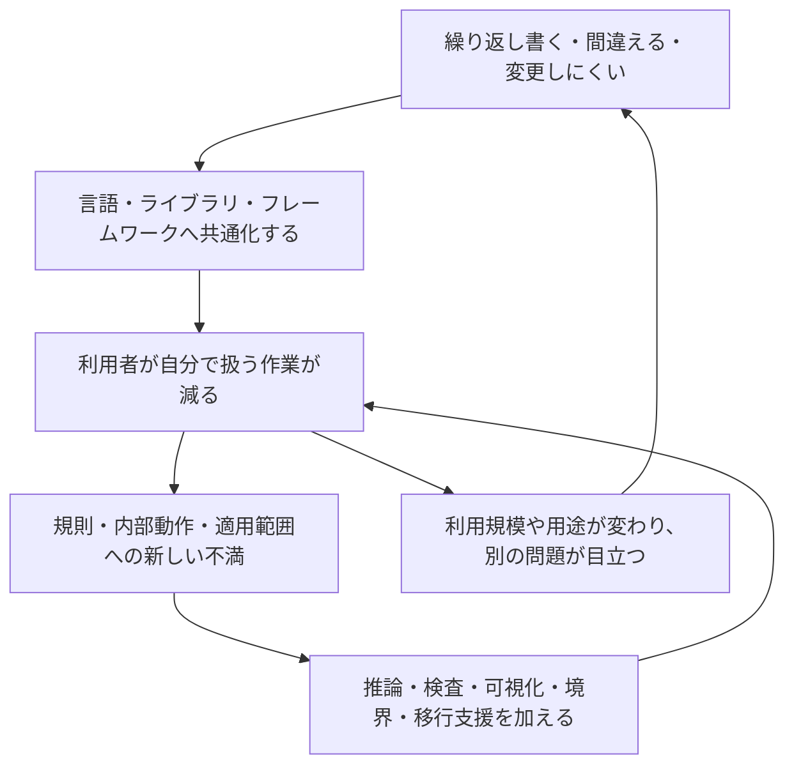

# 既存環境への不満から見る、言語・フレームワーク・ライブラリの進化

[メモの一覧へ](README.md) · [プログラマーの負担の変遷](programmer-burden-transitions.md) · [言語の保証と信頼の設計](language-guarantees-and-trust.md)

調査日・資料確認日: **2026-11-07**

目的: **「何に困ったか → 何を変えたか → 何が楽になったか → 次に何が問題になったか」**をたどり、言語とその周辺環境の進化、今後の設計の方向を考える。

開発者本人の回顧、公式の設計提案、公式ドキュメントを主な根拠とする。既存の[負担の分類](programmer-burden-and-language-design.md)が「何を助けるか」、[負担の変遷](programmer-burden-transitions.md)が「負担がどう移るか」を整理したのに対し、本メモは**具体的な不満が次の設計を生む過程**に焦点を当てる。

全体を先につかむには2節の見取り図と12節の今後の進展を、具体的な経緯を追うには3–10節を読む。言語・ライブラリ・フレームワークの役割の違いは11節に整理した。

## 1. 進化を「不満の連なり」として読む

この視点で見えてくるのは、人の作業を機械や共通部品へ任せるたびに、**任せるための条件、任せた結果の見え方、例外への対処**が次の課題になる、という繰り返しである。



これは本メモの見取り図である。不満だけが発明の理由とは限らない。新しい機械・用途への対応、研究、教育、好奇心も関わる。また、不満を持った時点で、必ず新言語を作る必要があるわけでもない。

以下では、三つを区別する。

- **資料で確認できる経緯:** 作者が述べた動機や、提案文書に記された先行技術との関係。
- **問題から見た比較:** 似た不満に対する設計を並べたもの。直接の影響・継承関係は主張しない。
- **考察・将来の仮説:** 事例から引き出した解釈と提案。将来の採用や成功を予言するものではない。

「次の問題」にも、導入した仕組みに伴う**新しい負担**、別の担当や時点へ移った**移転した負担**、その変更では解決されない**残った問題**がある。これを混同すると、「改善するたびに必ず悪化する」という誤った読み方になる。

## 2. 連なりの見取り図

各行は独立した問題の流れであり、上から下へ全言語が進んだという年表ではない。詳しい根拠は後の各節に示す。

| 出発点の不満 | 最初の応答 | そこで目立つ次の不満 | さらに行われた応答 |
| --- | --- | --- | --- |
| 機械向けの記述とデバッグが高くつく | FORTRANのような高水準の記述と翻訳 | 高水準で書けても、処理や変更の影響を追うのが難しい | 構造化制御、情報隠蔽などによる理解範囲の整理 |
| ABCは使いやすいが外部機能を足しにくい。Cとシェルでは運用の記述が不便 | 拡張できるスクリプト言語としてのPython | 大きくなると値や関数の約束を把握しにくい | mypyなどの型解析と、型ヒントの標準化 |
| JavaScriptの大きなコードを安全に変更しにくい | TypeScriptで型情報と開発支援を足す | 型注釈だけでは外部入力の実体は確認できない | Zodなどの実行時検査と、スキーマからの型の導出 |
| 大規模開発でビルド・依存・読み方が揃わない | Goの言語設計とツールの一体化 | 型だけが違うコードを繰り返し書く | 型パラメータによる再利用 |
| 寿命や共有の規律を人間だけで守るのが難しい | Rustの所有権・借用検査 | 安全に書いたつもりでも、検査の都合で書き直す | NLLによる借用解析の精密化 |
| Web開発で毎回同じ設定や接続処理を作る | Rails・Djangoの規約と共通機能 | 規約の例外や、隠れたDBアクセスを扱いにくい | 設定の明示、先読み、意図しない遅延読み込みの検出 |
| 状態に合わせた画面更新を人が追う | Reactの宣言的なUI | 状態を使う処理の再利用、配置、最適化が難しい | Hooks、解析ツール、React Compiler。別の解としてSvelte |
| 非同期処理の書き方・組み合わせ・後始末が難しい | 共通基盤と`async/await` | 子タスクの寿命、複数の失敗を扱いにくい | Trioのnursery、例外グループ、`asyncio.TaskGroup` |

## 3. 初期の大きな不満:「機械に合わせて書く時間がかかりすぎる」

**資料で確認できる動機:** BackusはFORTRANの開発史で、プログラミングとデバッグの費用を主要な動機に挙げている。同時に、それ以前の自動プログラミングには実行速度への強い不信があった。そこでFORTRANは、数式に近い記述を受け付け、効率のよい機械語へ翻訳することを目指した。[BackusによるFORTRAN開発史、§1.1–1.3](https://softwarepreservation.computerhistory.org/FORTRAN/paper/p25-backus.pdf)

流れとしては、次のように読める。

```text
機械ごとの細かい指示を書くのが大変
  → 数式や高水準の操作をまとめて書く
  → 翻訳と最適化を処理系へ任せる
  → 人は計算方法を考えやすくなる
  → 生成された処理の性能や、処理系の正しさを確認する必要は残る
```

さらに、記述が高水準になっても、人が実行の流れや変更の影響を追う問題は残る。Dijkstraは、自由なジャンプがソースと実行過程の対応を理解しにくくすることを論じた。Parnasは、処理の順序だけでモジュールを分ける方法を比較し、変更されそうな設計判断を隠す分割を示した。[Dijkstraの問題提起](https://www.cs.utexas.edu/~EWD/transcriptions/EWD02xx/EWD215.html)、[Parnasのモジュール分割の論文、1972年](https://www.cs.lafayette.edu/~gexia/cs301/resources/parnas.html)

**問題から見た比較:** 「命令を短くする」という解決だけでは、「大きくなったプログラムを理解する」という不満は消えない。構造化制御や情報隠蔽は、追いかける必要のある範囲を小さくする方向の応答と整理できる。これはFORTRANから両者への直接の因果関係を示す記述ではない。

**新しい負担:** 処理系の利用と挙動の理解、部品の境界と公開する約束の設計。**残る問題:** アルゴリズムの妥当性、必要な性能、要求自体の正しさ。

## 4. ABC・C・シェルへの不満 → Python → 型ヒント

### 4.1 「書きやすいが閉じている」を解消する

**資料で確認できる経緯:** Guido van RossumはABCの高水準なデータ型や構文を評価しつつ、拡張しにくい点に不満を持っていた。また、Amoebaのシステム管理では、Cプログラムかシェルスクリプトを書く方法に不便があり、シェルから独自のシステムコールを使いにくかった。そこで、ABCに似た書きやすさと、外部機能へ接続できる拡張性を組み合わせた。[Python公式FAQに収録された作者の説明](https://docs.python.org/3/faq/general.html#why-was-python-created-in-the-first-place)

```text
ABC: 高水準で書けるが、必要な外部機能を足しにくい
C・シェル: 既存の運用作業を都合よくまとめにくい
  → Python: 高水準の記述と、既存システムへの接続を両立させる
  → 小さな処理を組み合わせて試す手間が減る
```

作者は後の回顧でも、閉じたABCの反省、既存のUnix環境との協調、読み方のばらつきを減らす意図を説明している。ここでは「機能の多さ」だけでなく、**既存資産を使えること、他人が読みやすいこと**が改善対象になっている。[作者による1996年の前書き](https://www.python.org/doc/essays/foreword/)

### 4.2 「すぐ書ける」の次に「変更時に約束を確認したい」が来る

動的に使える言語でも、コードの規模や利用者が増えると、引数・戻り値の約束を機械で確認したい場面がある。Pythonでは、第三者の静的型解析の利用を受け、PEP 484が型表記と共通の語彙を標準化した。mypyからの影響も明記されている。中心の目的は静的解析、補完、リファクタリング支援で、型ヒントを付けただけで実行時検査が行われる設計ではない。[PEP 484、Abstract / Rationale and Goals](https://peps.python.org/pep-0484/)

```text
柔軟に書き、既存機能を組み合わせる
  → 規模が増えると、約束の把握や変更確認がつらい
  → 外部の型検査器で解析する
  → 解析器ごとの表現を揃えるため、型ヒントを標準化する
```

**軽くなった点:** 読み手が実装を調べて推測していた情報を、表記と解析で共有できる。

**新しい負担:** 型の表記、動的な使い方との接続、検査対象の範囲を決める。**残る問題:** 未検査部分、外部入力、業務上の意味の正しさ。

**考察:** 書き始めやすさを保ちつつ、必要な場所へ確認手段を足す発展である。既存の使い方をすべて捨てる移行を避けたことにも意味がある。

## 5. JavaScriptの変更の難しさ → TypeScript → 境界での検査

### 5.1 既存資産を保ちながら、変更の手がかりを足す

**資料で確認できる動機:** TypeScriptチームは、複雑なJavaScriptコードの扱いに苦労するチームに対し、型検査、補完、参照先への移動、リファクタリングを提供する狙いを説明している。2012年に公開され、既存JavaScriptと協調することを重視してきた。[TypeScriptの10年を振り返る公式記事](https://devblogs.microsoft.com/typescript/ten-years-of-typescript/)

```text
既存のJavaScriptを広く使いたい
  ＋ 大きな変更を、実行して初めて間違いがわかる形にしたくない
  → 型と開発支援を、既存の実行環境の上へ足す
  → 多くの接続ミスや変更漏れを早く発見できる
```

ただし、TypeScriptは実用上の使い方を認めるため、型理論上の健全性を完全には満たさない選択を含む。型検査を通ったという事実を、任意の実行時エラーがない証明として使うことはできない。[公式Handbookの健全性に関する説明](https://www.typescriptlang.org/docs/handbook/type-compatibility.html#a-note-on-soundness)

### 5.2 外部から来た値は、別に確かめる必要がある

**問題から見た接続:** 型のある内部コードと、ネットワークなどから入る値の境界には、実行時に確かめる仕事が残る。Zodのようなライブラリは、スキーマによる入力検査を行い、そのスキーマから静的な型も導出できる。検査の記述と内部で使う型を結び付ける応答である。[Zodの入力検査と型推論](https://zod.dev/basics)

```text
内部の型の整合性を検査する
  → 外部の値が、その型の条件を満たすかは未確認
  → 境界に実行時検査を置く
  → 検査を通った値を内部へ渡す
  → 検査仕様の妥当性と、現実との対応を扱う問題が残る
```

これはTypeScriptがZodを直接生んだという開発史の主張ではなく、両者の役割がつながることの説明である。

**新しい負担:** 型定義やスキーマの設計・保守、検査の実行費用、失敗時の処理。**残る問題:** 「数値である」と確認できても、「センサーが現実の温度を正しく測った」とは限らない。

**考察:** 後者には、[外部契約と信頼](unsafe-as-external-contract.md)の問題が現れる。形式の検査と、情報源の正確さを受け入れる判断は、別の条件として扱う必要がある。

## 6. 大規模な開発環境への不満 → Go → ジェネリクス

### 6.1 文法だけでなく、待ち時間と共同作業を変える

**資料で確認できる動機:** Rob PikeはGoの背景として、遅いビルド、制御しにくい依存、各人が異なる言語機能の部分集合を使うこと、読解や更新の難しさを挙げた。言語・パッケージ・ツールを合わせて設計し、`gofmt`では書式を決める作業と議論を機械へ任せた。[Go at Google、§4–5 / §17](https://go.dev/talks/2012/splash.article)

```text
一人は書けても、大人数で読む・ビルドする・更新するのが遅い
  → 依存の扱い、共通の記法、解析・整形しやすさを揃える
  → チーム全体の待ち時間や、毎回の判断を減らす
```

### 6.2 機能を抑えた設計にも、次の不満が生まれる

初期のGoでは、型だけが違う処理を共通化しようとすると、複製、追加のメソッド、リフレクション、コード生成などの手間があった。Ian Lance Taylorは2019年の説明で、その重複と、ジェネリクス追加による複雑さの両方を論じている。これは当時の動機を読む資料であり、記事後半の草案構文は最終仕様ではない。[Why Generics?](https://go.dev/blog/why-generics)

Go 1.18では型パラメータ、型の集合としての制約、型引数の推論が加わった。同じ処理を型ごとに書く負担を減らす一方、共通部品の作者は、許す型と操作を設計する必要がある。[2022年のジェネリクス導入の説明](https://go.dev/blog/intro-generics)

```text
大規模開発の複雑さを抑えたい
  → 読み方と道具を揃える
  → 一方で、型をまたぐ再利用には重複が残る
  → 型パラメータを足す
  → 重複は減るが、制約・推論・診断を理解する負担が加わる
```

**考察:** 「機能が少なければ常に簡単」「多ければ常に便利」のどちらでも評価しきれない。**文法を学ぶ費用、複製を保守する費用、ビルドの費用、部品を使う費用の合計**を考える必要がある。共同作業の改善には、言語機能以外のツールも効いている。

## 7. 人が守るメモリ管理の規律 → Rust → 借用検査の改善

### 7.1 守り方を文書に書くだけでは間違える

**資料で確認できる動機:** Rustの公式な説明は、安全なシステムプログラミングと並行処理を扱いやすくすることを問題として挙げ、所有権を、人が守ろうとしてきたアクセスの規律をコンパイラが検査する方法と説明している。同じ規則をライブラリのAPIにも使える。[Fearless Concurrency with Rust、2015年](https://blog.rust-lang.org/2015/04/10/Fearless-Concurrency/)

```text
いつ解放するか、いつ共有してよいかを人が追う
  → 寿命・所有・借用の規則を型と検査に組み込む
  → メモリやデータ競合に関する一定の誤りを、利用前に拒否できる
  → 今度は、規則を満たす構造の設計と、拒否理由の理解が必要になる
```

この保証は、言語・処理系が正しく、依存する`unsafe`の実装が契約を守るなどの前提を持つ。停止、デッドロック、外部処理の成否まで一括して保証するものではない。保証の範囲と前提は[言語の保証と信頼の設計](language-guarantees-and-trust.md)を参照。

### 7.2 安全規則を保ちながら、検査の都合による書き直しを減らす

NLLの提案は、借用の範囲を字句的なブロックよりも制御フローに即して推論し、検査を通すためだけの局所的な書き換えを減らすことを目指した。提案には、その変更でも解消しない制限も記されている。[RFC 2094、2017年](https://rust-lang.github.io/rfcs/2094-nll.html)

NLLはRust 2018に導入され、旧方式との比較を行う移行期間を経て、Rust 1.63で全コードに使われる方式となった。検査の改善自体にも、互換性と診断を確認する作業が必要だった。[2022年の移行完了の説明](https://blog.rust-lang.org/2022/08/05/nll-by-default/)

```text
人が安全条件を守り切るのは難しい
  → コンパイラが検査する
  → 解析の粗さによって、安全な使い方も拒否されることがある
  → 安全性を維持しながら解析を精密にする
  → 利用者の書き直しを減らし、解析器側がより多くを引き受ける
```

**新しい負担:** 所有関係を設計すること。**移転した負担:** 人の確認の一部が、処理系・共通ライブラリの実装と検証へ移る。**残る問題:** 共有の多いデータ構造の表現、解析の限界、アプリケーションの仕様の正しさ。

**考察:** 利便性への不満は、安全性を弱める方向だけでなく、**同じ条件をより少ない手書き情報で確かめる方向**にも技術を進める。

## 8. Web開発の繰り返し → フレームワーク → 見えない処理への対策

### 8.1 毎回決めること、毎回作ることを減らす

**資料で確認できる経緯:** Djangoは、新聞社の短い締め切りに対応するWeb開発から生まれた。2003年からPythonでサイトを作る中で共通部分を抽出し、2005年に公開した。実際の開発で繰り返した作業が、共通の枠組みになった例である。[Django公式FAQ](https://docs.djangoproject.com/en/5.2/faq/general/#why-does-this-project-exist)

Railsは、命名や配置などの判断を規約へまとめ、利用する道具の組み合わせも既定で提供する。DHHは、判断の反復を減らす利点と、規約から外れるべき場面を判断する難しさの両方を説明している。[The Rails Doctrine、Convention over Configuration / The menu is omakase](https://rubyonrails.org/doctrine)

```text
認証・管理・DBとの接続などを、アプリごとに作り直す
  → 共通の実装と、置き方・呼び方の規約を用意する
  → 少ない記述で動く範囲が広がる
  → 規約に合わない要件や、暗黙に動く処理の理解が次の課題になる
```

RailsとDjangoは、この問題に取り組んだ別の事例として並べている。片方から片方が派生したという説明ではない。また、両者の機能や規約が同一という意味でもない。

### 8.2 短く書けても、実行費用まで短くなるとは限らない

具体例がORMによる関連データの取得である。Railsのガイドは、一覧を得る問い合わせに加えて、各要素の関連先を個別に読むことでN回の問い合わせが発生するN+1問題を説明している。先読みで問い合わせをまとめ、`strict_loading`で意図しない関連の遅延読み込みを検出する方法も示す。[Active Record Query Interface、Eager Loading Associations](https://guides.rubyonrails.org/active_record_querying.html#eager-loading-associations)

```text
SQLや結果の組み立てを繰り返し書くのが大変
  → オブジェクトの関連としてアクセスできるようにする
  → 短い参照の裏でDB問い合わせが発生し、回数を見落としやすくなる
  → 必要な関連を先読みし、予期しない読み込みを検出する
  → データ量や実行計画に応じた調整は残る
```

この列は、ガイドが扱う問題と対策のつながりを示す。各APIの発明順を確定する年表ではない。

**軽くなった点:** 定型処理と組み合わせの判断。**新しい負担:** 規約の学習、例外的な要件への対応、暗黙の処理の把握。**残る問題:** データベースの処理能力、必要なデータ量、業務上の一貫性。

**考察:** 抽象化の次の改善は、さらに隠すことだけではない。**普段は細部を省略でき、必要なときには処理と費用を取り出して調べられること**が重要になる。

## 9. 手動の画面更新 → React → Hooks・コンパイラ

### 9.1 状態と画面のずれを、人が追い続ける不満

**資料で確認できる動機:** 2013年のReactの説明は、データの変更に応じてDOMを命令的に更新する作業に対し、状態から画面の記述を作り直し、差分の適用をライブラリへ任せる方式を示した。部品を組み合わせるためにJavaScriptの抽象化を使う狙いも説明している。[Why did we build React?](https://legacy.reactjs.org/blog/2013/06/05/why-react.html)

```text
値が変わるたび、画面のどこを直すかを手で対応付ける
  → 状態から「どんな画面か」を記述する
  → 実際の更新手順をReactへ任せる
  → 次に、状態を使う処理の分け方や再利用が問題になる
```

### 9.2 同じライブラリの使い方への不満が、新しいAPIを生む

Hooksの導入説明は、状態を使う処理の再利用の難しさ、ラッパーの多重化、関連する処理がライフサイクルメソッドへ分散する問題を挙げている。Hooksは、部品階層を増やさずにその処理を関数としてまとめる応答だった。[Introducing Hooks、Motivation](https://legacy.reactjs.org/docs/hooks-intro.html#motivation)

一方、`useState`などには、条件分岐や反復の中で呼ばず、Reactの関数の決められた場所から呼ぶ規則がある。通常のJavaScript関数の構文だけでは伝わらない制約を、文書やlintでも扱う必要がある。[Rules of Hooks](https://react.dev/reference/rules/rules-of-hooks)

### 9.3 自分で最適化を足す不満には、解析で応答する

React Compilerの公式説明は、手動のメモ化が面倒で間違えやすく、保守するコードを増やす点を動機として挙げる。そこで、ビルド時の解析でメモ化を自動化する。これは画面更新の仕組みを使う人の負担を、さらに処理系へ移す例である。[React Compiler Introduction](https://react.dev/learn/react-compiler/introduction)

ただし、コンパイラはRules of Reactに従うコードを前提とする。解析で問題を見つけた箇所は最適化を見送り、検出できない前提違反は実行時の問題になりうる。公式資料にも、その切り分けが説明されている。[Debugging and Troubleshooting](https://react.dev/learn/react-compiler/debugging)

```text
画面更新を手で追う
  → 宣言的に書き、更新を任せる
  → 状態を使う処理を再利用しにくい
  → Hooksで分ける
  → 呼び出し規則や依存関係の理解、手動最適化の負担が目立つ
  → lint・コンパイラで確認や最適化を引き受ける
```

この最後の矢印は、Hooksだけが手動最適化を必要にしたという因果関係を意味しない。再利用、正しい利用、性能という別の問題に対する応答が積み重なっている。

**別の設計による比較:** Svelte作者の2018年の記事は、仮想DOMの比較などの実行費用を問題にし、ビルド時に更新処理を生成する方向を説明する。同じ宣言的な記述を支える仕事を、どこで行うかが異なる。この記事は当時の設計意図を読む資料であり、現在の全用途での性能優劣を示す測定ではない。[Rich Harrisによる説明](https://svelte.dev/blog/virtual-dom-is-pure-overhead)

**新しい負担:** ライブラリ固有の規則、ビルド時の処理、生成結果の診断。**残る問題:** 外部データとの整合性、応答時間の計測、画面の設計自体。

**考察:** ライブラリが扱う規則を、専用の解析やコンパイルが支える発展が見える。必要な支援が、汎用言語の文法だけでは完結しないことを示している。

## 10. 非同期ライブラリの分立 → 構文 → 構造化 → 例外仕様

この例では、ライブラリの経験が言語の変更へ戻る関係を、提案文書から具体的に追える。

### 10.1 組み合わせにくい → 共通基盤を作る

PEP 3156は、イベントループの共通インターフェース、通信の抽象化、コルーチンによる実行を提案した。TwistedやTornadoなどとの相互運用も設計対象であり、`asyncio`はPython 3.4に標準ライブラリとして入った。[PEP 3156、Introduction / Interoperability](https://peps.python.org/pep-3156/)

**軽くなった点:** 非同期処理を組み合わせるための共通の接点ができる。**残る問題:** 共通インターフェースだけでは、実行の流れを読みやすく書く問題は解決しきれない。

### 10.2 生成器との区別がつきにくい → 専用の構文を作る

PEP 492は、ジェネレーターを使うコルーチンが通常の生成器と紛らわしく、書き換えによって意図せず性質が変わる問題を挙げた。Python 3.5に`async def`、`await`などを導入し、解析器にも区別しやすい概念にした。提案は`asyncio`からの動機を明記している。[PEP 492、Rationale and Goals / Specification](https://peps.python.org/pep-0492/)

**軽くなった点:** 待機を含む手順を、順序を保った形で書きやすくなる。**新しい負担:** 同期・非同期の呼び出しを区別する。**残る問題:** 並行して始めた処理を誰が回収し、失敗を誰へ伝えるか。

### 10.3 子の寿命と後始末を追いにくい → まとまりを作る

Trio作者のNathaniel J. Smithは、タスクを始めてすぐ戻る方式では、呼び出しの構造から処理の寿命やエラーの伝わり方を追いにくいと論じた。nurseryは、開始した子タスクが終了するまで、そのまとまりを抜けない方式である。[Notes on structured concurrency、2018年](https://vorpus.org/blog/notes-on-structured-concurrency-or-go-statement-considered-harmful/)

**軽くなった点:** 子の完了待ちと後始末の責任を、コードのまとまりに対応させられる。**新しい負担:** 長時間動く処理の所属や、失敗時に同じグループをどう終えるかを決める。

### 10.4 複数の子が失敗する → 例外の仕組みを拡張する

PEP 654は、Trioの`MultiError`を扱う難しさを当初の動機に挙げる。複数の無関係な例外を一緒に伝え、一部を処理し、残りを伝播させるため、Python 3.11に`ExceptionGroup`と`except*`を導入した。Trioに着想を得た`asyncio`のタスク起動APIを実現することも、主要な動機として明記されている。[PEP 654、Motivation / Rationale](https://peps.python.org/pep-0654/)

同じPython 3.11で加わった`asyncio.TaskGroup`は、グループの終了時に子を待ち、通常の子タスクの失敗では他の子へキャンセルを要求し、終了後に例外をまとめて伝える。ただし、内部でキャンセルを使うため、その要求を握りつぶすコルーチンなどには注意が必要である。子が終了しなければ、グループの終了も待たされうる。[Python 3.11のTask GroupsとTask Cancellation](https://docs.python.org/3.11/library/asyncio-task.html#task-groups)

```text
ライブラリごとに基盤が違って組み合わせにくい
  → イベントループなどの接点を共通化する
  → コルーチンの書き方が紛らわしい
  → 言語にasync/awaitを加える
  → 並行処理の寿命・後始末・失敗の伝播がつらい
  → ライブラリでnurseryを提供する
  → 複数エラーを既存の例外だけで扱いにくい
  → 言語に例外グループを加える
  → 標準ライブラリでもTaskGroupを提供する
```

**残る問題:** キャンセルは外部の副作用の取り消しと同じではない。たとえば送金要求を出した後で待機を中断しても、送金の成否は別に確かめる必要がある。グループに属させることだけで、通信・永続化・現実世界の処理まで原子的にはならない。この点は[ソフトウェアの限界](limits-of-software-and-trust.md)につながる。

**考察:** ライブラリで試し、既存の言語仕様では扱いづらい点が見つかり、必要な意味を言語へ加え、それを再びライブラリが利用する、という往復が確認できる。

## 11. なぜ、新言語・新フレームワーク・新ライブラリに分かれるのか

以下は事例からの整理である。境界は固定ではなく、マクロ、プラグイン、専用コンパイラなどで重なりうる。

| 不満の所在 | 応答を置きやすい場所 | その場所で行うこと | そこで増える費用 |
| --- | --- | --- | --- |
| 同じ処理を何度も書く | ライブラリ | 共通の実装とAPIを配る | APIの学習、依存と更新の管理 |
| アプリ全体の組み合わせや進め方を毎回決める | フレームワーク | 規約、実行の流れ、既定の構成を提供する | 規約外の要件への対応、構成全体の理解 |
| 寿命・制御・例外・型の扱いを、既存のAPIだけでは表現・検査しにくい | 言語・実行系 | 共通の意味と検査の基盤を足す | 学習、互換性、処理系実装と検証 |
| 入力・更新・構造がわかるので、機械的に変換したい | コンパイラ・開発ツール | 推論、最適化、診断、移行を引き受ける | 解析時間、生成結果の理解、道具への依存 |

ライブラリであっても、言語の型や所有権を使えば、APIの利用条件を機械で検査できる。逆に、言語に専用構文があっても、実行基盤や外部の規約まで自動で整うわけではない。**どの不満を、どこまでの範囲で減らしたいか**が、設計する層を選ぶ基準になる。

### 11.1 改善が次の不満を生む、四つの理由

1. **仕事の移転:** 利用者が省略できる情報を、ライブラリ作者・処理系・実行時が扱う。Goの共通部品やRustの解析のように、担当が変わる。
2. **抽象化で見えにくくなる:** ORMの問い合わせやUIの更新のように、短い記述の裏の処理を観測する必要が出る。
3. **成功して用途が広がる:** 小さな処理に便利な道具が、大きな共同開発にも使われ、変更・性能・互換性の不満が目立つ。
4. **異なる価値がぶつかる:** すぐ書けること、厳しく検査すること、速く動くこと、既存資産を保つことには、同時に満たしにくい場面がある。

これらはすべてを一定量で交換する法則ではない。NLLや自動化ツールのように、機械の解析を改善して利用者の負担を減らせる余地もある。

## 12. この連なりから考える、今後の進展

以下は**考察・仮説**である。「現在ある仕組み」は前節までで確認したもの、「次に望まれる応答」はそこからの提案として区別する。全機能を一つの言語へ集めることを前提にしない。

| 次の不満として考えられること | 現在ある仕組み・手がかり | 次に望まれる応答 | 軽くなる負担 | 新しく増える問題・残る問題 |
| --- | --- | --- | --- | --- |
| 安全規則には納得できるが、型注釈や検査のための書き直しが多い | NLL、型推論、静的解析 | 保証を維持し、より少ない情報で判断する解析と、拒否理由の説明 | 利用者の注釈・試行錯誤 | 解析の費用、推論が見えにくいこと、完全な自動判定の限界 |
| 少ない記述で動くが、費用や副作用を予想しにくい | ORMの先読み・検出、UIの解析と最適化 | I/O・更新・割り当てなどを調べられる表示、必要な境界での効果・予算の指定 | 実行経路と費用を探す作業 | 表示・指定の学習、計測と本番との差。物理資源の上限は残る |
| 型は合うが、入力や外部サービスについて何を確認したか曖昧 | 入力検査、型への変換、既存の契約・隔離技術 | 検査した性質、未確認の前提、利用する権限を別々に表す | 接続条件のレビュー、暗黙の信頼の発見 | 宣言と監査の手間、前提の更新。宣言だけで外部の正しさは保証できない |
| タスクの後始末は揃ったが、外部処理の結果や中断の意味は曖昧 | 構造化並行処理、例外グループ | 完了・失敗・結果未確定を分けるAPI、再試行や補償の方針との接続 | 失敗経路の追跡 | 状態と方針の設計。相手の協力や永続化の条件は残る |
| 新しい道具へ移るたびに、過去の改善を捨てて書き直す | 型ヒントの任意導入、既存JSとの協調、検査器の段階移行 | 段階導入、互換層、自動移行、保証の境界の表示を最初から設計する | 移行の判断と手作業 | 新旧方式の併存、互換層の保守、境界の検査 |
| コードを生成・共有できても、要求を満たす根拠が足りない | 型・入力検査・契約などによる確認 | 生成や再利用の経路にかかわらず、要求・検査・実行結果を対応付ける | 変更内容を根拠なく読み直す作業の一部 | 要求と評価基準を決める負担、検証器への信頼。人の目的の妥当性は残る |

最後の行は、生成AIに限らず、テンプレート、コード生成器、外部の共通部品にも当てはまる仮説である。自動生成の普及度や生産性の実証結果を主張するものではない。

### 12.1 「信頼」は、任せた仕事の条件を扱う次の対象になりうる

ここまでの事例には、次のような共通する問いがある。

```text
人が何をするか
  → 機械や共通部品に何を任せるか
  → 任せてもよい条件は何か
  → その条件のうち、何を検査し、何を制限し、何を前提として受け入れるか
```

今後の不満として、「内部の処理はよく検査されているが、何を前提として使っているかは文書や担当者の記憶に散っている」という状況が考えられる。その応答として、前提を名前付きで表し、保証との依存関係を追える言語・ツールには意味がある。

ただし、**検査できることまで信頼へ置き換えると、間違いを見つける力を失う**。内部で確かめる、実行時に検査する、隔離や権限で制限する、それでも残る前提を引き受ける、という選択を組み合わせたい。詳細は[言語の保証と信頼の設計](language-guarantees-and-trust.md)に分けている。ここで述べる統合は設計案であり、特定の既存言語やこのリポジトリの実装済み仕様を説明するものではない。

たとえば、外部ライブラリについて「提供者を信頼する」とだけ書いても、何の保証を引き受けたかがわからない。「この関数は渡した領域の外へ書かない」「この測定値は指定期間内に校正された機器から来る」のように、**対象・性質・有効な条件**へ分解すると、検査・隔離・運用のどこで支えるべきかを考えやすい。

その代償は、前提を保守する仕事が加わることである。現実的な設計では、すべての記述に前提の一覧を手書きさせるより、普段は推論し、外部接続・権限の付与・保証の公表などの境界で確認できる形が候補になる。何を暗黙にしても安全かは、別途検証が必要である。

### 12.2 次の改善を評価するための問い

新しい機能の数や短いサンプルだけで判断せず、同じ仕事をする条件で次を確認したい。

- 誰の、どの作業が減るのか。書く人だけでなく、読む人、共通部品の作者、運用する人ではどうか。
- 間違いを発見する時点は早くなるか。拒否された場合、理由と直し方がわかるか。
- 普通の要件から外れたとき、内部動作を観測し、必要な部分だけ明示できるか。
- 新しい規則、ビルド時間、実行費用、依存、移行費用を含めても、対象の仕事が楽になるか。
- 保証の対象と条件、確認できていない前提、失敗時に残る状態がわかるか。

この評価に必要な工数や不具合率の実測は、本メモでは行っていない。ここでの結論は、一次資料からの設計意図の調査と、それに基づく問題の整理・仮説である。

## 13. 資料を読み直すための案内

本文のリンクを、目的ごとにたどる場合の案内。年代は資料や紹介した導入時点を表し、発明の優先順位を確定するものではない。

| 確かめたいこと | 主な一次資料 |
| --- | --- |
| 機械向け記述、制御、分割への問題意識 | [Backusの開発史](https://softwarepreservation.computerhistory.org/FORTRAN/paper/p25-backus.pdf)、[Dijkstraの論考](https://www.cs.utexas.edu/~EWD/transcriptions/EWD02xx/EWD215.html)、[Parnasの1972年論文](https://www.cs.lafayette.edu/~gexia/cs301/resources/parnas.html) |
| Pythonの動機と型ヒントの目的 | [作者の説明を収録したFAQ](https://docs.python.org/3/faq/general.html#why-was-python-created-in-the-first-place)、[1996年の前書き](https://www.python.org/doc/essays/foreword/)、[PEP 484](https://peps.python.org/pep-0484/) |
| 既存JavaScriptとの協調と、実行時検査の役割 | [TypeScript公式の回顧](https://devblogs.microsoft.com/typescript/ten-years-of-typescript/)、[健全性の説明](https://www.typescriptlang.org/docs/handbook/type-compatibility.html#a-note-on-soundness)、[Zod公式文書](https://zod.dev/basics) |
| 大規模開発と、機能追加の費用 | [Pikeの2012年の講演記事](https://go.dev/talks/2012/splash.article)、[2019年のWhy Generics?](https://go.dev/blog/why-generics)、[Go 1.18のジェネリクス](https://go.dev/blog/intro-generics) |
| 安全規則と、その使い勝手の改善 | [Rustの2015年の説明](https://blog.rust-lang.org/2015/04/10/Fearless-Concurrency/)、[NLLのRFC](https://rust-lang.github.io/rfcs/2094-nll.html)、[2022年の移行完了](https://blog.rust-lang.org/2022/08/05/nll-by-default/) |
| 実務からの抽出、規約、隠れたDB処理 | [Djangoの開発経緯](https://docs.djangoproject.com/en/5.2/faq/general/#why-does-this-project-exist)、[Railsの設計思想](https://rubyonrails.org/doctrine)、[Active Recordの問い合わせガイド](https://guides.rubyonrails.org/active_record_querying.html#eager-loading-associations) |
| UIの宣言、再利用、最適化 | [Reactの2013年の説明](https://legacy.reactjs.org/blog/2013/06/05/why-react.html)、[Hooksの動機](https://legacy.reactjs.org/docs/hooks-intro.html#motivation)、[Hooksの規則](https://react.dev/reference/rules/rules-of-hooks)、[Compilerの目的](https://react.dev/learn/react-compiler/introduction)、[診断と前提](https://react.dev/learn/react-compiler/debugging)、[Svelte作者の2018年の説明](https://svelte.dev/blog/virtual-dom-is-pure-overhead) |
| ライブラリの経験が言語仕様へ戻る経緯 | [PEP 3156](https://peps.python.org/pep-3156/)、[PEP 492](https://peps.python.org/pep-0492/)、[Trio作者の論考](https://vorpus.org/blog/notes-on-structured-concurrency-or-go-statement-considered-harmful/)、[PEP 654](https://peps.python.org/pep-0654/)、[Python 3.11のTaskGroup](https://docs.python.org/3.11/library/asyncio-task.html#task-groups) |

