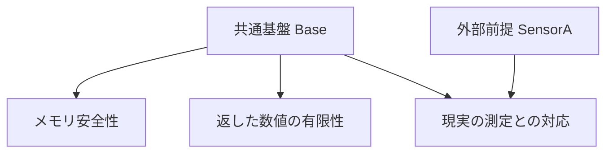

# ソフトウェアの限界を、プログラミング言語の保証と信頼として扱う

[メモの一覧へ](README.md) · [ソフトウェアの限界と信頼する前提](limits-of-software-and-trust.md) · [外部契約としてのunsafe](unsafe-as-external-contract.md)

作成日・資料確認日: **2026-11-07**

目的: ソフトウェア内で解決できる条件と、資源・外部世界・人間などに依存する条件を、言語の型・契約・効果・権限・検証・実行基盤でどう扱うかを考察する。特に、残る信頼をどのような言語上の対象にするとよいかを検討する。

前の[限界の調査](limits-of-software-and-trust.md)が「何が限界か」を扱ったのに対し、本メモは「その限界に対して、言語が何を表し、検査し、保証するか」に焦点を置く。既存技術の説明には一次資料を添え、それらを組み合わせた設計案は明示して分ける。擬似記述は実装済みの文法でも、このリポジトリの確定仕様でもない。

## 1. 結論の見通し

将来の言語では、条件ごとに次の扱いを選び、組み合わせるのがよいと考える。

1. **内部で証明する:** 型、所有権、事前・事後条件、証明で正当化する。
2. **利用前に検査する:** 実行時に確認できる条件を検査し、満たす場合だけ強い操作を許す。
3. **境界で強制する:** 検証していない相手でも、指定した保証を壊せないように制限する。
4. **要求を制限し、失敗や不明を表す:** 計算・容量・通信の限界を、入力上限、予算、結果の状態へ反映する。
5. **残る前提を条件付き保証として引き受ける:** 何を、どの対象・期間・構成について受け入れたかを記録する。

この最後の仕組みを、言語の「信頼」として扱う余地がある。ただし、その役割は、事実を真にしたり、任意の検査を省略したりすることではない。**ある保証が成立するために必要な、まだ解消していない前提を表し、利用先まで追跡すること**が中心になる。

また、同じ対象についても保証は複数ある。「外部の値が現実に正しいか」は信頼に依存していても、「その値を範囲外アクセスなしに処理する」は別に保証できる。この分離が重要になる。

## 2. 「解決できる／できない」を、条件と保証に分解する

### 2.1 機械的に扱う方法は一種類ではない

| 条件の性質 | 言語での主な扱い | そこで得る保証 | 残る条件 |
| --- | --- | --- | --- |
| 内部の値や状態から証明できる | 型、依存型、詳細な契約、所有権、証明 | 対象モデル内で条件が成立する | 証明・型検査の基盤、仕様と実装の対応 |
| 実行時に判定できる | 検査付き変換、契約、境界チェック | 通過した値や操作について条件を使える | 検査の正しさ、検査後も条件を維持する仕組み |
| 相手が破る可能性はあるが、干渉を制限できる | 隔離、権限、管理されたメモリ、参照モニター | 境界が許す相手の振る舞いに対して、指定した内部の性質を保つ | 境界・実行基盤の正しさと構成 |
| 無制限には処理できない | 入力制限、資源予算、失敗可能なAPI | 受理範囲や資源消費を制限し、不成立を扱う | 実資源、計測・制限の基盤、成功する条件 |
| 情報が足りず判断できない | 未確認・推定・結果未確定という型や状態 | 知っていないことを、知っていることとして利用させない | 新たな観測、相手の協力、判断方針 |
| 外部の振る舞いや実物との対応を内部で確認しきれない | 名前付きの前提、接続契約、条件付き保証 | 何に依存する主張なのかを明示できる | 前提そのものの妥当性と維持 |
| 要求が資源や原理と両立しない | 仕様や受理条件を変更する | 実現できる要求だけを約束する | 信頼宣言で解決したことにはしない |

たとえば、バッファの長さは検査できる。外部コードがその後に領域外へ書かないことは、長さの検査だけでは確認できない。後者には、相手の検証、隔離、または未検証の前提の受け入れが必要になる。

### 2.2 「不明」は「危険」や「偽」と同じではない

静的解析が証明できない理由には、実際の誤り、情報不足、解析の精度、計算予算の不足などがある。停止問題の制約がある以上、一般のプログラムについて、この分類を常に完全自動で決定できるとはしない。

設計としては、少なくとも次を区別できるとよい。

```text
条件を確認できた       → その条件を利用する
違反を確認できた       → 拒否・エラーとして扱う
確認できなかった       → 追加の証明、動的検査、制限、明示的な前提を選ぶ
要求自体が両立しない   → 要求を変更する
```

「証明できないなら自動的に信頼する」を既定動作にすると、検査の意味が弱くなる。信頼の導入は、通常の解析成功とは異なる出来事として記録したい。

## 3. 参考になる既存の言語・研究

以下は部品となる既存技術であり、本メモ後半の統一的な仕組み全体を実装しているという意味ではない。実装・研究・参照資料の範囲も区別する。

| 技術・資料 | 確認できる仕組み | この検討への示唆と限界 |
| --- | --- | --- |
| Leanの公理と`#print axioms` | 定義や証明が推移的に依存する公理を表示する | 仮定の依存を言語・検査器が追う実例。ただし、表示は公理が現実に正しい証拠ではない。[公式の公理の説明](https://lean-lang.org/doc/reference/latest/Axioms/) |
| Leanの証明検査 | 定理の意味、公理、独立した再検査などを区別する | 依存一覧だけで成果物・実行基盤を含む保証が完成するとはしない。[公式の証明検査の説明](https://lean-lang.org/doc/reference/latest/ValidatingProofs/) |
| Agdaの`--safe` | 未証明の公理や未完成の証明などにつながる機能を制限し、インポート先にも条件を要求する | そのファイルだけでなく、依存先を含む受理方針を定義できる。[Safe Agda](https://agda.readthedocs.io/en/latest/language/safe-agda.html) |
| F*の`Tot` | 純粋な全域計算を、効果を持つ計算と区別する | 論理に用いる計算と一般の実行を分けられる。抽象モデルでの停止は、実機での期限や容量の保証とは別。[公式チュートリアル](https://fstar-lang.org/tutorial/book/part4/part4_computation_types_and_tot.html) |
| Dafnyの仮定監査 | 公式開発版参照マニュアルの`audit`は、未検証の宣言、外部契約、`assume`などを監査対象として扱う | 「検証に成功したか」に加え、何を仮定したかを見る。ここでは開発版文書の記載を根拠とし、全配布版での提供を一括して主張しない。[参照マニュアル](https://dafny.org/dafny/DafnyRef/DafnyRef) |
| Racketの契約 | モジュールなどの境界で値を監視し、義務と保証の違反を扱う | 静的証明がない部分も動的な強制で扱える。任意の外部実装をラップするだけで制限できるわけではない。[Contracts and Boundaries](https://docs.racket-lang.org/guide/contract-boundaries.html) |
| Rustの`unsafe extern` | 外部関数の宣言の正しさを、宣言する側が引き受ける | 外部との対応を引き受ける場所と、項目の利用を区別する実例。外部実装を証明するものではない。[Rust Edition Guide](https://doc.rust-lang.org/edition-guide/rust-2024/unsafe-extern.html) |
| Kokaのエフェクト型 | 潜在的な作用を型に表し、型・効果を推論する研究と実装 | 「何をするか」の追跡を参考にできる。ただし作用の一覧は、その相手の正しさに関する前提の一覧とは異なる。[研究の説明](https://www.microsoft.com/en-us/research/publication/koka-programming-with-row-polymorphic-effect-types/) |
| Cap’n ProtoのcapabilityによるRPC | 対象へ操作する参照・権限を受け渡す | 操作できる対象を限定する設計の実例。権限があることは、対象の誠実さや応答の正しさの証拠ではない。[公式RPC仕様](https://capnproto.org/rpc.html) |
| RLBox | 隔離と、外部由来の値を型・検査で扱う仕組みを組み合わせる | 相手への信頼を減らすには、境界と受け渡す値の扱いを両方設計する。[原論文の紹介](https://www.usenix.org/conference/usenixsecurity20/presentation/narayan) |
| Proof-Carrying Code（PCC） | 提供者が証拠を添え、利用者が指定した安全方針について検査する研究 | 生産者や解析器全体を信用する代わりに、結果と証拠を検査する。ただし方針・検査器・機械モデルの基盤は残る。[研究紹介](https://www.cs.cmu.edu/~fox/pcc.html) |
| Resource Aware ML | 型に基づいて資源の使用量を解析する研究 | 資源を静的に扱う道がある。保証は明示したcost semanticsに対するもので、実時間へ直結はしない。[配列・参照を含む解析の原論文](https://www.cs.cmu.edu/~janh/assets/pdf/LichtmanH17.pdf) |
| Wasmtimeの実行制御 | fuelやepochによってゲストの実行を制御する | 静的に完了を証明しなくても、実行を制限できる。ただし任意のブロッキングするホスト呼び出しまで止めるものではない。[APIの条件](https://docs.rs/wasmtime/latest/wasmtime/struct.Config.html) |

ここからは、これらの仕組みを踏まえた本メモの設計上の整理と提案である。

## 4. 型・作用・権限・信頼を分ける

### 4.1 それぞれが答える問いが違う

| 概念 | 答える問い | 例 |
| --- | --- | --- |
| 値の型・検査した性質 | これは何で、どんな操作を正しく適用できるか | 長さが確認されたバイト列、有限の数、範囲内の添字 |
| 保証 | この処理について何を主張するか | メモリ安全、結果が整列済み、測定誤差が指定以内 |
| 効果 | この処理は何を起こしうるか | I/O、状態変更、例外、非停止の可能性 |
| capability・権限 | 誰が、どの対象へ、どの操作をできるか | 特定ファイルへの書き込み、特定装置の操作 |
| 資源条件 | どれだけ使い、どの条件なら実行できるか | 入力上限、ヒープ使用量、計算予算 |
| 証拠・根拠 | どの主張を、何に基づいて利用できるか | 証明、検査結果、強制機構、測定報告 |
| 未解消の前提・信頼 | その保証に、何の成立を引き受けているか | 装置の停止契約、校正条件、特定基盤の動作モデル |

たとえば、センサーへの読み取り権限を持つことは、そのセンサーが正しく測る証拠ではない。I/O効果がない純粋な計算でも、入力の現実的な意味が外部の前提に依存することはある。

一方、外部データを読むというだけで、その内容の真実を信用する必要もない。任意のバイト列として安全に扱い、確認した範囲だけ利用できる。

### 4.2 「信頼度」の一つの順位にまとめない

証明、動的検査、署名、試験・測定、組織の受け入れ判断は、同じ主張を同じ条件で確認するものではない。「信頼度が高いから、低い証明義務をすべて代替する」とは扱えない。

たとえば署名付きの測定値でも、測定誤差の保証は別である。多数の試験で動いたコードも、全入力についての証明と同じではない。確率的な根拠を使うなら、確率の対象、期間、分布、相関などのモデルも記録する必要がある。

これらは、保証する性質ごとに根拠を選ぶ設計として扱う。

## 5. 信頼を「保証が依存する前提」として表す

### 5.1 最小の意味は、条件付きの主張である

提案する基本形は、次の意味を持つものとする。

```text
処理fについて:
    保証する性質: G
    未解消の前提: A1, A2
    共通の基盤: Base

意味:
    Base, A1, A2が成立する対象モデルの実行では、fはGを満たす。
```

ここでは、`A1`を宣言しただけで、プログラム全体へ無条件の真理として追加しない。A1に依存する保証は、依存を伴ったまま公開される。

また、`Base`には、採用した論理、検査器、実行モデル、対応する機種・構成などを含める。共通部分を省略表示できても、依存が存在しないことにはしない。論理の公理、ソフトウェア基盤の正しさ、物理的な動作条件は、根拠の種類として区別する。

`Base`の内容も明示・版管理し、受理方針の対象にする。追加の前提を共通基盤へ移して表示から隠しただけでは、依存を減らしたとは扱わない。

### 5.2 前提は、対象・性質・範囲へ結び付ける

```text
前提 SensorA:
    対象: sensor-7 / 接続世代42 / 設定C
    利用する主張:
        指定した測定条件で取得した標本の誤差が範囲E以内である
    適用範囲:
        対象の測定条件・時点・構成
    根拠:
        外部の校正・評価資料と、配備時の受け入れ判断
    解消していないこと:
        実行中のすべての物理異常を、内部コードが検出するわけではない
```

対象の名前やハッシュは対応を識別する材料であり、主張の正しさを証明するものではない。将来の言語では、前提と根拠を、特定の接続や成果物へ結び付ける形が考えられる。

### 5.3 前提を受け入れる権限と、前提が真である証拠を分ける

配備担当のコードに、ある前提を採用する権限を与えることはできる。しかし、それはその前提を証明したことにはならない。

したがって、仮に`TrustPermit<A>`のような値を作るとしても、それだけで`Proof<A>`を得る規則にはしない。前者は「この構成でAへの依存を許可した」という管理上の権限であり、後者とは意味が異なる。

通常のライブラリが勝手に任意の前提を導入できないようにすることも重要になる。ただし、導入箇所を制限しても、虚偽や矛盾した前提が正しくなるわけではない。

### 5.4 任意の`assume`を、通常の証明と混ぜない

論理へ矛盾した公理を加えると、保証は無意味になりうる。条件付きの証明でも、前提を満たす実行が存在しなければ、実際の運用を保証したことにならない。

Leanの公理依存表示やAgdaの安全モードは、この境界を考える参考になる。標準の論理的基盤と、途中の未完成な証明や独自の仮定を同じ意味で扱うべきではない。[Leanの公理と依存追跡](https://lean-lang.org/doc/reference/latest/Axioms/)、[Agdaの安全モード](https://agda.readthedocs.io/en/latest/language/safe-agda.html)

設計案では、少なくとも次を分けたい。

- 論理体系として採用する基盤。
- 検証中の穴や、一時的に置いた仮定。
- 外部の操作・対象・環境に結び付いた前提。
- 証明・検査・強制によって解消した条件。

外部契約へ限定することは監査を助けるが、任意の契約の整合性を自動で判定できる、という意味ではない。証明済みの条件と、依存を残した条件の間に、暗黙の変換を置かないことが重要になる。

## 6. 保証ごとに依存を追う設計案

### 6.1 同じ関数でも、性質によって必要な前提が異なる

以下は擬似記述である。相手のデータを管理されたバイト列として受け取り、相手に内部メモリを直接書き換える権限を与えない構成を想定する。`Sample(v)`を返す経路では、内部で形式と有限性を検査する。外部I/Oが必ず終わるとは仮定していない。

```text
function read_sample(device: SensorReadCapability) -> SampleOutcome
    effects: { device_read, allocation }
    termination: not_established

    guarantees:
        memory_safe
            under { Base }

        on Sample(v): v is finite
            under { Base }

        on Sample(v): v corresponds to the physical measurement within E
            under { Base, SensorA }
```

この例で、数値を安全に表示するだけなら、測定の正確さの保証を使わずに済む。一方、現実の測定誤差がE以内だという結論を使う処理は、`SensorA`への依存を引き継ぐ。



ただし、外部の値を根拠なく配列の添字に使うなど、内部の安全性までSensorAへ依存させた実装なら、上の宣言は受理できない。内部のメモリ安全性を独立に主張するには、そのための範囲検査や証明が必要になる。

性質ごとに分ける以上、「すべての前提が真なら全体が正しい」という証明だけでは足りない。たとえばメモリ安全性については、SensorAが成り立たなくても、Baseの許す範囲の入力や振る舞いに対して成立することを示す必要がある。コンパイラの最適化も、この分離を保たなければならない。

### 6.2 呼び出し・返却・保存を越えて追う

保証の合成では、呼び出し先や返却値について利用した保証の前提を引き継ぐ必要がある。クロージャ、オブジェクト、非同期処理、保存済みデータへ隠しても、必要な依存は消えない。

結果を捨てれば依存を外せる、とも限らない。相手がメモリへ直接干渉できる呼び出しなら、結果を使わなくても、呼び出し中の安全性に関する条件が残る。

完全に最小の前提集合を、任意のコードから自動発見することは要求しない。実装の出発点としては、明示的な保証と依存情報を使い、保守的に合成する方式が現実的だと考える。不要な依存を外すには、その保証が依存しないことを確認する。

前提どうしの循環も、その宣言だけでは根拠にならない。「AならB」「BならA」という契約があっても、それだけでAが成立するとは言えない。循環的な推論を許すなら、その健全性を別に定義・検査する必要がある。

### 6.3 データの型と、現実についての主張を分ける

提案する区別は、次のようになる。

| 表現の例 | 意味 | 無条件には得られないもの |
| --- | --- | --- |
| `Checked<P, T>` | Base以外の未解消の前提を使わず、管理された値Tの条件Pを検査・証明した | その値の意味が現実に正しいという主張 |
| `Observed<Source, Time, T>` | この出所・時点に結び付く観測値として扱う | 誤差ゼロ、現在も有効、内容が真実という保証 |
| `Conditional<A, G>` | Aを前提とする保証Gを表す | 依存を消した無条件のG |
| `Capability<Object, Op>` | 対象へ操作する権限を表す | 対象の正しさや操作の成功 |

これらは型名を付ければ完成するわけではない。構築する規則、対象の同一性、変更・共有・保存の扱い、依存を引き継ぐ規則まで含めて意味を定義する必要がある。

## 7. 実行時検査で扱う範囲と、強制できる範囲

### 7.1 検査したことを、利用するまで維持する

`Checked<P, T>`が有効なのは、Pを検査した対象と、利用する対象が対応している間である。

```text
外部の共有領域で長さを読む
    → 長さが範囲内か検査する
    → 外部が長さや内容を変更する
    → もう一度読んで利用する
```

このような経路では、最初の検査結果を後の値へそのまま適用できない。管理されたスナップショット、外部からの変更の禁止、操作の一体化などが必要になる。

RLBoxの研究も、外部由来の値の扱いと隔離を組み合わせる一方、共有メモリに関するdouble-fetchの問題をすべて自動的に解消するとはしていない。[RLBox原論文の制約と議論](https://www.usenix.org/system/files/sec20-narayan.pdf)

設計案では、単に「検査済み」とするより、「この不変な値について検査した」「この借用・世代の間だけ利用できる」という形にしたい。外部が型の規則に従わず変更できるなら、内部の借用規則だけでその変更を防いだことにはならない。

### 7.2 検出できることと、強制できることは違う

Schneiderは、実行を監視して必要なら止める古典的なモデルについて、強制可能な方針の条件を論じている。そのモデルではsafety property（違反が有限の実行履歴で確定する性質）であることが必要だが、それだけで十分ではない。監視側が関連する実行を観測し、必要な制御をできることも関わる。[Enforceable Security Policies](https://www.cs.cornell.edu/fbs/publications/EnfSecPols.pdf)

| 主張 | 言語・実行基盤での扱い | 留意する点 |
| --- | --- | --- |
| 範囲外の添字でアクセスしない | 利用前に検査し、違反操作を止める | すべての該当経路を仲介し、検査と利用の対応を保つ |
| 権限のない対象へ送信しない | 送信前の権限検査、capabilityによる制限 | 別の送信経路を自由に使えるなら、その経路も扱う |
| 期限内に処理を成功させる | 時間解析、資源予約、環境条件を必要とする | 超過の検出やプログラム停止だけでは、成功を実現できない |
| 相手がいつか応答する | 外部の進行条件を契約にする、待機や未確定を表す | 有限時間の監視だけで、今後一切応答しないとは判定できない |

期限を定めた「一定時間を超えて待たせない」という性質は、違反を有限の観測で捉えられても、プログラムを止めるだけでは時間の進行を止められない。保証する結果や、制御できる資源まで定義する必要がある。

また、外部コードが検査より前に内部メモリを書き換えられるなら、戻り値を後から検査するだけで封じ込めることはできない。検査は、境界が持つ制御能力と一緒に評価する。

## 8. 資源・停止・期限を、別々の仕様にする

### 8.1 全域性は、容量や実時間を自動的には保証しない

F*の`Tot`のように、論理に使う計算を全域で純粋なものへ限定する設計は重要である。しかし、抽象モデルで停止して結果を返すことと、任意の現物で必要な資源を確保できることは違う。

提案する区別は次のとおりである。

| 仕様の軸 | 主張すること | 追加で必要なもの |
| --- | --- | --- |
| 停止性 | 対象モデル・評価規則で計算が停止する | 使用資源、外部計算や実行基盤の条件 |
| 抽象的な資源上限 | 指定したコストモデルで、使用量がF(n)以内である | コストモデルと実装の対応 |
| 実行予算 | 予算を超える計算を制限・中断する | 計測と中断の基盤、対象外の操作の扱い |
| 実時間の期限 | 指定した実行環境で期限内に結果を返す | スケジューリング、処理速度、割り込み、I/Oなどの条件 |
| 成功する条件 | 必要な容量や外部応答が与えられれば成功する | 実資源の供給や相手の進行 |

Resource Aware MLの保証も、明示したcost semanticsに関するものである。実時間へ結び付けるには、実行基盤を含む対応が必要になる。[資源解析の原論文](https://www.cs.cmu.edu/~janh/assets/pdf/LichtmanH17.pdf)

### 8.2 予算を型や権限で扱うなら、失敗経路まで数える

たとえば`MemoryBudget`を複製できない資源として渡し、確保時に消費し、解放後に戻す設計が考えられる。ただし、これは意味の定義が必要な案である。

- 予算が数えるものを、要素数、使用バイト数、アロケータの費用などから明示する。
- 別名参照、共有、コピー、GC、非同期処理が保持する領域を扱う。
- エラー報告や後始末が追加で使う資源も含める。
- 予約が実物の容量・利用可能性とどう対応するかを明示する。

ソフトウェアの台帳に空きがあることだけで、OSや物理メモリでの確保成功が証明されるわけではない。確保失敗を通常の結果として返すか、成功を保証する予約機構の条件を別に必要とする。

Wasmtimeも、fuelやepochは、ブロッキングする任意のホスト呼び出しを解決するものではないと説明している。ゲストの計算だけを計測しながら、ホスト側で無制限に待つ構成では、システム全体の期限は保証されない。[Wasmtime APIのホスト呼び出しに関する条件](https://docs.rs/wasmtime/latest/wasmtime/struct.Config.html)

### 8.3 実現不能な要求は、信頼の前提へ逃がさない

有限容量に無制限の情報を必ず保存することや、相手の進行条件なしに常に通信を完了させることを、`trusted`の一語で受理しない。

そのような要求には、受理範囲、結果、保証のいずれかを変える必要がある。前提を追加するなら、実現できる対象や条件を定義したのであって、元の無条件の要求を満たしたわけではない。

## 9. 時間と更新をまたぐ前提をどう扱うか

### 9.1 ある時点の事実を、持続する性質へ変換しない

「時点tで値を読み、その値を検査した」という事実と、「その装置や対象は今後も同じ条件に従う」という前提は異なる。

```text
検査済みの不変スナップショット:
    その値の範囲や形式についての保証を保てる。

現在も変化する外部対象:
    観測時点、世代、利用期間、更新・失効の規則が必要になる。
```

この区別には、ライフタイム、世代番号、typestate、利用期間を限定した権限などを組み合わせられると考える。ただし、番号を更新しただけで装置の動作や外部アクセスが止まるわけではない。

### 9.2 前提の撤回は、過去の結果を自動的に修復しない

校正条件の誤りや接続先の変更が判明したら、その前提に依存する保証を以後採用しない、依存する成果物を調べ直す、新しい根拠を要求する、といった運用が必要になる。

しかし、すでに出した結果や、実行済みの外部操作が自動的に正しくなるわけではない。メモリ破壊を許す前提がすでに破れていたなら、依存のラベルを外すだけで内部が修復されることもない。

したがって、ここでの「撤回」は、論理的な命題を都合よく真偽反転させる機能ではなく、**ある前提を今後の保証の根拠として採用する範囲を変更すること**として設計したい。

## 10. 具体例: 外部デコーダとDMA

### 10.1 同じ結果型でも、必要な信頼は違う

外部デコーダから画像を得るAPIを考える。以下では、内部のメモリ安全性を保証対象とする。

| 接続方式 | 内部のメモリ安全性についての根拠 | 残る依存 |
| --- | --- | --- |
| 同じプロセスで直接呼び出す | 内部の呼び出し条件を確認し、外部の読み書きの契約を受け入れる | 外部が許された領域・期間を守る条件 |
| 外部実装も検証する | 対象モデルで契約を守ることを証明し、呼び出し側と対応づける | 証明・成果物・機械モデルなどの基盤 |
| 隔離し、結果を検査して取り込む | 相手の任意の振る舞いに対して境界を強制し、内部への変換を検査する | 隔離・受け渡し・実行基盤の条件 |

隔離は、外部デコーダ自身を正しくするわけではない。内部を保護する保証について、デコーダの善意やメモリ規約から、境界機構の正しさへ依存を移す設計である。[RLBoxの境界設計](https://www.usenix.org/conference/usenixsecurity20/presentation/narayan)、[Wasmtimeのセキュリティモデル](https://docs.wasmtime.dev/security.html)

公開APIの表面が同じでも、保証に必要な前提が同じとは限らない。接続方式を差し替えるときは、保証対象と前提の対応を、ライブラリの外から確認できるようにしたい。

また、形式が正しい画像を得たことは、画素の意味、著者の意図、処理の完了、資源の節約まで一括して保証するものではない。

### 10.2 DMAのタイムアウトを、所有権返却と同一視しない

DMAの利用では、内部の型でバッファの所有やCPU側のアクセスを管理できる。一方、装置がいつアクセスを終えるかは、装置・接続の契約やアクセス遮断の機構にも依存する。

提案する結果の形は、たとえば次のようになる。

```text
DmaResult:
    Completed(OwnedBuffer)
        停止・可視性の条件を満たし、内部へ利用権限を返した。

    StillRunning(InFlightBuffer)
        処理中として保持し、内部の通常の利用へ戻さない。

    StopUnconfirmed(QuarantinedBuffer)
        アクセス停止が確認できず、領域を保留する。
```

これは型と状態遷移の案であり、装置の停止条件を証明する完成済みの機構ではない。タイムアウトを観測しただけで`OwnedBuffer`を生成する規則は置かない。

保留中の資源は予算を消費し続ける。そのため、安全性を維持できても、容量不足や進行不能に至ることはありうる。この経路では、無理に資源を再利用せず、新規受付の拒否や装置単位の復旧など、別の保証を選ぶ必要がある。

さらに、デストラクタが必ず実行されることだけに安全性を依存させない。たとえばRustでは、安全なコードでもデストラクタが実行されない経路があり、unsafeな実装側もそれを考慮する必要がある。[`mem::forget`の安全性の説明](https://doc.rust-lang.org/std/mem/fn.forget.html#safety)

この例の詳しい前提と、内部の状態・外部の契約の分担は、既存の[DMA接続の考察](unsafe-as-external-contract.md#7-例-dmaの接続は時間をまたぐ契約になる)を参照。

## 11. 前提を、モジュールと配備へどう運ぶか

### 11.1 保証の依存情報を公開インターフェースに含める

設計案として、ライブラリは関数の型に加え、公開する保証と前提の情報を持つ。コンパイラやビルド処理は、使用する保証に必要な依存を合成し、エントリーポイントや成果物ごとに表示する。

```text
成果物 image_tool:
    共通基盤:
        検査器、実行モデル、対応機種・設定

    保証 HostMemorySafe:
        追加の依存: SandboxBoundaryB

    保証 MeasurementAccurate:
        追加の依存: SensorA

    保証 CompletionWithinDeadline:
        未確立
```

ここで「追加の依存がない」は、共通基盤も不要という意味にはしない。また、この一覧は依存を報告するもので、一覧に書かれた条件が現実に成立することを自動で証明しない。

動的ロード、FFI、反射、生成コードなど、通常の解析を越える経路も規則に含める必要がある。依存情報がない成果物は、勝手に「依存なし」へ扱わず、検査・隔離・明示的な受け入れのいずれかを要求する。

### 11.2 受理方針は、保証する性質ごとに定める

たとえば配備側は、次のように条件を選べるとよい。

| 対象の保証 | 受理方針の例 |
| --- | --- |
| 内部のメモリ安全性 | 指定した基盤と隔離機構以外の、未検証ライブラリの読み書き契約へ依存しない |
| 測定の妥当性 | 対象・構成・期間の合うSensorAを受け入れた場合だけ、その保証を利用する |
| 資源の上限 | 指定したコストモデルの証明か、対象範囲を覆う実行制限を要求する |
| 期限内の完了 | 静的な計算量だけで受理せず、実行基盤・外部応答の条件も要求する |

Agdaの安全モードは依存先まで受理条件を及ぼす実例であり、Leanの公理依存表示やDafnyの監査は、推移的な前提の確認を考える参考になる。ただし、それらがこの表の統一的な配備方針をそのまま実装しているわけではない。

### 11.3 更新時は、対象と根拠の対応を再確認する

成果物や機種のハッシュ、版、設定を変えたときは、以前の証明・前提・測定の適用範囲が維持されるかを確認する。

署名やダイジェストは対応づけや改ざん検知を助けるが、そのまま仕様の正しさの証明にはならない。シリアライズした値を読み直す場合も、保存した宣言だけを根拠に、実行時の対象や保証が一致したことにはしない。

## 12. 言語として成立させるために検証すること

以下は、提案した仕組みを具体化する際の研究課題である。ここでは新しい型システムの実装や健全性の証明は行っていない。

| 課題 | 確かめるべきこと |
| --- | --- |
| 条件付きの健全性 | 各保証について列挙した前提が成立すれば、その保証が成り立つこと。別の保証の前提を暗黙に必要としないこと |
| 保証の分離 | 依存しないと宣言した外部前提が成り立たない場合も、共通基盤など必要な前提の許す範囲で、その性質を維持すること |
| 依存の合成 | 関数、クロージャ、オブジェクト、非同期処理、動的な呼び出しを通じて必要な依存が失われないこと |
| 値と時点の対応 | 検査結果を別の値や世代へ誤用できず、可変な外部状態を永久の事実に変換できないこと |
| 資源の意味 | 計測対象、失敗・後始末、外部操作を含む範囲で、宣言した予算に意味があること |
| 境界の強制 | 指定した相手の振る舞いに対して、どの内部の保証を保てるか |
| 証拠の検査 | 証明・検査結果と対象コード・設定の対応を確かめ、未完成の証明を通常の根拠へ混ぜないこと |
| 配備との接続 | コンパイル・ロード・更新後も、証明対象や受け入れた条件との対応を維持すること |

内部の証明が強くなっても、実物や要求との対応は残る。一方、その対応が残るからといって、未検証のソフトウェアをそのまま広く信頼する必要もない。PCCのように検査する範囲を変え、信頼する実装を小さくする方向を取れる。[PCCの研究](https://www.cs.cmu.edu/~fox/pcc.html)

## 13. プログラマーの負担を増やしすぎない導入案

すべての値へ複雑な保証や依存を手書きさせると、前の[負担の変遷](programmer-burden-transitions.md)で見たように、確認作業を減らす代わりに宣言・保守の仕事が増える。

段階的な導入として、次を検討できる。

1. **境界を明確にする:** 通常の型、失敗可能なAPI、所有・権限・状態、外部宣言を整える。
2. **前提を一覧にする:** 接続と根拠を識別し、依存先にある未検証の条件を成果物から追えるようにする。
3. **保証ごとに分ける:** 型・契約・証明を使い、メモリ、機能、資源、外部の意味などの依存を区別する。
4. **証明・検査・隔離へ置き換える:** 必要なところから、未解消の前提を減らす。

日常の利用では、推論や既定の契約を使い、公開境界や前提を導入する場所で必要な情報を明示する。診断では、単に「信頼が不足」とするより、**どの保証が、どの呼び出し・前提を通じて、その条件を要求したか**を説明する方がよい。

## 14. この調査からの設計上の見通し

ソフトウェア的に扱える領域には、証明だけでなく、型による制約、実行時の検査、隔離、権限、資源予算、受理する入力の限定がある。それらの適用範囲を明確にすれば、現在は信頼している条件も減らせる。

それでも残るものは、単一の「危険な操作」というより、**ある保証を使うための、対象と範囲が定まった前提**として扱うのがよいと考える。

この方向での「信頼」は、権限や値の型を置き換える概念ではない。保証・根拠・未解消の前提を結び、利用先や更新まで追えるようにする概念である。受け入れた前提を無条件の証拠へ変換せず、失敗や不明を正しく残すことが、その仕組みの中心になる。

## 関連メモ

- [ソフトウェアの限界と信頼する前提](limits-of-software-and-trust.md): 原理、資源、物理、観測、人間に関わる限界の分類。
- [外部契約としてのunsafe](unsafe-as-external-contract.md): 契約・接続・利用の分離と、装置・外部実装の扱い。
- [unsafeを置き換えた後に、何が残るか](what-remains-of-unsafe.md): 検証の終点と、モデルから実物への接続。
- [所有権とその先](ownership-and-beyond.md): 所有・権限・型・効果の関連。
- [プログラマーの負担の変遷](programmer-burden-transitions.md): 自動化によって減る作業と、新たに必要になる設計・理解。

