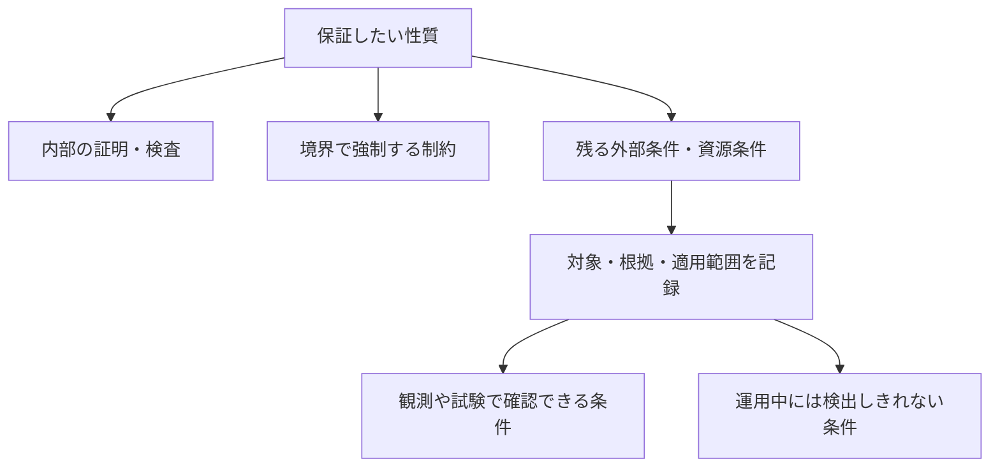

# ソフトウェアだけでは越えられない限界と、信頼する前提

[メモの一覧へ](README.md) · [外部世界との接続だけが残る場合のunsafe](unsafe-as-external-contract.md) · [unsafeを置き換えた後に、何が残るか](what-remains-of-unsafe.md)

作成日・資料確認日: **2026-11-07**

更新日: **2026-11-07**（保証・前提を言語の仕組みとして扱う発展メモへのリンクを追加）

発展する考察: [ソフトウェアの限界を、プログラミング言語の保証と信頼として扱う](language-guarantees-and-trust.md)。証明・検査・隔離と未解消の前提を分け、保証ごとの依存追跡、時点、資源、配備の設計を検討している。

目的: ソフトウェア開発で、どのような問題がプログラムの工夫や検証だけでは解消できないのかを調べ、将来の言語で「何を信頼するか」を扱うための土台を整理する。

## 1. 最初に押さえたい結論

ソフトウェアによる保証には、**計算や情報の原理的な限界、有限の物理資源、モデルと実物の対応、観測・権限の不足、人間や組織が決める要求**という異なる境界がある。すべてを「最後は何かを信じるしかない」とまとめると、取れる対策を見失いやすい。

特に、次の三つを分ける必要がある。

| 区別 | 例 | 必要な対応 |
| --- | --- | --- |
| 要求を同時には満たせない | 有限の容量へ、無制限の情報を失わず保存する | 入力・保証・資源のいずれかを変える。信頼の宣言では解消しない |
| 保証が外部条件に依存する | 永続化の指示を受けた装置が、その契約どおりに保存する | 条件、根拠、適用範囲を明示し、可能なら検証・強制・冗長化する |
| 現状では十分に確認していない | 複雑なコードを検証する費用をまだ払っていない | 検証や設計変更によって縮められる。原理的な不可能性とは分ける |

信頼とは、本メモでは、**指定した保証を利用するために、その場で独立に証明・強制できていない条件を、根拠と責任を伴って受け入れること**とする。ただし、信頼によってその条件が現実に成立するわけではない。

この文書の分類・言語設計案は本メモの考察である。原論文や公式資料で確認した仕組み・限界には出典を付した。「将来も絶対に改善できないもの」と「特定の条件や予算では解決できないもの」を区別する。

## 2. 数学の公理に似ている点と、違う点

### 2.1 保証は、前提から導く形になる

既存の[外部契約の考察](unsafe-as-external-contract.md)を、システム全体へ広げると、保証は概ね次の構造になる。

```text
論理体系と推論規則
    ＋ プログラム・機械・外部環境のモデル
    ＋ 明示した前提A
    ＋ プログラムが保証Gを満たすことの証明
        ⇒ モデル内では、Aが成立する実行についてGが成り立つ

実際のシステムへ適用するには、さらに:
    配備した成果物・設定が、証明対象と対応する
    実物がモデルに従い、必要な環境条件Aが維持される
```

公理に似ているのは、すべての主張を同じ範囲の内部だけで導くのではなく、推論の出発点を置くところである。

違いは、ハードウェアや人についての前提は、**現実に成立しているかを調べる経験的な主張**でもあることだ。「この装置は指定どおりに動く」と選択・宣言しただけで、装置の動作が変わることはない。測定、試験、製造・運用上の管理など、数学の証明とは異なる根拠が必要になる。

seL4も、形式的な保証の前提として、機械のモデルへの適合、論理や証明検査に関する条件を区別し、物理世界へ結び付ける前提は数学的証明だけでは消えないと説明している。[seL4の証明の前提とその意味](https://sel4.systems/Verification/assumptions.html#what-do-these-assumptions-mean)

### 2.2 信頼の種類を一つにしない

| 前提の種類 | 例 | 根拠の性格 |
| --- | --- | --- |
| 論理的な基盤 | 採用した論理・推論規則が、意図する意味に対して妥当である | 数学的な検討、より小さな基盤への還元 |
| 実装・配備の対応 | 検証したコードと、実行するバイナリや設定が対応する | 証明、成果物の検査、配備記録 |
| 物理的・経験的な前提 | メモリ、CPU、時計、センサーが指定した条件内で振る舞う | 仕様、測定、試験、故障モデル、運用条件 |
| 相手の振る舞いの前提 | 外部装置が完了後にバッファへアクセスしない | 相手の検証、強制できる境界、契約の受け入れ |
| 権威・価値判断 | どの鍵・主体へどの権限を与え、何を許容するか | 利用者・組織による判断、責任の所在 |

なお、「この相手を信頼する」という一個のフラグより、「この構成で、この性質のために、この条件を受け入れる」という記録の方が、保証との関係を追いやすい。

### 2.3 安全性、進行、品質を分ける

| 主張 | 意味 | 資源不足・応答不能の場合 |
| --- | --- | --- |
| 指定した安全性 | 例: 領域外へアクセスしない、許可なく変更しない | 拒否や停止によって維持できる設計もある |
| 進行・可用性 | 例: 処理が完了する、要求に応答し続ける | 資源、電力、通信などの前提が直接効く |
| 時間・精度・機能 | 例: 期限内に、指定誤差で、意図した結果を返す | 対象入力、実行基盤、環境、要求の定義を含めて評価する |

エラーを安全に返せることと、成功することは異なる。逆に、特定の機能が停止しても守るべき安全性を保てる場合はある。「安全」という語で、これらを一括しない。

## 3. 限界の一覧

詳細は第4節に示す。各行は重なりうるが、限界の理由を分けるために並べている。

| 分類 | ソフトウェアだけでは無条件に満たせない要求 | 軽減・対処できること | 残る前提・変更する要求 |
| --- | --- | --- | --- |
| 計算可能性 | 任意のプログラムの停止や安全性を、必ず停止する万能手続きで完全判定する | 対象言語の制限、健全だが不完全な解析、証明、実行時検査 | 判定対象を限定する。不明や拒否を認める |
| 情報量・保存容量 | 有限容量へ、任意量の区別すべき情報を失わず入れる | 圧縮、共有、削除、外部保存、入力制限 | 情報を減らすか、資源を増やすか、受理しない |
| 処理速度・帯域・電力 | 有限資源で、任意量の仕事を任意の短時間に終える | よいアルゴリズム、並列化、予約、負荷制御 | 対象仕事量と実行環境、期限、供給能力 |
| 数値表現・精度 | 有限の固定表現で、任意の実数や演算結果をすべて厳密に表す | 多倍長、区間、記号表現、誤差解析 | 扱う数の範囲、許容誤差、計算費用 |
| 物理故障・モデルとの対応 | 任意の物理的破壊や誤動作の下でも、同じ機械が完全に動く | 誤り検出・訂正、冗長化、隔離、機種変更 | 故障の種類・数・相関、基盤の動作条件 |
| 電源・永続化・情報の喪失 | 電力がなくても計算を続け、全保存先が失われても元の情報を復元する | UPS、ログ、複製、検証、復旧手順 | 電力や有効な情報の残存、保存系の契約 |
| 分散した判断 | 通信・故障の制約を変えず、整合性と進行を常に両立する | クォーラム、追加の時間条件、拒否、保証の変更 | 故障モデル、通信・時間の条件、優先する保証 |
| 観測できない事実 | 同じ観測結果から、実際には異なる世界を必ず識別する | センサー追加、校正、照合、不確かさの表現 | 観測経路とモデル。情報がなければ不明とする |
| 外部の不可逆な操作 | 結果が不明な操作を、相手の協力なしに必ず一回だけ完了・撤回する | 操作ID、重複排除、照会、補償、操作制限 | 相手の処理規則、履歴の保持、物理的な可逆性 |
| 暗号・乱数・本人性 | 鍵や乱数の前提を欠いたまま認証し、認証だけで発言内容の真実まで保証する | 暗号、鍵管理、乱数源の評価、権限の限定 | 脅威モデル、秘密や乱数源、信頼の起点、意味の確認 |
| 仕様・モデル・検証基盤 | 仕様への適合だけから、要求の妥当性と実世界の全条件への適合を導く | 仕様の検討、証明対象の拡大、独立した検査 | モデル化の範囲、実物との対応、採用する基盤 |
| 人間・組織 | 無限の注意・理解・即時対応や、相反する価値判断の自動的な解消を要求する | 自動化、役割分担、教育、わかりやすい表示、権限管理 | 人の能力・時間、誰が何を正しいと決めるか |

## 4. 個々の限界を掘り下げる

### 4.1 計算可能性: 万能の判定器は作れない

通常の、記憶容量に上限を置かないチューリング完全な計算モデルでは、任意のプログラムと入力について、その計算が停止するかを必ず正しく答え、判定器自身も必ず停止する手続きを作れない。停止問題に結び付くこの限界は、CPUを速くする問題とは異なる。[Turingの原論文](https://petri.kutvonen.net/Turing_Paper_1936.html)

したがって、将来のコンパイラやAIが賢くなっても、同じ対象・同じ要求のまま、すべてを完全に自動判定することはできない。ただし、個別のプログラムの停止を証明することや、扱う言語・入力を限定して完全判定することは可能である。

| できること | 引き受ける制約 |
| --- | --- |
| 安全だと判断できたものだけ受理する | 実際には安全でも拒否されるコードがありうる |
| 証明・注釈を受け取り、検査する | 証明の作成や、その論理体系で扱える範囲が課題になる |
| 実行回数・記憶量を制限する | 本来なら後で完了する計算も、予算切れになる |
| 言語の表現力を制限する | 書ける計算や使用方法が限定される |

ここでは、**証明を検査することと、任意の正しいプログラムの証明を自動で発見すること**も区別する。

現実の固定容量の機械を、状態も外部入力も有限に限定したモデルでは、状態探索によって判定できる場合がある。その場合の問題は主に状態数と費用になる。抽象モデルの判定不能性を、あらゆる有限モデルへそのまま当てはめない。

### 4.2 保存容量と情報量: 圧縮やクラウドでも消えないもの

容量の限界は、単にメモリ管理が難しいという問題ではない。**区別して保持しなければならない情報の量**にも下限がある。

以下は本メモでの単純な数え上げである。

```text
データ・索引・メタデータを合わせ、保持できる状態がBビットなら:
    区別できる状態は最大2^B通り。

B+1ビットの任意の入力には:
    2^(B+1)通りの可能性がある。

すべてをBビットの状態へ写し、後で必ず元へ戻すことはできない。
```

圧縮がよく効く入力はあるが、すべての入力を一律に短くする可逆圧縮にはできない。ハッシュで照合用の短い値を保存しても、それだけで元の任意の内容を復元できるわけではない。

外部ストレージ、ネットワーク、利用者が保持するデータへ移せば、ローカルの負担は減る。ただし、システム全体の保存先・情報源が増えたのであって、情報量の条件がなくなったわけではない。

**残る判断:** 入力上限、保存期間、削除方針、圧縮できる対象の制限、外部資源への依存を決める。「メモリ確保は必ず成功する」と信頼宣言しても、無制限の受理は実現しない。

### 4.3 CPU・帯域・期限・電力: 計算できることと、間に合うことは違う

ソフトウェアは、計算量を減らし、キャッシュや並列性を利用できる。しかし、ある構成で使える処理能力・転送帯域・エネルギーを無制限に作ることはできない。ハードウェアの増設や外部への委譲は有効だが、それも新たな資源・通信・費用への依存になる。

たとえば、読み出す必要のあるデータ量をD、その経路の転送速度の上限をVとするモデルでは、読み出しだけでも少なくともD/Vの時間が必要になる。CPUのコアを増やしても、その経路の帯域が変わらなければ、この条件は消えない。並列化でも、処理間の依存や直列部分を無条件にはなくせない。

リアルタイムの保証には、平均的な速さやクロック周波数だけでは足りない。実行経路、キャッシュ、割り込み、スケジューラ、共有資源などを含む条件が必要になる。WCET解析も、対象ハードウェアでの実行時間の上限を求める問題として扱われる。[WilhelmらのWCET研究](https://www.cs.fsu.edu/~whalley/papers/tecs07.pdf)

| 要求 | ソフトウェアでできる対処 | それだけでは保証されないこと |
| --- | --- | --- |
| 無制限の要求を受け続ける | 受付制限、キューの上限、優先順位、負荷の分散 | 有限の処理能力で、すべてを期限内に成功させること |
| 一定時間で処理する | 入力上限、資源予約、実行時間解析、予算切れの中断 | 入力や環境を無制限にした場合の成功 |
| 消費電力や発熱を減らす | アルゴリズム、稼働率、使用機能を調整する | 必要な電力供給・冷却の不要化 |

Wasmtimeのfuelは、計算の進行に予算を設ける実例である。ただし、抽象的な実行予算と実時間は別の量で、fuelの上限だけから任意のホスト処理を含む期限保証が出るわけではない。[Wasmtimeの実行中断の仕組み](https://docs.wasmtime.dev/examples-interrupting-wasm.html)

また、「難しい計算」と「原理的に計算不能」を混ぜない。たとえばP対NPは計算量に関する未解決問題として扱われており、NP完全だからといって、多項式時間の解法が存在しないと証明済みではない。[Clay Mathematics Instituteの問題説明](https://www.claymath.org/millennium/p-vs-np/)

### 4.4 数値の精度: 正しい演算でも、表せない値はある

固定長のビット列で表現できる値は有限であり、任意の実数や演算結果を厳密に格納することはできない。有限桁の二進浮動小数点では十進の0.1を厳密に表せないことや、丸め誤差は、その具体例である。[Goldbergの浮動小数点の解説](https://docs.oracle.com/cd/E19957-01/806-3568/ncg_goldberg.html)

多倍長整数、有理数、区間演算、記号表現へ変えることで、厳密に扱える問題や誤差を保証できる範囲は広がる。ただし、記憶量・実行時間・扱う式の範囲との交換になる。

ここで必要なのは、計算機を無条件に信用することより、**どの数をどんな意味で表現し、どの誤差を許すかという仕様**である。プログラムが数値型の規則どおりに動くことと、結果が用途に十分な精度を持つことは別に確認する。

### 4.5 物理故障: 正しいプログラムも、実行媒体の誤動作は含めて考える

CPUやメモリは抽象的な数式ではなく、物理的な装置である。実際の動作が採用したモデルと異なれば、モデル内で証明した性質を、そのまま適用できない。

DRAMの実地調査は記憶装置の誤りを報告し、RowHammerの研究は、特定のアクセスが近傍の記憶内容へ影響する例を示した。ここでは現在の全製品が同じ性質を持つとは扱わず、**独立した記憶位置という抽象化が実物で破れることがある**という例として読む。[2009年のDRAM調査](https://research.google/pubs/dram-errors-in-the-wild-a-large-scale-field-study/)、[2014年のRowHammer原論文](https://www.istc-cc.cmu.edu/publications/papers/2014/kim-isca14.pdf)

| 対処 | 軽減できること | 残る条件 |
| --- | --- | --- |
| 誤り検出・訂正 | 対象とする種類・数の誤りを検出・訂正する | 符号の能力、検査・訂正側の動作、対象外の故障 |
| 複製・多数決 | 一部の故障に耐える | 必要な数の健全な系統、共通原因故障への対処 |
| 別機種・別経路を使う | 特定の共通原因を避ける | 本当に原因が分かれるか、残る共有部分 |
| 隔離・停止 | 故障の影響範囲を限定する | 隔離・停止の機構自身と、その故障モデル |

どんな故障でも検出できる、という要求にはしない。たとえば、データと検査器が同時に都合よく書き換わることまで許せば、検査器が報告する値も保証できない。

一方、故障を「この範囲で、この個数まで」などと限定すれば、厳密な訂正・耐故障の保証を与えられる場合はある。物理的な前提があることは、検証や冗長化が役に立たないという意味ではない。

### 4.6 電源・永続化・全コピーの喪失: 後から取り戻せない情報

電力を必要とする計算は、必要な電力供給がなければ継続できない。UPSや別拠点は供給範囲を広げるが、ソフトウェアが電力そのものを生成するわけではない。

保存についても、「書き込みを要求した」「OSが受け取った」「装置が不揮発な状態へ反映した」「後の故障からも復元できる」を分ける必要がある。SQLiteの原子的コミットの説明にも、保存系や同期操作の振る舞いに関する明示的な前提がある。[SQLiteのハードウェア前提](https://www.sqlite.org/atomiccommit.html#hardware_assumptions)

```text
プログラムが保存処理を正しく呼ぶ
    ⇒ 必要な命令を発行したことは確認できる

保存系の契約が成立する
    ⇒ 指定した故障条件に対して保存されたと判断できる

将来のあらゆる破壊でも絶対に失われない
    ⇒ 上の二つからは導けない
```

ログ、バックアップ、誤り訂正符号を使っても、復元に必要な情報がすべての保存先から失われ、別の情報源にも残っていなければ、一般に元の任意の内容を復元できない。これはバックアップの実装が未熟という問題ではなく、情報が残っていないという条件による。

**残る前提:** どの故障を対象とし、少なくとも何が残り、保存・復旧の機構が何を守るか。保存完了の通知を信頼することも、その期間・対象・故障条件に限定して記述する。

### 4.7 分散システム: 相手が遅いのか、止まったのかを常には判別できない

応答がないだけでは、故障、通信の遅れ、相手がまだ処理中、結果だけが失われた場合を必ず区別できない。時計やタイムアウトは判断の材料になるが、観測していない事実を作り出すものではない。

代表的な限界には、前提の異なる次の二つがある。ここで合意は、決定内容の一致に加えて、参加者の入力に関する妥当性も要求する。

| 結果 | 成立する条件と、両立できない要求 | 取り違えないこと |
| --- | --- | --- |
| FLP | 通信や実行速度に既知の時間上限を置かない非同期モデルで、1プロセスが停止しうる場合、決定的な合意プロトコルに、常に合意して終了する保証を与えられない | 合意の安全性を保つ実装や、追加の時間条件・異なる保証を使う方式まで不可能とは言わない |
| CAP | 無期限の分断も許すモデルでは、線形化可能な読み書きの整合性と、すべての正常ノードで要求を完了し続ける可用性を、分断中も同時に保証できない | 一般的な「整合性」や稼働率を何でも指す定理ではなく、通常時から常に三つのうち二つだけを選ぶという話でもない |

根拠: [Fischer・Lynch・Patersonの原論文](https://groups.csail.mit.edu/tds/papers/Lynch/jacm85.pdf)、[Gilbert・LynchのCAPの原論文](https://users.ece.cmu.edu/~adrian/731-sp04/readings/GL-cap.pdf)。

考え方の例として、通信できない二拠点のうち片方で更新が完了した後、もう片方に読み取り要求が来る場合を考える。後者には更新内容が届かない。そのまま古い値を返す、更新の到達を待つ、読み取りを拒む、などの選択が必要になる。型を強くしても、届いていない情報そのものは得られない。

**残る選択:** 正常とみなす時間・故障の範囲、進行を保証する条件、待機や拒否を許す操作、緩める整合性を明示する。タイムアウトを「故障が確定した」という型へ直結させない。

### 4.8 観測・測定: 正しいバイト列と、正しい現実の情報は違う

センサーから受け取った値が、形式、範囲、署名などの検査に通っても、対象の物理量を正しく表しているとは限らない。装置の校正、設置位置、遅延、測定条件、故障などが関わる。計測の分野では、測定値とともに不確かさや測定モデルを扱う。[BIPM/JCGMの計測ガイド](https://www.bipm.org/en/web/guest/publications/guides)

ここでの限界は、本メモでは次の情報の問題として整理できる。

```text
世界A: 装置も対象も正常で、値「20」を受信した。
世界B: 装置に異常があり、実際は異なるのに同じ値「20」を受信した。

受信側へ届く情報がすべて同じなら、その情報だけを使って
世界Aと世界Bを、常に正しく区別することはできない。
```

別の測定経路、自己診断、校正記録、モデルとの照合によって区別できる場合は増える。ただし、すべての経路が共通の原因で同じ誤りを伝えることなどを無制限に許したまま、常に真実を得るとはできない。

これは人の入力、検索結果、外部データにも当てはまる。どれほど賢い解析器でも、与えられた情報と完全に整合する複数の現実から、追加の根拠なしに正しい方を必ず選ぶ保証は導けない。

**残る前提:** 観測の由来、鮮度、不確かさ、信頼する測定条件。必要なら、値ではなく「この根拠の下での推定」「不明」「追加観測が必要」という結果を返す。

### 4.9 外部の副作用: 応答がないことは、実行されなかった証拠ではない

外部サービスへ操作を依頼し、その完了応答だけが届かなかった場合を考える。呼び出し側では「未実行」と「実行済みだが応答喪失」が同じように見えることがある。

無条件に再試行すれば、操作が重複する可能性がある。再試行しなければ、未実行のまま残る可能性がある。呼び出し側の例外処理やトランザクションだけで、相手の操作履歴まで巻き戻せるわけではない。

| 対処 | 必要になる条件 |
| --- | --- |
| 同じ操作IDを使って再試行する | 相手が、そのIDに基づいて重複を排除・照会できる |
| 結果を記録し、操作と対応づける | 記録と操作の整合性、記録の保持期間、相手の保存系が必要 |
| 補償操作を行う | 意味のある補償が存在し、相手や物理系が実行できる |
| 操作を中止する | 相手が中止を受理し、すでに起きた効果をどう扱うかが定義されている |

冪等なAPIは、この問題を扱いやすくする実用的な方法である。一方、遅れて届く要求や操作IDの保存期間まで含む設計が必要になる。[AWSによる冪等な再試行の設計例](https://aws.amazon.com/builders-library/making-retries-safe-with-idempotent-APIs/)

物理的な作用には、そもそも厳密な逆操作がないものもある。不可逆な変更を行った後で、内部の変数を元へ戻すだけでは現実の変更は消えない。

**言語への示唆:** 成功・失敗に加え、「結果未確定」「外部へ権限を渡したまま」「補償が必要」を表せるとよい。これらを一律に通常の失敗へ潰すと、再試行や資源再利用の誤りにつながる。

### 4.10 暗号・乱数・本人性: 検査を成立させる起点が必要になる

暗号は信頼を減らす重要な道具だが、検査するものを限定して理解する必要がある。

| 仕組み | 確認・支援すること | それだけでは確認できないこと |
| --- | --- | --- |
| ハッシュによる成果物の識別 | 指定したダイジェストとの対応を検査する | その成果物が正しい、安全、最新であること |
| デジタル署名 | 方式の前提の下で、鍵とメッセージの関係を検査する | 書かれた内容の真実、署名主体の将来の善意 |
| 証明書の検証 | 信頼の起点を基に、名前と公開鍵の結び付きを検査する | その起点を誰が正当と決めるべきか |
| 疑似乱数生成器 | 適切な種などの条件の下で、乱数列を生成する | 外から新たな情報を得ず、既知の決定的状態だけから秘密の不確実性を生むこと |

RFC 5280では、証明書の検証に使うtrust anchorは検証アルゴリズムへの入力である。暗号的な連鎖をどこまで確認しても、どの起点を受け入れるかという設定は別に必要になる。[RFC 5280 §6.1](https://datatracker.ietf.org/doc/html/rfc5280#section-6.1)

秘密鍵の保護、乱数源、実装、攻撃者の能力なども保証の条件になる。たとえばEdDSAの仕様にも、秘密鍵、サイドチャネル、鍵生成時の乱数に関する条件がある。[RFC 8032 §8](https://www.rfc-editor.org/rfc/rfc8032.html#section-8)

乱数源については、NIST SP 800-90Bが設計や評価、健全性試験を扱っている。ただし、有限の出力を試験したことだけを、装置が将来も常に同じ性質を持つ証明とは扱わない。[NIST SP 800-90B](https://csrc.nist.gov/pubs/sp/800/90/b/final)

**残る前提:** 鍵・乱数・実装・脅威モデル、そして最初の権限や名前との対応。これは「すべての暗号は同じ種類の未証明仮定に依存する」という主張ではなく、採用する方式ごとの保証条件を記録すべきだという整理である。

### 4.11 仕様・モデル・検証基盤: 証明対象の外側を見失わない

形式検証は、明示した仕様とモデルについての強い保証を与える。しかし、仕様を満たしていることから、その仕様が利用者の本当の要求を表しているとは直ちに導けない。

ソフトウェアが意図した機能を正しく実装していても、それだけでシステム全体の安全な動作を確保したことにはならず、安全上の要求をシステムの分析から特定する必要がある。[Abdulkhaleq・Wagner・Levesonの研究](https://dspace.mit.edu/entities/publication/43aafa21-0671-4f1c-ae12-a0b0d8c97ac6)

検証基盤については、次の二方向を区別したい。

| 縮められる信頼 | なお確認すること |
| --- | --- |
| コンパイラの出力を検査し、コンパイラ全体をそのまま信頼せずに済む構成にする | その検査の範囲、使うモデル、検査器、対象成果物との対応 |
| 証明検査器を小さくし、独立に検査する | 採用した論理・意味付けと、実際の検査実行の基盤 |
| OS・機械語・機械管理まで検証対象を広げる | 現物、機種、初期状態、設定が対象モデルに対応すること |

seL4は、一部の構成でバイナリ検証によってコンパイラやリンカへの依存を減らす一方、情報流の保証はモデルが扱う経路に限られることも説明している。たとえば機能的な正しさと、時間などを通じた情報漏洩の不在は別の性質である。[seL4の保証範囲と前提](https://sel4.systems/Verification/assumptions.html)

また、Trusting Trust型のコンパイラ攻撃に対しても、Diverse Double-Compilingのように、追加の条件と独立した経路によって、ソースと実行形式の対応を確認する研究がある。[Wheelerの研究](https://dwheeler.com/trusting-trust/dissertation/html/wheeler-trusting-trust-ddc.html)

したがって、**特定のコンパイラ、ブートコード、OSが永遠に検証不能だとは考えない**。残る境界は動かせる。一方、検査を何段重ねても、モデルについての主張と、実際の対象・環境との対応を同じものとしては扱わない。

### 4.12 人間・組織: 能力の有限性と、正しさを決める責任

人的な限界には、計算機の性能不足とは異なるものが含まれる。

| 側面 | ソフトウェアで支援できること | ソフトウェアだけでは与えられない前提 |
| --- | --- | --- |
| 注意・記憶・反応時間 | 表示の整理、警報、要約、作業の自動化 | すべてを同時に見落とさず、任意の短時間で判断できる能力 |
| 理解とレビューの工数 | 型、証明、差分、依存関係の可視化 | 全対象を無制限に読んで理解する時間・人員 |
| 要求と価値の選択 | 選択肢や影響を示し、指定された目的を最適化する | 誰のどの要求を採り、何を許容するかという合意 |
| 権限と責任 | 操作範囲の制限、承認や履歴の記録 | 初期の権限設定や責任分担そのものの正当性 |
| 誠実さと組織の継続 | 権限分離、照合、複数経路、監査 | すべての関係者の無期限の誠実さ、保守する意思と資源 |

Bainbridgeは、自動化により通常作業を減らしても、異常時の監視や引き継ぎを人へ残すことで、難しい要求が集中しうると論じた。「人が最後に確認する」を付けるだけでは、その人が間に合い、状況を理解できる根拠にはならない。[Ironies of Automation](https://gwern.net/doc/sociology/technology/1983-bainbridge.pdf)

これは、人間の誤りがあらゆる場面で不可避だという定理でも、必ず人間を実行時の制御に残すべきだという主張でもない。役割をなくす、入力や操作を制限する、自動で検証・拒否するなどによって、特定の人的依存を除くことはできる。

しかし、入力されていない要求や、合意されていない価値判断を、ソフトウェアの内部的な正しさだけから正当化することはできない。本メモでは、これは情報の不足と、判断する権威・責任の問題として整理する。

予算や保守人員の不足も重要だが、原理的な検証不能性とは分ける。費用を払えば検証できるものを、現在確認していないからという理由で「人を信じるしかない不可避の領域」へ固定しない。

## 5. 将来の言語では、何を仕様として表すとよいか

以下は設計案であり、特定の言語の実装済み機能ではない。既存の[外部契約・接続・利用の三段階](unsafe-as-external-contract.md#3-宣言接続利用の三段階に分ける)を、資源・観測・運用へ広げる考察である。

### 5.1 保証と、その前提を別々に記録する



一個の「信頼済み」ラベルの代わりに、少なくとも次の情報を区別したい。

| 項目 | 記録する内容 |
| --- | --- |
| 保証する性質 | メモリ安全性、整合性、期限、精度、永続性など |
| 対象 | 成果物、機種、設定、接続先、版。識別情報自体を正しさの証拠とはしない |
| 必要条件 | 資源の上限、許す故障、時間条件、装置や相手の振る舞い |
| 根拠 | 証明、実行時の強制、測定・試験、外部契約、組織の受け入れ判断 |
| 適用範囲 | 対象入力、構成、期間、運用状態、保証する故障の範囲 |
| 確認できること | 何を監視でき、何の違反は検出できないか |
| 条件が不明・不成立のとき | 拒否、縮退、保留、再確認など。実際に実行できる対応だけを約束する |

「物理的な前提がある」と「任意の未検証コードを信用する」は同じではない。前者が残ることを理由に、後者を広げる必要はない。

### 5.2 異なる条件を、すべてunsafeへ押し込めない

| 条件 | 言語・実行基盤側で扱う方向 | なお外側へ残ること |
| --- | --- | --- |
| メモリ・実行予算 | 上限付き確保、受付制限、計算予算、予算切れの結果 | 実資源の供給、計測や制限機構の動作 |
| 時間 | 期限、時計の種類、スケジューリング条件を区別する | 実行基盤の時間特性、必要な外部応答 |
| 外部データ | 検証前の値から、確認した性質だけを持つ値へ変換する | 測定内容や外部の発言の真実 |
| 非同期の装置 | 権限・所有・進行状態を型で管理する | 装置の停止・同期条件、制限を強制する基盤 |
| 操作の結果不明 | 未確定状態、操作ID、照会・補償の手順を表す | 相手が履歴や操作規則を守ること |
| 数値と推定 | 誤差、単位、区間、鮮度などを区別する | 測定モデル、校正、用途に必要な精度 |
| 信頼の更新 | 根拠と対象の対応を追い、変更時に再確認する | 新しい対象や条件についての証拠 |

資源不足や通信失敗は、型があるだけでメモリ破壊になる必要はない。正常な失敗として扱える範囲を広げれば、信頼が必要な箇所を狭められる。

一方、「必要な資源が必ずある」「相手は必ず止まる」と宣言するだけの機構では、問題を隠すことになる。条件が確認できない場合に、どの保証を維持し、何を諦めるかまで定義したい。

### 5.3 前提が破れたときに、必ず検出できるとは約束しない

受信サイズや予算切れのように、基盤が動作する前提の下で検出・強制できる条件はある。一方、センサーの偽った測定値や、検査器自身を含む物理故障は、必ず検出できるとは限らない。

そのため、次の二つを分ける必要がある。

```text
検出可能な違反:
    検出した場合の拒否・回復・隔離を仕様にする。

検出を保証できない前提:
    その前提に依存する保証と、根拠・対象範囲を記録する。
    違反すれば必ず安全停止する、とは自動的に主張しない。
```

停止にも電力・制御経路・装置の協力が必要な場合がある。内部プロセスを止められることと、外部で始まった作用を止められることは別である。

## 6. 例: センサーの値を、期限内に処理して保存する

次の要求を考える。

```text
届くすべての測定値を、常に正しい現実の値として扱い、
決められた時間内に処理して、永久に失わず保存する。
```

このままでは、入力の量、装置の誤り、電力、通信、保存容量、保持期間が無制限であり、実現可能な保証になっていない。必要な条件を分けると、次のようになる。

| 段階 | ソフトウェアが担えること | 外部に必要な条件・判断 |
| --- | --- | --- |
| 受信 | 上限内のデータだけを受理し、形式や認証情報を検査する | 到着量・到着間隔、送信元と鍵の対応 |
| 解釈 | 単位、範囲、時刻、記録された不確かさを扱う | 実測の妥当性、校正、設置・環境条件 |
| 処理 | 受理した入力のメモリ・計算量を制限し、内部の安全性を検証する | 対象機械での実行時間、スケジューリング、電力 |
| 保存 | ログや複製、永続化操作、復旧手順を実装する | 保存系の契約、想定する故障、残存するコピー |
| 運用 | 容量不足や確認できる異常を報告し、受付を制限する | 保守の資源、保持期間と損失許容についての判断 |

改善した仕様では、たとえば次を個別に定める。

- 対象とする入力のサイズ・到着量・保存期間。
- 処理が成功する資源・時間の条件と、失敗時にも守る内部の性質。
- 何をもって「保存済み」とし、どの故障に耐えるか。
- 測定の妥当性について何を確認し、何を未確認のまま受け取るか。
- 期限超過、容量不足、保存結果未確定の場合に、何を返し、何を再利用しないか。

エラーを返せる仕様に変えた場合、それは「常に保存に成功する」という元の要求を達成したのではなく、**成功条件を限定し、不成立でも守る性質を明確にした**のである。

この例で信頼する対象は、一個のセンサーや一個のOSではない。「この校正条件の下での測定」「この設定での保存完了」「この負荷での時間特性」という、性質ごとの条件になる。

## 7. この考察から言語設計へ持ち帰るもの

ここからは本メモの結論であり、確定した言語仕様ではない。

**第一に、原理・資源の制約と、未検証の信頼を分ける。** 有限容量や判定不能性は、相手を信頼すれば消える問題ではない。要求や対象を限定する仕組みが必要になる。

**第二に、信頼は対象の名前より、必要な振る舞いとして記述する。** 「この装置を信頼する」より、「この条件で完了を通知した後は、このバッファへアクセスしない」の方が、内部の型・権限・状態との対応を定義できる。

**第三に、根拠を混ぜない。** 証明、境界での強制、試験・測定、署名、組織の承認は、確認しているものが異なる。互いを補えるが、一つで他のすべてを代替したことにはしない。

**第四に、信頼の縮小を続けられる構成にする。** 未検証コードを隔離する、出力を検査する、証明対象を広げるなどによって、前提の範囲は動かせる。「最後は物理的な前提が残る」ことを、改善を止める理由にはしない。

**第五に、保証を成功時だけの一枚にしない。** 成功、通常の失敗、結果未確定、権限をまだ取り戻せない状態、検出不能な前提違反を分けると、どこまで機械的に扱え、どこで外部の根拠が必要になるかが明確になる。

既存の[unsafeを外部契約へ集める案](unsafe-as-external-contract.md)に加えるなら、中心になるのは、**保証・対象・条件・根拠・資源・不明時の状態を対応づける仕組み**だと考える。安全性を「無条件の絶対保証」として一語で表すより、どの世界・条件・故障の範囲について何を保証するのかを、利用者が追えるようにしたい。

## 8. 関連メモと資料の読み方

- [外部世界との接続だけが残る場合のunsafe](unsafe-as-external-contract.md): 契約・接続・利用を分け、外部の振る舞いと権限を結び付ける案。
- [unsafeを置き換えた後に、何が残るか](what-remains-of-unsafe.md): 判定不能性、検証範囲、実物との接続についての先行する考察。
- [プログラマーの負担の変遷](programmer-burden-transitions.md): 自動化や静的検査によって仕事がどこへ移るか。

信頼と証明の境界は[seL4の前提](https://sel4.systems/Verification/assumptions.html)、保存系の具体的な条件は[SQLiteの原子的コミット](https://www.sqlite.org/atomiccommit.html)、観測・運用・人を含む問題は[STPAに基づく安全工学の研究](https://dspace.mit.edu/entities/publication/43aafa21-0671-4f1c-ae12-a0b0d8c97ac6)と[Bainbridgeの自動化の考察](https://gwern.net/doc/sociology/technology/1983-bainbridge.pdf)を入口にすると、異なる種類の前提を比較しやすい。

