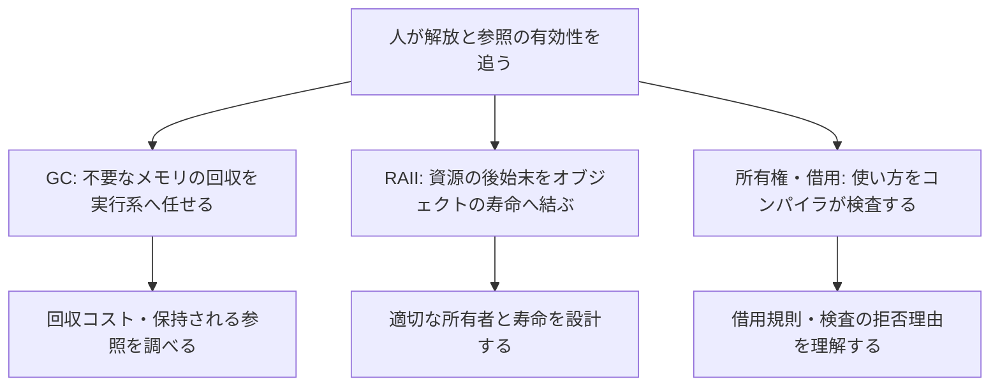
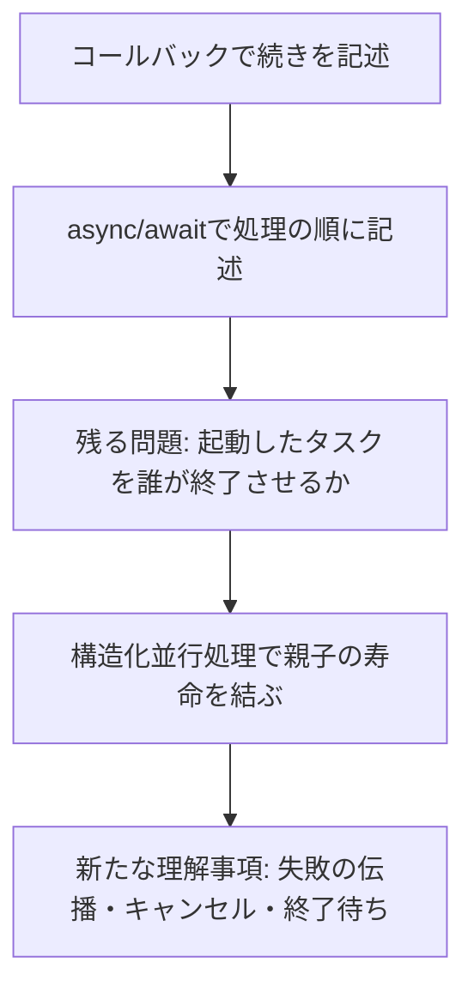

# プログラマーの負担はどう移り変わったか

[メモの一覧へ](README.md) · [負担の種類による12分類](programmer-burden-and-language-design.md) · [リポジトリの目次へ](../../README.md)

調査日: **2026-11-07**

目的: 言語・機能・仕様・パラダイムの変化を、**「以前は何が大変だったか → 何が楽になったか → 代わりに何が問題になったか」**という形で比較する。

## 1. 全体をつかむための見方

負担の変遷は、機械への指示を細かく書く仕事から、処理の構造・型・所有関係・仕様を設計する仕事へ、重点を広げてきたと整理できる。人が行っていた処理を自動化すると、記述や確認の手間は減る。一方、その自動化が何をするかを理解し、適切な条件を与える仕事が生じる。

ただし、これは本メモによる見取り図である。すべての言語が同じ順序で発展したわけではなく、古い方式も用途に応じて使われ続けている。GCと所有権、動的型と静的型、関数型とオブジェクト指向などは、単純な前世代・次世代の関係ではない。

特に、**新しい仕組みを導入した後で困ることが、すべてその仕組みのせいで新しく生まれた問題とは限らない**。以下では区別して記す。

| 表記 | 意味 | 例 |
| --- | --- | --- |
| **新規** | 比較元にはなかった規則や仕組みに伴う作業・制約 | 所有権検査に通るよう、借用の使い方を整理する |
| **移転** | 以前の仕事や問題が、別の場所・時点・担当へ移る | メモリの回収作業を実行系へ渡し、その実行コストを観測する |
| **残存** | その変更では解決されず、以前から残っている問題 | 型が合っていても、計算式や業務規則は間違えうる |

「新規」は、その比較で導入された負担という意味であり、どの利用者にも必ず重くなるという意味ではない。各表の利点と代償の整理は本メモの考察で、仕組みや歴史的な節目には一次資料を添えた。工数や不具合率の優劣を測定した調査ではない。

## 2. 歴史上の節目を大まかに並べる

以下は発明の優先順位を確定する年表ではなく、関心の広がりを読むための代表的な資料・実装の節目である。重なる時期に、異なる解決策が並行して発展している。

| 時期・節目 | 負担を減らす方向 | 軽くなった点 | 新たな問題・次に扱う課題 |
| --- | --- | --- | --- |
| 1950年代: FORTRANの開発 | 機械向け命令の手書きから、数式などの翻訳へ | 低水準の記述と調整の一部をコンパイラへ任せる | 生成された処理とソースの対応、処理系の利用、性能の確認。[Backusの開発史](https://softwarepreservation.computerhistory.org/FORTRAN/paper/p25-backus.pdf) |
| 1960年: Lisp原論文 | 不要になった記憶領域の手動追跡から自動回収へ | 解放対象を逐一管理する作業を減らす | 回収に使う時間・空間や、参照を残してしまう設計。[McCarthyの記憶回収の説明](https://www-formal.stanford.edu/jmc/recursive/node4.html) |
| 1964年: BASIC初版 | 学生・教員が学びやすく、素早く試せる言語・利用環境へ | 入門に必要な学習を減らす | 入門の容易さだけでは、大規模なコードの構造化・保守は決まらない。[初版の設計要件](https://www.dartmouth.edu/basicfifty/basicmanual_1964.pdf) |
| 1968–1972年: 構造化制御と情報隠蔽の議論 | 自由な飛び先や共有情報を追う作業から、局所的な理解へ | 制御のまとまりと、変更の影響範囲を把握しやすくする | 例外的な脱出の表現、部品の境界と契約の設計。[Dijkstra](https://www.cs.utexas.edu/~EWD/transcriptions/EWD02xx/EWD215.html)、[Parnas](https://www.cs.lafayette.edu/~gexia/cs301/resources/parnas.html) |
| 1974–1978年: SEQUELとMLの型検査の論文 | 手順や型の整合性を、人だけで組み立て・確認する仕事からの自動化 | 問い合わせの手順を省略し、多相的な処理を型検査する | 実行計画や推論された型など、機械が決めるものを理解する。[SEQUEL](https://course.ccs.neu.edu/cs5200f17/ssl/readings/boyce.pdf)、[Milner](https://www.pure.ed.ac.uk/ws/files/15143545/1_s2.0_0022000078900144_main.pdf) |
| 1980–1990年代の議論・実用化 | 部品の組み合わせ、読みやすい記述、実行環境の共通化へ | 再利用、試作、読解、異種環境への配布を助ける | 抽象化の設計、実行時に決まる挙動の理解、実行基盤への依存。[Hughesの関数型の議論](https://www.cs.tufts.edu/comp/150FP/archive/john-hughes/whyfp.pdf)、[Python作者の1996年の説明](https://www.python.org/doc/essays/foreword/)、[Javaの1996年の説明](https://www.oracle.com/java/technologies/architecture-neutral-portable-robust.html) |
| 2000–2010年代の取り組み | 大規模・並行・既存資産を含む開発への支援 | Erlang/OTPによる障害対処、Goによる開発工程の改善、TypeScriptによる既存JavaScriptの検査など | 通信手順、依存関係、型のある部分とない部分の接続。[Armstrongの2003年論文](https://erlang.org/download/armstrong_thesis_2003.pdf)、[Goの2012年の説明](https://go.dev/talks/2012/splash.article)、[TypeScriptの2012年公開を振り返る記事](https://devblogs.microsoft.com/typescript/ten-years-of-typescript/) |
| 近年の具体例: Swift 5.5、Go 1.18、RustのNLL | 導入済みの抽象化・安全規則を、さらに使いやすくする | 子タスクの寿命管理、型をまたぐ再利用、借用検査の柔軟化 | キャンセルの意味、型パラメータの制約、検査規則の理解。[構造化並行処理](https://github.com/swiftlang/swift-evolution/blob/main/proposals/0304-structured-concurrency.md)、[2022年のGoジェネリクス](https://go.dev/blog/intro-generics)、[2022年のNLL移行完了](https://blog.rust-lang.org/2022/08/05/nll-by-default/) |

大きく言えば、支援の対象が「一つの計算を記述する」から「大きな仕組みを安全に変更し続ける」へ広がっている。ただし、最近の言語だけが保守や安全性を考えたという意味ではない。1970年代のモジュールや型検査の議論にも、その問題意識がある。

## 3. 何が楽になり、何が難しくなったのか

この節の矢印は、比較する方式の変化を表す。直接の継承関係や、全言語が通った発展経路を表すものではない。

### 3.1 機械命令の記述 → 高水準の記述 → 実行環境の共通化

**以前の負担:** 計算の意図を、対象機械の命令・記憶配置・呼び出し方へ細かく落とし込む。別の環境で動かすには、その環境の都合にも対応する。

| 変化 | 軽くなった点 | 新たな問題・移った負担 | 残存する問題 |
| --- | --- | --- | --- |
| 機械向けの記述 → FORTRANなどの高水準言語 | 数式や制御をまとめて書き、命令生成を任せる | **新規:** コンパイルという段階や、生成コードとの対応を理解する。**移転:** 命令生成・最適化の仕事が処理系へ移る | 計算方法や計算量の選択、入出力の費用 |
| 環境ごとの実行形式 → Javaなどの共通実行基盤 | 対応する実行系のある環境へ配布しやすい | **新規:** 実行系の導入・互換性という条件が加わる。**移転:** 機械差への対応を実行基盤の実装側が引き受ける | OS・外部ライブラリ・資源制約などの差 |

たとえば、数式を一つ変える際に機械命令の並びまで手直しする作業は減る。その代わり、性能が予想と違う場合には、コンパイラや実行系がどう処理したかを調べる。

根拠: [FORTRANの開発史](https://softwarepreservation.computerhistory.org/FORTRAN/paper/p25-backus.pdf)、[Javaの移植性の設計](https://www.oracle.com/java/technologies/architecture-neutral-portable-robust.html)。

### 3.2 飛び先を追う → 構造を読む／全体を読む → 境界を読む

**以前の負担:** ある行へどこから飛んでくるか、どの処理が共有データの形式を知っているかを、広い範囲で調べる。

| 変化 | 軽くなった点 | 新たな問題・移った負担 | 残存する問題 |
| --- | --- | --- | --- |
| 自由なジャンプ中心 → 分岐・反復・手続きによる構造化 | ソースのまとまりと実行のまとまりを対応づけやすい | **新規:** ジャンプを厳しく制限する方式では、複数の脱出経路を表すために追加のフラグや入れ子が必要になる場合がある | アルゴリズム自体の複雑さ、誤った条件式 |
| 内部表現を各所で共有 → モジュールと抽象データ型 | 利用者が覚える情報と、変更が波及する範囲を減らせる | **新規:** 公開する操作と隠す情報を設計する。**移転:** 内部の正しさを守る責任が、部品の実装側へ集まる | 境界が不適切なら、変更は広く波及する |

構造化は「制御を理解しやすくする」改善、情報隠蔽は「理解しなければならない範囲を小さくする」改善である。後者では、部品を使う人は楽になる一方、部品の作者はよい境界を決める必要がある。

なお、構造化を「すべてのジャンプの禁止」と同一視する必要はない。Knuthは反復やエラー時の脱出について、読みやすさと効率を両立する構文を論じている。[Dijkstraの問題提起](https://www.cs.utexas.edu/~EWD/transcriptions/EWD02xx/EWD215.html)、[Knuthの1974年論文](https://gwern.net/doc/cs/algorithm/1974-knuth.pdf)、[Parnasの情報隠蔽](https://www.cs.lafayette.edu/~gexia/cs301/resources/parnas.html)。

### 3.3 同じ処理を何度も書く → 共通の抽象化を設計する

**以前の負担:** 同じ手順、型だけが違う処理、対象ごとの分岐を繰り返し実装し、修正時には複製した箇所を探す。

| 変化 | 軽くなった点 | 新たな問題・移った負担 | 残存する問題 |
| --- | --- | --- | --- |
| 対象ごとの分岐 → オブジェクトの多相性 | 共通の呼び出し方で異なる実装を使える | **新規:** 派生型が共通の約束を守る設計が必要。動的な呼び出し先を追う負担も生じる。**移転:** 振る舞いの選択が、呼び出し側の分岐から実装の選択へ移る | 状態の整合性、共有された可変データ |
| 型ごとに複製 → ジェネリクス・多相関数 | 要素型などの違いを引数化し、処理を共有する | **新規:** 型パラメータや制約を設計し、その診断を読む必要がある | 抽象化した処理の仕様・性能が適切かという判断 |
| 手順の一部まで複製 → 高階関数・マクロ | 処理の差分や構文上の反復をまとめる | **新規:** 関数を渡す仕組みや、マクロ展開・名前のスコープなどを理解する | 共通化する範囲の判断、過度に複雑な抽象化 |

たとえば複数の要素型に対応するコンテナを一つにまとめると、利用者の重複は減る。しかし作者は、その要素型に「比較可能であること」などの条件が必要かを考える。再利用の拡大は、**各利用者の実装作業を、共通部品の設計作業へ集める変化**でもある。

継承していることと、親の代わりに正しく使えることも同じではない。後者には振る舞いの約束が関わる。[Javaの多相性とカプセル化](https://www.oracle.com/java/technologies/object-oriented.html)、[Liskov・Wingの振る舞いによる部分型](https://www.cs.cmu.edu/~wing/publications/LiskovWing94.pdf)、[Rustのジェネリクス](https://doc.rust-lang.org/book/ch10-01-syntax.html)、[Hughesの高階関数の議論](https://www.cs.tufts.edu/comp/150FP/archive/john-hughes/whyfp.pdf)、[Racketのマクロ](https://docs.racket-lang.org/guide/macros.html)。

### 3.4 解放を手で追う → 回収を任せる／所有と寿命を規則にする

**以前の負担:** どの経路で処理が終わっても解放されるか、参照先がまだ生きているかを人間が追う。

ここには複数の解決方向がある。下図は選択肢の比較で、歴史的な派生関係ではない。RAIIと所有権検査のように、組み合わせるものもある。

| 変化 | 軽くなった点 | 新たな問題・移った負担 | 残存する問題 |
| --- | --- | --- | --- |
| 手動解放 → トレーシングGC | 到達不能なメモリの回収を自分で列挙しない | **移転:** 回収作業を実行系が担う。**新規:** 回収機構に伴う停止や追加メモリを、方式に応じて考慮する | 不要な参照を保持する設計、メモリ不足。ファイルなどの適切な終了時点 |
| 各経路で個別に後始末 → RAII | スコープ退出や例外経路の後始末を、資源型の実装へまとめる | **新規:** 資源の寿命と所有するオブジェクトの寿命を適切に対応づける必要がある | 非所有参照の有効性や、共有所有の設計 |
| 人間の規律中心 → Rustの所有権・借用検査 | 一部の参照誤用や競合をコンパイル時に発見する | **新規:** 所有・借用の規則に合うデータ構造とAPIが必要。安全な意図でも解析が受け入れられない場合がある | 資源消費、デッドロック、業務上の誤りなど |

さらに、**安全規則を導入した後、その規則を使う負担を減らす改善**もある。RustのNLLは、借用の範囲をブロックだけでなく制御と使用箇所から解析し、検査を通すための局所的な書き換えを減らした。これは安全性を捨てる変更ではなく、解析の精度・柔軟性を上げる方向である。

NLLでも、型やAPIに必要な関係を表す仕事がなくなるわけではない。新規機能による負担だけでなく、以前の機能が要求していた回避作業が減った点にも注目すると、変遷がわかりやすい。

根拠: [Lispの自動回収](https://www-formal.stanford.edu/jmc/recursive/node4.html)、[C++のRAII](https://www.stroustrup.com/bs_faq2.html#finally)、[Rustの所有権](https://doc.rust-lang.org/book/ch04-01-what-is-ownership.html)、[NLLの動機と改善対象](https://rust-lang.github.io/rfcs/2094-nll.html)、[Rust 2018での導入と2022年の移行完了](https://blog.rust-lang.org/2022/08/05/nll-by-default/)。詳しくは[所有権とその先](ownership-and-beyond.md)。

### 3.5 型を書く負担と、型の誤りを探す負担を両方減らす

**以前の負担:** 型を明示する方式では宣言・修正が増え、静的な検査を行わない方式では不整合を実行後に発見する仕事が増える。

「静的型 → 動的型 → 静的型へ回帰」という一本の歴史ではない。**記述を減らす方向と、検査・情報を増やす方向が、組み合わされてきた**と見る方が正確である。

| 変化 | 軽くなった点 | 新たな問題・移った負担 | 残存する問題 |
| --- | --- | --- | --- |
| 型の明示中心 → 型推論 | 式や使い方から導ける型を繰り返し書かない | **新規:** 文脈から推論された型や、制約の衝突を理解する必要がある | 型設計、型では表していない仕様の誤り |
| 明示的な型宣言・静的制約を前提とする方式 → 動的型を使う方式 | 宣言を省き、値の形を試行しながら処理を組み立てやすい | **移転:** 型不整合の一部の発見が実行時やテストへ移る。「型の誤り」そのものが新しく生まれたわけではない | テストで通っていない経路の挙動 |
| 動的な既存資産 → 任意の型注釈・段階的な検査 | すべてを書き直さずに、検査や補完を増やせる | **新規:** 型定義・注釈・検査設定を保守し、検査する範囲の境界を扱う | 外部入力の検証、検査対象外や安全性を弱める操作 |

Pythonの型ヒントは、Pythonを動的型の言語として保ちながら静的解析などを助ける設計であり、注釈を書くだけで通常の実行時型検査が行われるわけではない。TypeScriptもJavaScriptに検査の層を加えるが、完全な型安全性を保証する設計ではない。

根拠: [Milnerの型推論・多相型検査](https://www.pure.ed.ac.uk/ws/files/15143545/1_s2.0_0022000078900144_main.pdf)、[Pythonの型ヒントの目的と非目標](https://peps.python.org/pep-0484/#rationale-and-goals)、[TypeScriptの目的の振り返り](https://devblogs.microsoft.com/typescript/ten-years-of-typescript/)、[TypeScriptの健全性の範囲](https://www.typescriptlang.org/docs/handbook/type-compatibility.html#a-note-on-soundness)。

### 3.6 状態を更新する手順を書く → 値の変換や欲しい条件を書く

**以前の負担:** 変数がいつ・どこから変更されるかを追い、走査・探索・集計の手順を実装する。

| 変化 | 軽くなった点 | 新たな問題・移った負担 | 残存する問題 |
| --- | --- | --- | --- |
| 共有する可変状態中心 → 不変データ・純粋関数中心 | 別の処理による書き換えを考える範囲を減らし、入力と結果から理解しやすくする | **新規:** 更新を値の変換として表す方法や、入出力との接続を学ぶ。**移転:** 表現や評価方式に応じた時間・空間の調整が必要になる | 外部世界の状態、必要な処理順序、停止性 |
| 行ごとの取得手順 → SQLの集合的な問い合わせ | 欲しいデータの条件を中心に書き、走査・結合方法の選択を任せる | **移転:** 性能調整の対象が、手書きのループからスキーマ・索引・統計・実行計画へ移る | 条件や結合の意味、重複、欠損値、業務規則 |
| 探索処理の手書き → Prologの関係・探索機構 | 照合と失敗時の戻りを共通の仕組みに任せる | **新規:** 単一化・バックトラックなどの実行規則を理解する。**移転:** 探索の効率を節やゴールの並べ方などから調整する | 問題の計算量、通常の深さ優先探索での停止性 |

たとえば「注文を読み、顧客ごとの箱に金額を足す」という手順を、「顧客ごとに合計を求める」という問い合わせへ置き換える。処理を書く仕事は減るが、遅いときにはDBMSの計画を読む必要がある。

不変データだから毎回すべてをコピーする、純粋な言語だから入出力を扱えない、という意味ではない。共有や実装上の最適化、作用の表現がある。負担が減るのは、主に**状態や手順を直接追う部分**である。

根拠: [Hughesの関数型の議論](https://www.cs.tufts.edu/comp/150FP/archive/john-hughes/whyfp.pdf)、[HaskellのIO](https://www.haskell.org/onlinereport/haskell2010/haskellch7.html)、[SEQUELの設計目的](https://course.ccs.neu.edu/cs5200f17/ssl/readings/boyce.pdf)、[PostgreSQLの実行計画](https://www.postgresql.org/docs/current/using-explain.html)、[SWI-Prologの実行規則](https://www.swi-prolog.org/pldoc/man?section=glossary)。

### 3.7 特別な値の約束を覚える → 欠損・失敗を仕組みとして扱う

**以前の負担:** `-1`や`null`が何を意味するかを覚え、各呼び出しで確認し、必要なら上位へ伝える。

ここでも二つの流れを分けるとわかりやすい。

- **欠損:** 値があるかないか。nullable型やOptionなどで表す。
- **失敗:** 操作が成功したか、なぜ失敗したか。例外やResultなどで表す。

| 変化 | 軽くなった点 | 新たな問題・移った負担 | 残存する問題 |
| --- | --- | --- | --- |
| 特別な値で欠損を表す → nullable型・Option | 欠損の可能性を型から知り、確認せずに使う誤りを検出しやすい | **新規:** 取り出しや合成の型規則を学ぶ。**移転:** 以前も必要だった欠損確認を、型に沿った分岐・変換・伝播として表す | 欠損時に何をするべきかという業務上の判断 |
| 各呼び出しでエラー値を確認 → 例外 | 通常の処理と失敗の対処を分け、途中の関数で同じ伝播処理を繰り返さずに済む | **新規:** 途中で制御が抜ける経路と後始末を理解する。未検査例外では呼び出し側の型だけから失敗を把握しにくい | 回復可能性、再試行の可否、処理途中の状態 |
| エラー番号などの慣習 → Resultのような和型と網羅性検査 | 失敗を型のある値として表し、場合分けを検査できる | **新規:** エラー型と型に沿った変換を設計する。**移転:** 以前も必要だった場合分けを、型の規則に沿って記述する | 分岐を書いても、回復策が正しいとは限らない |
| Resultの手動伝播 → Rustの`?`など | 定型的な成功値の取り出しと失敗の早期返却を短く書く | **新規:** どの関数から戻るか、どのエラー型へ変換するかを理解する | 回復・再試行・記録を実施する方針 |

具体的には、「関数が失敗するかを知る」仕事と、「失敗を呼び出し側へ渡す」仕事は自動化できる部分がある。しかし「決済に失敗したときに再試行してよいか」は、それだけでは決まらない。

例外とResultは併存する方式で、Resultがすべての例外を歴史的に置き換えたわけではない。Result型があっても、意図的に無視したり、失敗時に停止する書き方を選んだりできる。

根拠: [Kotlinのnull安全性と保証の外へ出る経路](https://kotlinlang.org/docs/null-safety.html)、[Rustのmatchの網羅性](https://doc.rust-lang.org/book/ch06-02-match.html)、[例外を使う動機](https://www.stroustrup.com/bs_faq2.html#exceptions)、[Pythonの例外処理](https://docs.python.org/3/tutorial/errors.html)、[RustのResultと`?`](https://doc.rust-lang.org/book/ch09-02-recoverable-errors-with-result.html)。

### 3.8 同時に動く処理を手で調整する → 通信・待機・寿命を構造にする

**以前の負担:** 複数の処理が共有データへ触れる順序、待機後の再開、失敗した処理の終了と後始末を調整する。

「データの共有」「待機後の継続」「タスクの寿命」は別の問題なので、異なる仕組みが発展した。

| 変化 | 軽くなった点 | 新たな問題・移った負担 | 残存する問題 |
| --- | --- | --- | --- |
| 共有メモリを直接同期 → メッセージ通信・actorによる隔離 | 状態の持ち主を限定し、個々の共有アクセスの調整を減らす | **新規:** メッセージと隔離境界を設計する。**移転:** 同期の問題が通信手順・順序・待ち合わせへ移る | 論理的な競合、待ち続ける処理、処理量の制限 |
| 待機後のコールバックを手書き → async/await | 続きを別の関数へ細かく分割せず、処理の順に書きやすい | **新規:** 非同期関数の呼び出し規則を扱う。**移転:** 継続の管理を処理系へ任せ、利用者は待機点を意識する | 共有状態、キャンセル、エラー、並列度 |
| 独立して起動した処理を個別管理 → 構造化並行処理 | 親のスコープと子タスクの寿命を結び、終了待ち・失敗時の扱いをそろえる | **新規:** 親子間の失敗・キャンセルの規則を理解する。終了が遅い子の完了待ちも意識する | キャンセル要求を無視する処理、外部で開始済みの操作 |

注意したいのは、**書き順が単純になっても、実行が一つの不可分な処理になるわけではない**という点である。Swiftの再入可能なactorでは、`await`で待っている間に別の処理が状態を変えうる。「在庫を確認 → 通信を待つ → 在庫を更新」の間に前提が変わる問題は、actorでデータ競合を防いでも残る。

また、構造化並行処理のキャンセルは、Swiftでは協調的である。要求した瞬間に子が停止する保証はなく、スコープを抜けるためにその完了を待つ場合がある。

根拠: [Erlangのメッセージ通信](https://www.erlang.org/doc/system/conc_prog.html)、[C#の非同期処理の説明](https://learn.microsoft.com/en-us/dotnet/csharp/asynchronous-programming/)、[Swiftの構造化並行処理とキャンセル](https://github.com/swiftlang/swift-evolution/blob/main/proposals/0304-structured-concurrency.md)、[Swift actorの再入による利点と問題](https://github.com/swiftlang/swift-evolution/blob/main/proposals/0306-actors.md#actor-reentrancy)。actorの実行・再入規則は言語ごとに異なる。

### 3.9 実装とコメントから推測する → 契約・型・検証で前提を表す

**以前の負担:** どんな入力が必要か、何を書き換えるか、例外が起きるか、結果が要求に合うかを、実装の読解・テスト・人の推論で確認する。

| 変化 | 軽くなった点 | 新たな問題・移った負担 | 残存する問題 |
| --- | --- | --- | --- |
| 暗黙の前提 → Eiffelなどの契約 | 呼び出し側の義務と実装側の保証が明示され、違反を発見・切り分けしやすい | **新規:** 事前条件・事後条件・不変条件を書き、保守する | 契約に書かなかった要求、検査しなかった実行 |
| 作用を実装から調査 → Kokaなどのエフェクト型 | 関数が起こしうる作用を、型から判断する材料を得る | **新規:** 効果の意味や組み合わせ方を学ぶ。**移転:** 作用の情報が、実装だけでなく型の設計にも現れる | 外部システムの正しさ、型で扱わない資源制約 |
| 実装の正しさを人が確認 → Dafnyなどの自動検証 | 明示した仕様への適合や一部の実行時誤りを、検証器で確認する | **新規:** 仕様やループ不変条件、検証の補助を書く。**移転:** 実装の確認作業の一部が、仕様の正しさの確認へ移る | 利用者の要求そのものの誤解、モデル化していない外部挙動 |

「結果は0以上」という仕様に合うことを証明しても、「正しい金額を計算した」とは限らない。条件を精密にするほど検証できる部分は増えるが、書いて維持する情報も増える。

Kokaについては実装を伴う研究成果の例として扱う。これらの仕組みを、一般的な言語すべての標準機能や、テストを一切不要にする手段とは扱わない。

根拠: [Eiffelの契約](https://www.eiffel.org/doc/solutions/Design_by_Contract_and_Assertions)、[Kokaの効果の推論と意味](https://www.microsoft.com/en-us/research/publication/koka-programming-with-row-polymorphic-effect-types/)、[Dafnyの設計目的と注釈の責任](https://dafny.org/dafny/OnlineTutorial/guide)。

### 3.10 個人が書きやすい言語 → チームが変更し続けやすい言語とツール

**以前の負担:** 各人の書式や機能の使い方がばらばらで、ビルド・依存関係・更新の待ち時間と調整が大きくなる。

Goの設計解説は、遅いビルド、依存関係、コード理解、更新費用などを問題として挙げる。`gofmt`のような周辺ツールも、書式選びと読み手の負担を減らす役割を持つ。

| 変化 | 軽くなった点 | 新たな問題・移った負担 | 残存する問題 |
| --- | --- | --- | --- |
| 書式を各人が決める → 標準的な自動整形 | 書式調整・議論・読み手の切り替えを減らす | **移転:** 表示の決定をツールの規則へ委ねる。独自の見せ方は制約される | 命名、責務の分割、APIや依存関係の妥当性 |
| 型を引数にする共通化がないGo → Go 1.18のジェネリクス | 型ごとの重複を減らす新たな選択肢を得る | **新規:** 型パラメータ、型集合による制約、型引数の推論を理解する | 何を共通化すべきかという設計判断 |

これは「機能を減らせばよい」「機能を増やせばよい」のどちらかでは説明しにくい例である。選択肢をそろえると共同作業は楽になるが、表現したい共通性が残ることがある。その部分へ新機能を追加すれば反復作業は減る一方、言語として学ぶ規則は増える。

根拠: [Goの設計解説](https://go.dev/talks/2012/splash.article)、[Go 1.18のジェネリクス導入](https://go.dev/blog/intro-generics)。現在のGoにジェネリクスがないという比較ではなく、導入前後を比較している。

## 4. 「問題が解決した」と言う前に区別したいこと

| 変化を誤解しやすい言い方 | 実際に軽くなったこと | 依然として別に考えること |
| --- | --- | --- |
| GCでメモリの問題が消えた | 不要なメモリの手動解放を減らした | 保持し続ける参照、使用量、回収コスト |
| 型推論で型を考えなくてよくなった | 導出できる型情報の反復記述を減らした | データの意味と型の関係、推論結果、診断 |
| 不変データで状態がなくなった | 共有された値の書き換えを追う範囲を減らした | 外部の状態、状態遷移の表現、性能 |
| SQLで性能を考えなくてよくなった | 走査・結合・集計の実装を任せた | データ配置、索引、統計、選ばれた計画 |
| async/awaitで順次実行になった | 待機後の継続を順番に書きやすくした | 待機中の他の処理、共有状態、終了管理 |
| actorなら取引全体が安全になった | 隔離された状態へのアクセスを規律化した | 待機をまたぐ前提、複数の主体を含む整合性 |
| 自動検証で仕様まで正しくなった | 記述した仕様への適合を検証した | 仕様の不足、要求の誤解、検証対象の外側 |

この表は第3節の比較の要約である。新しい仕組みが助ける範囲を具体的にすると、残存する問題を、その仕組みが新たに生んだ欠点として数える誤りを避けられる。

## 5. 変遷から読み取れる、負担の移り先

ここからは事例に基づく本メモの考察である。

### 5.1 実装する仕事から、関係を設計する仕事へ

命令列、解放処理、エラーの伝播、待機後の継続などを言語や実行系が担当すると、人は「何を計算するか」「誰が所有するか」「どの型なら使えるか」「子タスクをどこまで生かすか」を指定するようになる。

つまり、細かい手順を多く書く負担が減り、少ない記述で大きな意味を持つ関係を正しく設計することが重要になる。

### 5.2 実行後の調査から、実行前の説明へ

静的型検査、所有権検査、契約に基づく検証では、以前なら実行中に調べていた誤りの一部を先に扱える。その代わり、プログラマーは検査器が理解できる型・所有関係・仕様を与える必要がある。

コードが長くなったり、コンパイルが通るまでの時間が増えたりしても、後の不具合調査が減る可能性がある。比較するなら、記述時だけでなく変更・読解・運用まで含めて見る必要がある。

### 5.3 利用者の負担から、部品の作者・処理系・ツールへ

抽象化の利用者は、GCやコンパイラ、ライブラリ、検証器の内部を毎回実装しない。それを成立させる仕事は、処理系や部品を作る側へ集まる。問題がなくなった部分と、専門化された部分を分けて評価したい。

また、自動化した判断を確認する手段も重要になる。推論された型、実行計画、マクロ展開、タスクの構造などが見えれば、自動化の利点を使いながら、期待との違いを調べやすい。

### 5.4 負担を減らす仕組み自体も、改善の対象になる

型推論は、型検査に必要な記述を減らす。`?`は、失敗を値として扱う際の定型処理を減らす。NLLは、借用検査を通すための書き換えを減らす。構造化並行処理は、非同期タスクの寿命管理を助ける。

このように、言語の変遷には、**元の問題を解く段階**に加え、**その解決策が要求する作業を減らす段階**がある。ただし改善後にも、保証の範囲と新たに覚える規則は残る。

前回の[12分類](programmer-burden-and-language-design.md)は「どの仕事を助けるか」を調べるために、本メモは「方式を変えたとき、仕事がどこへ移るか」を比較するために使うとよい。
