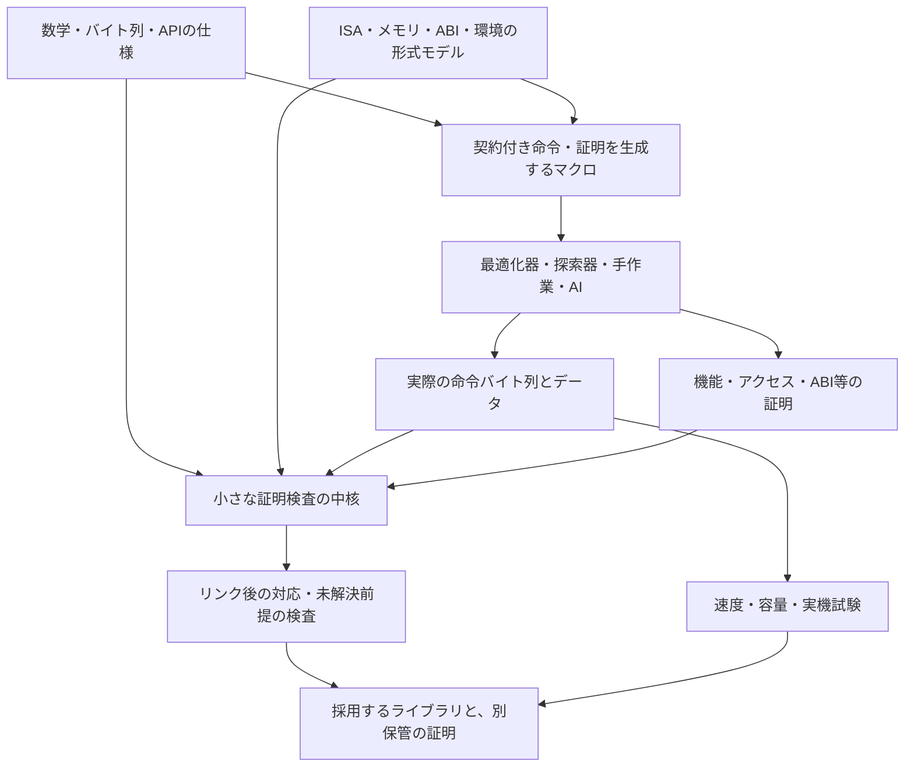

# 速度と容量を追求しながら、基盤ライブラリを機械語から検証する

[メモの一覧へ](README.md) · [言語の保証と信頼の設計](language-guarantees-and-trust.md) · [外部契約としてのunsafe](unsafe-as-external-contract.md) · [ソフトウェアの限界](limits-of-software-and-trust.md)

調査日・資料確認日: **2026-11-07**

更新日: **2026-11-08**（最小プロトタイプの実装計画へのリンクを追加）

具体化した計画: [検証済みlibcの最小プロトタイプ](../plans/verified-libc-minimal/README.md)。AArch64向けの2関数を対象に、命令マクロ、機械語の証明、成果物の照合、速度・容量の評価をつなぐ。計画段階であり、実装は未着手。

目的: libcのような基盤ライブラリについて、最適化の自由を保ち、実行速度・実行時メモリ・バイナリ容量を追求しながら、仕様と機械語の対応を検証する方法を調べる。既存の前例を比較し、証明を扱えるアセンブラと、高度なマクロを中心にした構築環境を考える。

既存技術の説明には一次資料を添える。後半の統合環境、擬似構文、開発手順、採用基準は**本メモの設計案**であり、このリポジトリに実装したツールや確定した言語仕様ではない。今回、ツールのインストール、ライブラリの構築、性能測定は行っていない。

## 読み方

- まず見通しを知る: 1–2節。
- 前例と、実際に利用できる道具を知る: 3–4節。
- libcへ適用すると何が難しいかを知る: 5節。
- 一からツールを作る場合の設計を読む: 6–9節。
- 最適化・速度・容量の評価と、着手順を考える: 10–12節。
- 最後まで残る信頼と未解決事項を確認する: 13–14節。

## 1. 結論の見通し

有力な構成は、**最適化された実行コードと、その性質を説明する証明を別の成果物として作り、実際に使う機械語が証明対象と一致することを検査する**方法である。

これは、証明しやすい遅い実装だけを採用する方針ではない。手書きアセンブリ、専用命令、SIMD、命令の並べ替え、レジスタ割り当てなどを候補に含め、採用する命令列について正しさを示す。**既存と同一の命令列を証明できれば、証明の存在によってその命令列が遅くなったり、大きくなったりする必要はない。**

この方向には、すでに近い前例がある。

- **s2n-bignum:** 最適化した機械語について、オブジェクトファイルのバイト列と対応する証明を検査する。[公式README](https://github.com/awslabs/s2n-bignum)、[保証の前提の説明](https://github.com/awslabs/s2n-bignum/blob/main/SOUNDNESS.md)
- **Vale:** アセンブリ水準の命令・マクロに、事前条件、事後条件、変更範囲、証明用の記述を付ける。[公式の言語説明](https://project-everest.github.io/vale/programs.html)
- **Jasmin:** 低水準の制御と高水準の構造を組み合わせ、検証されたコンパイラでアセンブリへ変換する。[公式文書](https://jasmin-lang.readthedocs.io/en/latest/index.html)
- **Fiat-Crypto:** 汎用の数学的な記述と証明から、パラメータに特化した低水準コードを導出する。[原論文](https://adam.chlipala.net/papers/FiatCryptoSP19/FiatCryptoSP19.pdf)

ただし、「実行時の証明用オーバーヘッドがない」と「どのCPU・どの入力でも世界最速かつ最小」は違う。後者を一般に約束する方法は示せない。対象CPU、入力の分布、必要な保証、容量の数え方を定め、**同じ条件で既存実装と競争すること**が具体的な目標になる。

libc全体についても、契約が書かれた関数、実装まで証明した関数、機械語までつながった関数を分ける必要がある。本調査の資料から、通常のlibc全体とあらゆる最適化経路が一括して検証済みで、あらゆる環境で性能・容量でも最良だ、と言える前例は確認していない。

## 2. 「信頼できる」「妥協しない」を、確認できる要求に分ける

### 2.1 一個の「検証済み」フラグでは足りない

| 確かめたい性質 | 内容 | それだけでは言えないこと |
| --- | --- | --- |
| 機能の正しさ | 入力に対して、仕様の結果を返す | 仕様が利用者の要求に合っているとは限らない |
| メモリアクセスの安全性 | 許された領域・権限・期間で読み書きする | 正しい計算結果や機密性とは別の性質 |
| 状態の保存 | 約束した範囲以外のレジスタ・メモリを壊さない | 最終状態が同じでも、途中の不正な読み書きはありうる |
| ABIへの適合 | 引数、戻り値、保存レジスタ、スタックなどの約束を守る | 呼び出し側が前提を満たすことまでは示さない |
| 停止と資源上限 | 指定条件で終了し、スタックや作業領域が上限内に収まる | OSによる待機や実機での終了時刻まで自動では決まらない |
| 秘密に依存しない実行 | 定めた観測モデルで、秘密に応じた分岐・アドレスなどを避ける | 任意の実機の時間・電力・投機実行からの漏洩の不在とは限らない |
| バイナリとの対応 | 検査した命令列・データ・接続条件が実物と一致する | 別のビルドや別の動的ライブラリへ保証は自動で移らない |

この表は本メモの要求整理である。特に、**結果の等しさ、途中のアクセス、安全な呼び出し、時間に関する性質を別々に扱う**ことが重要になる。

### 2.2 速度と小ささには、複数の軸がある

ループを展開すると、分岐を減らす代わりにコードが増える。CPU別の実装を多数入れると、各環境で速い実装を選べる代わりに配布物が増える。あるCPUで速い命令列が、別のCPUでも速いとは限らない。

したがって、次を分けて要求する。

1. **証明を消去する:** 証明項や証明専用の変数を、実行コード・実行時メモリへ残さない。
2. **必要な実装だけを含める:** 固定した機器では、その機器向けの実装をビルド時に選ぶ。
3. **同じ条件で比較する:** ABI、アクセスを許す範囲、CPU機能、入力、保証を揃える。
4. **速さと容量を両方記録する:** 平均だけでなく、重要な入力での遅延、コード・データ・依存の増加も確認する。
5. **最良でない候補を改良する:** 証明できることを理由に、既存より遅い候補を無条件に採用しない。

これは「最適化を諦める」条件ではなく、何を最適化できたかを判断する条件である。特定の安全性要求が既存の最適化と衝突する場合は、その衝突自体を明示し、同時に達成したことにしない。

## 3. 前例: すでに何ができているか

### 3.1 全体像

以下の対象範囲と注意点は、調査時に確認した文書による。研究用の処理系も含む。「暗号ライブラリの一部で成立する」ことから、「libc全体ですぐ成立する」とは推論しない。

| 前例 | 検証する場所・方法 | 今回の構想への示唆 | 範囲・残る注意点 |
| --- | --- | --- | --- |
| s2n-bignum | HOL Lightで機械語の数学的な振る舞いを証明し、オブジェクトの命令バイト列と照合 | 手で最適化した結果を直接扱える | 主に暗号用整数演算。C宣言・呼び出し側との接続やISAモデルなどに残る条件がある |
| Vale | アセンブリ水準の手続きを契約付きで合成し、DafnyまたはF*へ接続 | 証明付きマクロという提案に特に近い | 使用する検証基盤、命令モデル、出力経路の範囲を確認する必要がある |
| HACL* / EverCrypt | Low*のCに近いコードと、Valeのアセンブリを組み合わせる | 移植可能な実装と高速経路を、共通の抽象仕様で束ねる | C出力後のコンパイラなどを含め、経路ごとの保証を確認する |
| Jasmin | 形式的な意味を持つ低水準言語から、検証されたコンパイラでアセンブリへ変換 | 命令選択・配置を制御しながら、関数やループを使える | 安全性解析、機能証明、コンパイラ、アセンブル後の対応は区別する |
| Fiat-Crypto | 証明したアルゴリズムを部分評価し、特化した実装を生成 | 同じ証明を、多くの定数・ビット幅へ再利用できる | 主に暗号算術。通常のC出力だけでは、最終機械語の証明は完結しない |
| VST / CompCert | Cのプログラム論理と、Cからアセンブリへのコンパイラ検証 | Cで書いた部分の正しさを下へ伝える基盤になる | 全変換段階・外部関数・最終リンクが自動で証明済みになるわけではない |
| VSTlib / 検証済みmalloc | 仕様を持つ部品と、実装を証明した部品を構成する | libcに近い部品を、契約と証明で組み立てる先例 | 公理化された部品もある。逐次mallocの検証は並行malloc全体の検証ではない |
| CORE-MATH / Gappa | 高性能で正しく丸める数学関数の開発／浮動小数点等の数値的な性質の証明 | libmでは丸め・誤差の根拠も独立した部品になる | 各関数の数値的な根拠と、API・コンパイル後の機械語の証明を区別する |
| SLOTHY | 読みやすいアセンブリを、命令配置・レジスタ割り当てなどで最適化 | 計算の証明と、機械別の微調整を分けやすい | 最適化器の使用だけでは証明は完成しない。出力の等価性などを別に確認する |
| bedrock2 | 低水準のプログラム論理とRISC-V機械語への検証された変換 | ライブラリから機械語まで、一つの論理でつなぐ構成の参考 | 開発中の研究基盤。言語機能・対象環境は限定される |
| Sail / Islaris | 詳細なISAの意味を、実行・機械語検証へ利用する | 命令を都合のよい簡略モデルだけで定義する危険を減らす | 大規模なISAモデルにも、実機との対応や対象範囲の確認が必要 |
| PCC / TAL | コードに証拠を付ける／低水準コードにも型の規則を残す | 生成器を全面的に信頼せず、利用側で性質を確認する考え方 | 型安全性の証明と、任意の関数の機能的正しさは同じではない |

主な出典: [s2n-bignum](https://github.com/awslabs/s2n-bignum)、[Vale](https://project-everest.github.io/vale/intro.html)、[HACL* / EverCrypt](https://hacl-star.github.io/Overview.html)、[Jasmin](https://jasmin-lang.readthedocs.io/en/latest/index.html)、[Fiat-Crypto](https://adam.chlipala.net/papers/FiatCryptoSP19/FiatCryptoSP19.pdf)、[Verifiable C](https://softwarefoundations.cis.upenn.edu/vc-current/Preface.html)、[CompCertの検証範囲](https://compcert.org/man/manual001.html)、[VSTlib](https://github.com/PrincetonUniversity/VST/blob/master/lib/README.md)、[CORE-MATH](https://core-math.gitlabpages.inria.fr/)、[Gappa](https://gappa.gitlabpages.inria.fr/gappa/index.html)、[SLOTHY](https://slothy-optimizer.github.io/slothy/)、[bedrock2](https://github.com/mit-plv/bedrock2)、[Sail](https://github.com/rems-project/sail)、[Islaris原論文](https://www.cl.cam.ac.uk/~pes20/2022-pldi-islaris.pdf)、[PCC](https://people.eecs.berkeley.edu/~necula/ISSS02/)、[TAL](https://www.cs.cornell.edu/talc/papers/tal-toplas-abstract.html)。

### 3.2 最も直接的な先例: 最適化されたバイト列を証明する

s2n-bignumでは、関数の事前条件・数学的な結果・変更範囲を、機械の形式モデルに対して証明する。証明対象のバイト列を実際のオブジェクトと照合するため、アセンブラが正しく翻訳したことをそのまま仮定する必要を減らせる。[保証の構造とバイト列の対応](https://github.com/awslabs/s2n-bignum/blob/main/SOUNDNESS.md)

ここで重要なのは、「人が書いたアセンブリなので信頼する」という扱いから、**そのアセンブリが生んだ命令列について定理を持つ**扱いへ進めることである。

ただし、同じ文書は、ISAやデコーダ、実行環境、検査器、呼び出し側との接続の前提も挙げている。Cヘッダーと形式仕様の完全な機械検証による接続には未完の部分がある。定数時間性やメモリ安全性も、対象の関数と証明の範囲を確認する必要がある。[残る条件の一覧](https://github.com/awslabs/s2n-bignum/blob/main/SOUNDNESS.md)

**考察:** この方法をlibcへ持ち込む場合、各関数の証明に加え、C/Rustからその事前条件を満たして呼べることを接続する部分が重要になる。

### 3.3 「証明を持つマクロ」は、かなり近い形で存在する

Valeは、`requires`、`ensures`、`reads`、`modifies`などで手続きを記述する。手続きの呼び出しを命令列へ展開し、生成時に決まるパラメータで命令列を切り替えられる。証明用のghost変数・補題は実行コードへ残さず、ghost値を実機の命令のオペランドに使うことも禁止する。[マクロ・生成時パラメータ・ghostの説明](https://project-everest.github.io/vale/programs.html)

したがって、今回の発想の重要な部分は、すでに研究・実装されている。独自ツールを作る意味があるとすれば、たとえば**libc向けの仕様群、最終バイナリとの対応、C/Rustとの契約の接続、性能・容量の採用判断を一つの流れに揃えること**にある。

### 3.4 高水準の記述から、速い実装を導く先例

HACL*の研究の説明には、初期のOCamlへの抽出では性能が不足し、Cに近いLow*へ進んだ経緯がある。EverCryptは、そのC系統とValeのアセンブリ系統を組み合わせる。[開発史と構成](https://hacl-star.github.io/Overview.html)

Fiat-Cryptoの2019年の論文は、証明しやすい汎用の算術から部分評価で特化したコードを導き、複数の素体・CPUで競争力のある性能を報告した。BoringSSLへの導入も記されている。これは当時の対象・比較条件での結果であり、現在の全実装に対する一律の優位を示すものではない。[原論文](https://adam.chlipala.net/papers/FiatCryptoSP19/FiatCryptoSP19.pdf)

**考察:** 高い抽象度で書くこと自体が、実行時の費用になるとは限らない。生成時に処理を終え、必要な命令だけにできる場合は、抽象化を証明と再利用に使える。

### 3.5 libcに近い検証にも、証明と公理の混在がある

VSTlibは、部品を「外部の実装が仕様を守ると公理化するもの」と「構築して証明するもの」に分けている。通常のシステムの`malloc/free`を公理化して利用する経路と、検証したアロケータを構築する経路は別である。また、証明上のモジュール結合と、通常のリンカによるオブジェクトの結合も区別している。[VSTlibの説明](https://github.com/PrincetonUniversity/VST/blob/master/lib/README.md)

Appel・Naumannの2020年の研究は、標準APIと互換性のある逐次的な`malloc/free`実装をVSTで検証した。資源を追う仕様により、条件を満たす呼び出しで確保に成功することまで扱う。常にNULLを返す実装では利用側の目的を満たせない、という問題に応答している。[Verified Sequential Malloc/Free](https://collaborate.princeton.edu/en/publications/verified-sequential-mallocfree/)、[著者の論文](https://www.cs.princeton.edu/~appel/papers/memmgr.pdf)

**考察:** 「公理として使えるライブラリ」と「実装から証明したライブラリ」は区別する必要がある。前者は利用者の証明を進めるための有用な境界だが、今回の目的では、未証明の実装の仮定を減らす側まで進めたい。

### 3.6 最適化の自動化と証明を組み合わせる先例

SLOTHYは、命令スケジューリング、レジスタ割り当て、ソフトウェアパイプラインを扱う。公式文書は、最適化した結果をs2n-bignumで等価性検証する実例も挙げている。[SLOTHYの方式と利用例](https://slothy-optimizer.github.io/slothy/)

この分担は重要である。人は読みやすい計算を定義し、最適化器が機械別の命令配置を探索し、検証側がその結果を確かめる。探索アルゴリズムのすべてを、最初から正しさの根拠に含める必要がなくなる。

### 3.7 2026年の新しい研究: 既存のlibcを含むバイナリの検証

調査時点では、既存ソフトウェアのバイナリに証明を付ける作業を自動化する報告もある。

- **Anthropic / Theorem、2026-10-22:** RISC-V・Linux・静的リンク・単一スレッド・固定メモリ予算などの条件で、123ライブラリの実行可能なテスト成果物について安全性に関わる性質を検証したと報告し、証明の一部を公開している。入力にも64 MB未満という範囲がある。既存のテストを形式仕様へ使う方式であり、各ライブラリの全APIの機能仕様を証明したこととは区別する。[研究報告](https://www.anthropic.com/research/formal-verification)
- **Zellic / V12、2026-10-30:** 静的リンクされた非PIEのx86-64・glibcバイナリについて、起動処理などを含む特定のセキュリティ性質の証明を公開した。単一スレッドなどの範囲があり、起動中に`main`へ到達せず停止・クラッシュする実行も定理は許す。ISAモデルは未監査で、空虚な命題になる誤りも含めた限界を明記した研究プレビューである。[研究報告と制限](https://v12.sh/blog/x86-formal-verification-intro)、[公開リポジトリ](https://github.com/Zellic/x86-formal-verification-research)

**考察:** これらは証明を書く費用を下げる方向の前例である。今回の構築環境でも、AIや自動探索を証明の作成に使う余地はある。ただし、生成されたISAモデル・仕様・証明をすべて同じ意味で信頼する構成にはしない。証明が検査を通っても、命題が弱すぎる・事前条件が成立しない・機械モデルが違う問題は残る。

### 3.8 libmでは、数値の保証とAPI互換性も比較する

CORE-MATHは、既存の数学ライブラリへ組み込める、高性能で正しく丸める関数を目指している。公式サイトは関数ごとの実装や証明資料、性能比較を公開する。ただし、比較ではGNU libcとCORE-MATHの`errno`対応の違いも明記している。[CORE-MATHの目標・資料・比較条件](https://core-math.gitlabpages.inria.fr/)

Gappaは、浮動小数点・固定小数点を含む式の区間や計算誤差などを扱い、形式的な証明を生成する道具である。[Gappa User’s Guide](https://gappa.gitlabpages.inria.fr/gappa/index.html)

**考察:** 数値的な性質の証明を、メモリ・ABI・最終機械語の証明と接続する余地がある。一方、丸めが正しいことだけでlibmの全契約を満たしたとせず、例外、丸めモード、`errno`なども比較条件に含める。単に省略した機能の費用を、検証による高速化として数えない。

## 4. 三つの構築経路を組み合わせる

### 4.1 ソースを証明し、検証されたコンパイラで下げる

```text
関数の仕様
  ＋ Cや専用言語の実装の証明
  ＋ コンパイラの性質保存の証明
  → アセンブリ水準の保証
  ＋ エンコード・リンク後の対応の確認
  → 採用するバイナリの保証
```

VSTとCompCert、Jasminなどが、この経路の基盤になる。

CompCertのマニュアルは、検証した変換範囲と、外部プリプロセッサ・アセンブラ・リンカなどを区別している。また、コンパイラの正しさを証明しても、あらゆる最適化を行って最高の性能になるという保証ではない。性能に関する制限も公開している。[構成・検証範囲・性能の説明](https://compcert.org/man/manual001.html)

**向く部分:** 多くの通常の制御やデータ構造。**課題:** 最も速い専用命令列を自在に作れるか、アセンブル以降の対応をどう閉じるか。

### 4.2 最適化された機械語を、直接証明する

```text
手書きアセンブリ／既存コンパイラ／探索器
  → 実際の命令バイト列
  ＋ そのバイト列についての機能・アクセス・ABI等の証明
  → 採用するバイナリの保証
```

この経路では、生成方法に制約を掛けすぎずに済む。証明が実際の命令列の振る舞いまで到達していれば、生成に使ったGCCやLLVMの全実装を、その関数の正しさの直接の前提に含めずに済む。

**向く部分:** サイズが小さく、呼び出し回数が多く、機械別の最適化効果が大きい部品。**課題:** 逆コンパイル・不変条件・ビット演算などの証明費用。

### 4.3 証明しやすい実装と、高速版の等価性を証明する

```text
仕様を満たす実装Rを証明する
  → 探索器が高速版Oを作る
  → RとOの必要な性質の対応を証明する
  → Oも仕様を満たすと導く
```

これが、最適化の自由と証明の再利用を両立しやすい構成である。ただし、出力値の等しさだけでは、アクセスの安全性、停止、ABI、秘密に関する性質まで移らない。それぞれを保存する関係を要求する。

LLVM IRの最適化を検査するAlive2も、変換後の結果を検査する道具の例である。ただし、LLVM IRの検査を行うことと、最終機械語やリンカの正しさを証明することは別であり、非対応の変換もある。[Alive2の対象と制限](https://github.com/AliveToolkit/alive2)

**今回の提案:** 通常部分は4.1、特に重要な部分は4.2、微調整を繰り返す部分は4.3を使い、最終成果物と契約を共通の方法で管理する。

## 5. libcを対象にしたときの難所

### 5.1 「原始的なライブラリ」には、難しさの異なる層がある

| 層 | 例 | 主に証明すること | 外部との境界 |
| --- | --- | --- | --- |
| 有限のビット計算 | 加算、比較、ビット数え、固定幅算術 | ビット幅、桁上がり、符号、数学的な結果 | 命令と実機の対応 |
| メモリ操作 | `memcpy`、`memmove`、`memset`、`memcmp` | 範囲、重なり、初期状態、アクセス、返す値 | 呼び出し側が渡す領域と権限 |
| 終端を探す操作 | `strlen`、文字列探索 | 終端の存在と範囲、終了、広い読み出しの条件 | 実際に読める領域、ページ、並行変更 |
| 数学・変換 | `sqrt`、`sin`、文字列から数値への変換 | 丸め、誤差、NaN等、オーバーフロー、端の入力 | FP環境、ロケールなどの設定 |
| メモリ管理 | `malloc`、`free`、`realloc` | 所有、再利用、一貫性、確保成功の条件 | OSから供給される領域、並行処理 |
| OSへの接続 | `read`、`write`、時刻、ファイル | 引数変換、バッファ、戻り値・エラーの扱い | カーネル、装置、永続化、待機 |
| 実行基盤との接続 | 起動、TLS、スレッド、シグナル、`setjmp/longjmp` | 初期状態、制御移動、再入、保存状態 | ローダー、OS、言語実行系、メモリモデル |

これは着手範囲を分けるための設計上の分類である。基盤の初期版では、外部状態の少ない算術・メモリ操作から始めると、成果物と保証を小さく確認できる。

### 5.2 memcpyの正しさにも、呼び出し側の条件がある

GNU libcの説明では、`memcpy`は指定バイト数をコピーして宛先を返し、領域が重なる場合は未定義動作になる。重なりを許す操作は`memmove`である。[コピー操作の仕様](https://sourceware.org/glibc/manual/2.32/html_node/Copying-Strings-and-Arrays.html)

検証する契約には、少なくとも次を含めたい。

- コピー元は必要な期間だけ読み取り可能、コピー先は書き込み可能である。
- サイズが領域内に収まり、アドレス計算が対象モデルで正当である。
- `memcpy`では必要な非重複条件を満たす。
- 対象は通常のメモリか。MMIOや特別なアクセス回数が必要な領域を含むか。
- 並行する書き込み・解放がない、または許される干渉が明示されている。
- ゼロ長、NULL、整列、戻り値、破壊するレジスタをどう扱うか。

**検証済みmemcpyを、範囲外の長さで呼べば安全になるわけではない。** ライブラリの証明は、呼び出し側が前提を満たすことと組み合わせる必要がある。

### 5.3 ベクトル化と「余分に読む」最適化を曖昧にしない

たとえば、文字列を8バイトずつ調べると、終端の後のバイトまで同じ命令で読む場合がある。ここで区別するのは、次の性質である。

1. 正しい文字列長を返す。
2. アーキテクチャ上の例外を起こさない。
3. 許可された領域以外を一切読み取らない。
4. 競合するアクセスや観測可能な副作用を起こさない。
5. 投機実行なども含む、指定した機密性を守る。

これらは同じ条件ではない。「同じページにある」「結果には使わない」という理由だけで、すべてを満たしたことにはならない。

**設計案:** 命令の実際の読み書き範囲を記録し、残りの長さ・整列・ページ条件などを使う高速経路と、端の処理をそれぞれ証明する。既存の機械語が追加の読み取りを使うなら、その最適化を正当化できる観測・メモリモデルを明記する。単なる機能等価性を、より強い「領域外読み取りなし」の証明へ読み替えない。

標準Cの外部APIに対し、呼び出し側へ追加の余白を要求する内部高速APIを用意する場合も、両者は別の契約になる。追加条件を満たさない標準の呼び出しを、無条件にその高速APIへ渡してはいけない。

### 5.4 隠れた依存を、基盤の外へ追い出し忘れない

GCCの文書は、freestanding環境でも`memcpy`、`memmove`、`memset`、`memcmp`などを提供する必要があることを説明している。起動やOSとの接続を含め、コンパイラだけで完全な実行環境になるわけではない。[GCCのfreestanding環境の説明](https://gcc.gnu.org/onlinedocs/gcc/Standards.html)

同じ文書には、GCCが`memcpy`のコピー元とコピー先が完全に同じ場合にも動作することを要求する、という標準の通常の契約との違いもある。規格の関数名だけを合わせるのでなく、採用するコンパイラが実行基盤へ要求する追加条件も確認する必要がある。[GCCが要求する補助ルーチンと条件](https://gcc.gnu.org/onlinedocs/gcc/Standards.html)

libcを一から作る場合には、さらに次を成果物から調べる。

- 多倍長除算や浮動小数点などのコンパイラ補助関数。
- スタック保護、例外・巻き戻し、TLS、初期化が追加する呼び出し。
- コンパイラが置換・インライン化したメモリ操作。
- 起動コード、動的な実装選択、再配置、シンボルの差し替え。

コンパイル設定だけを見て「外部依存なし」と判断せず、実際のコードと未解決シンボルを確認する。たとえばライブラリの検証済み`memcpy`を呼ぶつもりでも、呼び出し側のコンパイラが別の命令列へ置換したなら、その場所には別の正当化が必要になる。

## 6. 一から作るなら: 証明を検査する中核と、自由に探索する外側

### 6.1 全体の構成

以下は統合ツールの設計案である。独自の言語・マクロ・成果物形式は作っても、最初から論理学や証明支援系まで作り直す必要はない。Rocq、Lean、HOL Lightなどの既存基盤を使い、その上に必要な機械・契約・生成の層を作る方が検証範囲を限定しやすい。



**候補を作ることと、採用を正当化することを分ける。** マクロ展開器や探索器が失敗しても、正しくない証明を検査器が受け付けない構成を目指す。探索のタイムアウトや「わからない」は、未証明という結果として扱う。

ただし、ソースの読み間違いで別の仕様を証明する問題は、証明検査だけでは防げない。検査器に渡す命題、対象コード、契約の表示も監査できる形にする。

### 6.2 中核が扱う対象

| 層 | 用意する対象 | 最低限必要な確認 |
| --- | --- | --- |
| 論理 | 命題・証明・許可する公理 | 証明を導出した規則と、未解消の仮定 |
| 機械 | レジスタ、フラグ、PC、メモリ、例外、命令の意味 | 実際の命令バイト列を、その意味へ正しく対応させる |
| 契約 | 事前・事後条件、読み書き範囲、変更範囲、終了 | 最終状態だけでなく、必要な実行途中の条件も満たす |
| ABI | 引数、戻り値、保存状態、スタック、CPU機能 | 外部の関数呼び出しと、検証した開始状態を結ぶ |
| 合成 | 順次実行、分岐、ループ、関数呼び出し | 前の事後条件が次の事前条件を満たす |
| バイナリ | エンコード、コード・定数配置、再配置、参照先 | 証明対象と最終成果物の対応を閉じる |

小さく作り始めることと、命令の意味を都合よく単純化することは違う。初期版は**正しく扱える命令だけを受理し、非対応の命令・モードは拒否する**。SailやIslarisのようなISA意味論・機械語検証の蓄積を参照できる。[Sail](https://github.com/rems-project/sail)、[Islaris](https://www.cl.cam.ac.uk/~pes20/2022-pldi-islaris.pdf)

初期の同期的なメモリ操作で欲しい定理は、概念的には「対象バイト列が配置され、契約Pを満たす任意の開始状態から、モデルが許す実行は不正なアクセスをせず、指定の資源内で終了し、契約QとABIの保存条件を満たす」という形になる。関数ごとに、停止も要求するのか、途中のアクセスも追うのかを明記する。外部待機や割り込みを加えるときは、その進行条件も別に扱う。

### 6.3 大きな自動化を、小さな検査の外へ置く

外側には、SMT、等式書き換え、シンボリック実行、命令探索、AIによる証明作成などを置ける。ただし、次のどれを使うかを明示する。

- 検査可能な証明を出させ、中核で再検査する。
- 検証された決定手続きを中核の論理の中で実行する。
- その道具の正しさを信頼する前提に加える。

強い保証を要求するビルドでは、最初の二つを優先する。「SMTが成功と表示した」だけを、証明項を検査した結果と同一視しない。

高水準の安全規則自体を低水準の意味から正当化し、信頼する規則を減らす方向には、PCCの研究にも前例がある。[Proof-Carrying Code with Untrusted Proof Rules](https://people.eecs.berkeley.edu/~necula/ISSS02/)

## 7. 証明付きアセンブラと、性質を保存するマクロ

### 7.1 命令を、契約を持つ最小部品にする

各命令について、レジスタ・フラグ・メモリ・例外の意味を定義する。そこから、よく使う条件下の定理を導く。

たとえば「加算」は数学的整数の加算と同じとは限らない。ビット幅での折り返し、符号の解釈、桁上がり、フラグへの影響を含める。「ロード」には、アドレス、読み取り範囲、整列、アクセスできる種類のメモリなどの条件がある。

命令の契約は、手書きの宣言をすべて公理として積むのでなく、**採用するISAの形式的な意味から導いた定理**にする。これにより、上のマクロは命令ごとの定理を利用できる。

### 7.2 マクロの出力を「コードと証明」にする

通常の文字列展開マクロだけでは、レジスタの別名、フラグの破壊、領域の重なりなどの条件を追いにくい。提案するマクロは、概念的には次の値を返す。

```text
生成したブロック:
  code        : 命令バイト列、またはその確定前の命令構造
  requires    : 呼び出し前の条件
  ensures     : 呼び出し後の条件
  accesses    : 読み取り・書き込みの許可範囲
  clobbers    : 変更するレジスタ・フラグ・メモリ
  stack_bound : 必要なスタックの上限
  proof       : 上記を、機械の意味から導く証拠
```

`requires`を増やせば何でも証明しやすくなるため、公開契約と一致するかも検査する。マクロ内部の都合で追加した条件は、呼び出し側で証明されるか、公開契約へ明示的に戻される必要がある。

### 7.3 例: 8バイトをコピーする部品

以下は**提案の擬似構文**であり、ValeやJasminの実際の文法ではない。通常のRAMを対象とした、整列済みの高速経路の一部を表す。

```text
macro Copy8(dst_reg, src_reg, tmp_reg):
  requires:
    dst_reg, src_reg, tmp_reg は互いに異なるレジスタ
    dst_reg と src_reg の値は8バイト境界に整列
    Read(src, 8, B) * Write(dst, 8, D)
    # src, dstは対応するアドレス用レジスタの開始時点の値
    # B, Dは証明用の、開始時点のバイト列
    # *は、この例では分離したメモリ権限の組み合わせ
    # 機械モード・アドレス・コード配置の条件も成立

  emits:
    Load64(tmp_reg, [src_reg])
    Store64([dst_reg], tmp_reg)

  ensures:
    Read(src, 8, B) * Write(dst, 8, B)
    src_reg と dst_reg の値は保存

  accesses:
    read  src[0..8)
    write dst[0..8)

  clobbers:
    tmp_reg, dst[0..8)
    # PCの通常の進行はブロックの制御規則で扱う

  stack_bound: 0
  proof:
    Load64の定理とStore64の定理を合成する
```

この部品から、8バイト単位のループと端の処理を組み合わせる。証明では、コピー済みの領域が開始時点の入力と等しく、未処理領域への権限が残り、残りの長さが減ることを追う。

これは`memcpy`全体の仕様ではない。未整列、ゼロ長、端、戻り値、ABIの保存状態などを扱う部品と接続して、公開APIの証明を完成させる。

**性能上の狙い:** `B`や`D`、権限、証明項は生成時・検査時にだけ使う。採用するISAで直接のロード・ストアとして確定できれば、その命令列に証明用の追加命令を入れる必要はない。反対に、前提を静的に確認できず実行時に調べる設計なら、その検査の費用は別に発生する。

### 7.4 抽象度を上げる規則も、定理として追加する

| 作りたい抽象化 | 証明すること | 実行コードへの影響 |
| --- | --- | --- |
| ブロックの連結 | 前の結果が次の条件を満たす | 通常は命令列を連結するだけ |
| 一時レジスタの入れ替え | 別名や生存範囲、保存対象を壊さない | レジスタ番号の変更、必要なら退避 |
| ループ展開 | 端と反復回数も含め、元の仕様を満たす | コード増加と分岐減少がありうる |
| SIMD化 | 各要素の対応、整列、端、アクセス範囲を保存 | SIMD命令と必要な端の処理 |
| 命令の並べ替え | データ、メモリ、フラグ、例外等の依存を守る | 命令の順序が変わる |
| 共通関数への切り出し | ABIと呼び出し前後の条件を守る | コード共有と呼び出し費用の交換 |
| 生成時の特化 | 固定した長さ・機能・定数に対して正しい | 不要な分岐や汎用処理を省ける |

マクロが高度になっても、意味を定義しない新命令として中核へ追加し続ける必要はない。既存の命令と合成規則から証明できる、派生した操作として拡張する。

ただし、「同じ結果になるなら自由に並べ替えてよい」とはしない。例外が起きる順、他スレッドから見えるアクセス、秘密に依存する観測まで守りたい場合は、その条件も変換の定理に含める。

### 7.5 インライン化を唯一の展開方法にしない

高いマクロを毎回すべて展開すると、速いが大きいコードになりうる。次を選べるようにする。

- 小さな固定長操作は展開する。
- 多くの場所から呼ぶ処理は、証明済みの関数として共有する。
- 固定CPU向けの版と、実行時に実装を選ぶ版を別に作る。
- 証明のための抽象化と、実行時の呼び出し境界を独立に決める。

証明を再利用するために、実行時にも必ず間接呼び出しやオブジェクトを残す必要はない。一方、型や所有権の消去だけで、通常の処理に必要な分岐・データ構造・退避まで消えるわけではない。

## 8. 公理・定理・信頼する前提を混ぜない

### 8.1 同じ契約を使えても、根拠は違う

| 根拠 | 例 | 利用側へ伝えるもの |
| --- | --- | --- |
| 形式モデル内の定理 | この命令列は、条件Pなら結果Qを満たす | 命題、証明、モデル、残る仮定 |
| 未検証実装について受け入れた前提 | 指定した外部関数は契約を守るとする | 対象、契約、根拠が未証明であること |
| 現実の実行に関する前提 | 対象CPUとメモリが採用したモデルに従う | 機器・設定・対象期間・故障モデルなど |
| 性能の測定結果 | この機器・入力・条件での遅延と容量 | 測定条件、結果、ばらつき、比較対象 |

最適化したライブラリの証明が完成したなら、その関数についての未検証の仮定は、定理へ置き換えられる。CPUや実行環境など、別の前提は残る。**公理を消したのか、別の場所へ移しただけかを追う。**

ライブラリ自身の正しさを公理にして同じ正しさを導く循環を、実装の検証として数えない。論理の基盤で採用する公理と、未検証のプログラムについての仮定も別に記録する。

### 8.2 前提を依存先まで伝える

概念的には、各定理に次の情報を付ける。

```text
contract: CopyBytes-v1
artifact: コード・定数・配置・再配置を特定する情報
target: ISA、必要な拡張、ABI、実行モード
proved: 機能、許可されたアクセス、ABI、停止、スタック上限
assumes:
  対象実機が指定ISAモデルに従う
  呼び出し中のメモリ権限が維持される
  指定した実行基盤が保存状態を守る
unproved_implementation_contracts: []
performance_evidence: 別管理の測定結果への参照
```

内部の未証明関数を使うと、`unproved_implementation_contracts`へ推移的に現れるようにする。`sorry`、`admit`、無条件の`assume`などを使って実装の穴を埋めた結果も、通常の証明成功に紛れ込ませない。

### 8.3 条件が本当に満たされるかを確認する

次の契約は形式的には扱えても、基盤の信頼性に役立たない場合がある。

- 成立しない条件を要求しているため、呼べる状態が存在しない。
- 呼び出し側から成立を示せない条件を、暗黙に仮定している。
- 事後条件が「何も要求しない」に近く、目的の性質を含まない。
- 正常に戻る場合しか述べず、停止や例外を要求していない。

そのため、代表的な呼び出し側を構築し、公開された前提を満たして定理を実際に使う検証も必要になる。仕様を意図的に壊した変種を検査器が拒否することや、別の意味のモデルとの比較も、定理とは役割の異なる検証として役立つ。

## 9. 証明を、最終バイナリと呼び出し側へ結ぶ

### 9.1 ソースファイル名や関数名の一致だけでは足りない

推奨する確認の順序は、次のとおりである。

1. 生成した命令構造について契約を証明する。
2. 実際のオブジェクトの命令バイト列を取り込み、エンコード・定数・参照先との対応を確認する。
3. リンク後に、再配置、追加されたコード、参照先、エントリー、実装選択を確認する。
4. 配布物をその検査結果へ結び付ける。
5. 実際のロードや配備が、想定した成果物・設定を使うことを確かめる。

3までを検証された生成・リンクで正当化する方法と、変換結果を個別に検査する方法がある。どちらでも、後処理で変わる部分を保証の外へ置き忘れない。

ハッシュは成果物の識別と改変検出に使えるが、ハッシュの一致それ自体は正しさの証明ではない。定理が対象とするバイト列と、関数の意味への対応が先に必要である。

### 9.2 動的リンクとCPU別実装を扱う

高速版を選ぶ仕組みには、選ばれる各実装だけでなく、選択側の正しさも必要になる。

- 必要なCPU機能と、OSが許す実行状態を満たす場合だけ選ぶ。
- 各候補が同じ公開契約を満たし、追加条件を選択側が正当化する。
- 動的に解決するシンボルとバージョン、差し替え可能性を限定する。
- コードが書き換わるなら、書き換え後の対応も検査する。

容量を優先する固定機器向け構成では、対象実装をビルド時に決め、不要な候補と実行時選択を省く方法がある。汎用の配布物では、複数版を含める容量と選択費用を評価する。

### 9.3 C/Rustの型と、機械語の契約を接続する

アセンブリでの「このアドレス範囲は読める」と、C/Rustでの「この参照・オブジェクトをこの期間に使える」は、そのまま同一ではない。

呼び出しラッパーでは、長さ、所有・借用、初期化、別名、表現、スタック、ABI、ポインタの由来など、必要な対応を示す。Rustの安全なAPIで公開するなら、そのAPIから到達可能なすべての呼び出しが低水準の前提を満たすことが必要である。

C ABI互換の入口は、そのままでは呼び出し側を検証しない。未検証の呼び出し側からも利用できることと、プログラム全体が安全であることは区別する。呼び出し側のコンパイラが誤った引数を生成する可能性も、ライブラリ関数内の定理だけでは消えない。

**設計案:** 同じ低水準実装に対し、従来のC ABI入口と、検証された契約を使う言語向け入口を用意する。後者は契約情報を生成・検査に利用し、条件が静的に成立する場合には、証明用のラッパー処理を実行時に残さない。

## 10. 性能の追求と、証明をどう両立するか

### 10.1 最適化器を正しさの根拠から外す

探索器には、手動調整、PGO、命令スケジューラ、超最適化、AIなどを使える。正しさの採用条件は、最終候補に必要な証明が付くことにする。

この構成では、最適化器のバグは、誤った実装を正しいとして使う問題から、証明に失敗する・探索時間を無駄にする問題へ移せる。ただし、これは証明検査・命題・対象コードとの結び付きが正しく、未確認の成功を許さない場合の話である。

### 10.2 証明しやすい形と、速い形を固定して同一にしない

たとえば、算術の説明では規則的な処理順序を使い、最終版では独立した計算を交互に配置できる。証明を命令番号へ過度に結び付けず、計算の依存・ブロックの契約・レジスタの対応で組み立てると、最適化後の等価性確認を再利用しやすい。

その代わり、証明の分割方法や中間の対応関係を設計する必要がある。最適化版がどれほど複雑でも、常に簡単に証明できるという約束にはしない。

### 10.3 実行時の費用、構築時の費用、保管容量を分ける

| 費用 | 証明を分離した場合 | 残る検討 |
| --- | --- | --- |
| 実行速度 | 証明のためだけの命令を除去できる | 実際のアルゴリズム、呼び出し、分岐、アクセスの費用 |
| 実行時メモリ | ghostデータ・証明項を不要にできる | 本来のスタック・ヒープ・作業領域 |
| 実行可能ファイル | 証明を外部に置けば、その分を含めずに済む | 展開、定数表、候補実装、メタデータ、依存 |
| ビルドと検査 | 通常の実行から費用を移せる | 証明生成・再検査の時間とメモリ |
| 配布・保管 | 実行用と監査用の成果物を分けられる | 証明も配布する場合の総容量、取得と再現の管理 |

PCCのように利用者側で証明を検査する方式なら、導入・ロード時の検査費用もある。実行時の関数呼び出しが軽くても、証明を含む配布容量や検査時間がゼロになるわけではない。

### 10.4 定数時間性を、最短時間や完全な機密性と混同しない

暗号でいう定数時間性は、指定した秘密に応じて観測が変わらないという性質である。どんな入力長でも同じ時間、最速の命令列、実際の全物理的な漏洩を排除する、といった意味ではない。

用途ごとに、公開してよい長さ、秘密の内容、観測する分岐・アドレス、対象命令と実機の条件を定める。一般の`memcmp`に許す早期終了と、秘密の一致判定用APIに必要な性質も別にする。結果が同じでも、両者を無条件に交換してはいけない。

機械語検証の前提にキャッシュや投機実行などの省略がありうる点は、s2n-bignumも明示している。[モデルと現実の隔たり](https://github.com/awslabs/s2n-bignum/blob/main/SOUNDNESS.md)

## 11. 実際に構築するための開発環境と評価手順

以下は、既存技術を組み合わせて着手するための案である。ここに挙げた全ツールが、そのまま接続できる完成済みの製品群という意味ではない。

### 11.1 用意する環境

| 役割 | 候補・構成 | 選ぶ際の確認 |
| --- | --- | --- |
| 証明と検査 | Rocq / HOL Light / Leanなど | 許可する公理、検査実行の基盤、独立に再検査する方法 |
| アセンブリに近い実装 | Vale、Jasmin、または独自の契約付き命令IR | 命令・ABI・証明・出力バイナリの対応範囲 |
| C部分の検証 | VST等と、適合するCompCertの構成 | 対象Cの意味、外部関数、検証した変換段階 |
| 数値計算の証明 | Gappa等の数値的な性質を扱う道具 | 丸め・誤差の命題と、実際に実行する演算の対応 |
| 命令の意味 | 対象に適合する既存ISAモデルやSail系の成果 | 命令拡張、例外、実行モード、実機との比較 |
| 候補の生成 | 通常のアセンブラ・コンパイラ、SLOTHY、独自探索器 | 出力へ証明を付けられるか、非対応時に拒否できるか |
| 実機評価 | 対象CPU、比較ライブラリ、再現可能な計測環境 | 入力の分布、周波数、OS、キャッシュ、計測のばらつき |
| 成果物管理 | バージョン固定、ビルド記録、コードと証明の識別 | 未検証の依存、最終リンク、配布物との対応 |

バージョンは各ツール単独の最新版を組み合わせるのでなく、互換性と検査が確認できる組を固定する。検証に使うツールのホスト環境と、速度を測る対象環境も分けて記録する。

### 11.2 一つの関数を採用するまで

```text
1. 標準・要求から公開契約を作る
2. 単純な参照実装を証明する
3. 既存高速版と、新しい候補を用意する
4. 候補の機能・アクセス・ABI・停止・資源を証明する
5. アセンブルとリンク後の対応を検査する
6. 実機で境界条件・互換性・性能・容量を評価する
7. 契約・証明・前提・実物・測定結果を結び付けて採用する
```

試験は証明の代用ではなく、仕様と実装・環境との食い違いを発見する役割を持つ。逆に、形式モデル内の証明を得ても、実機比較やAPI互換性の確認が不要になるわけではない。

### 11.3 性能と容量の測定対象

`memcpy`などなら、少なくとも次を評価する。

- 小・中・大の長さ、境界付近、長さの実際の利用分布。
- 整列・未整列、ページ境界、キャッシュに入る場合と入らない場合。
- 関数呼び出しの費用と、アプリケーションへ組み込んだ費用。
- 重要なケースの遅延、帯域、ばらつき。平均値だけに隠れる悪化。
- `.text`だけでなく、定数、再配置、必要なメタデータ、追加依存を含む容量。
- 必要なスタック・作業領域、複数実装と選択処理の総費用。

LLVM libcのベンチマーク設計も、マイクロベンチマークだけでは複雑な相互作用を捉えきれず、コードサイズなども重要だと説明している。また、実行カウンタの意味や測定結果が機械に依存する点を挙げる。[LLVM libcの測定設計](https://github.com/llvm/llvm-project/blob/main/libc/benchmarks/RATIONALE.md)

「命令数が少ない」「推定サイクル数が最小」というモデル内の結果も、実機測定と区別する。最悪実行時間が必要なら、対象機器と干渉・キャッシュなどの条件をさらに絞った解析を別途行う。

### 11.4 妥協しないための採用条件を、機械的に扱う

正しさは必須条件とし、その中で速度と容量を比較する。

- 既存と同じ保証・対象条件で比べる。
- 重要な入力群ごとに速度の許容範囲を決め、測定誤差と区別する。
- 容量と実行時資源に上限を設ける。
- ある候補が別の候補より速さ・容量とも劣るなら、その候補を採る理由を再検討する。
- 最速版と最小版が別なら、対象ごとに選ぶか、複数の配布構成を用意する。

これらの上限・許容範囲は、実機と用途から決める値であり、本メモでは数値を捏造しない。実測していない段階で「既存と同等以上」と宣言しない。

## 12. 最小構成から、どの順番で作るか

### 12.1 最初の実証範囲

**提案:** 最初は一つのISA・ABI・実行モード、通常のRAM、単一スレッド内の領域操作へ限定する。CPU選択は、実際に使う機器と既存モデルの充実度から決める。新しい文法の都合だけで決めない。

たとえば次の順で進める。

| 段階 | 作るもの | 完了を判断する条件 |
| --- | --- | --- |
| A | 最小の機械モデル、命令のエンコード・デコード、証明の再検査 | 実際のバイト列を対象に、基本的な算術・ロード・ストアの定理を確認できる |
| B | 保存レジスタ・スタックを含む関数契約、マクロ合成 | 小さな関数を外部から呼び、その呼び出し前後まで対応を示せる |
| C | `memset`、`memcpy`、`memmove`、`memcmp`の基本版 | 端・重なり・サイズ・停止を扱い、公開契約を満たす |
| D | 最適化版と等価性検査、最終成果物の対応 | 高速経路・端の処理を含めて証明し、リンクした実物へ結び付く |
| E | 実機評価と容量評価、C/Rust向けの接続 | 同条件の既存実装と比較し、契約を満たす呼び出しで利用できる |
| F | 文字列、算術の拡張、アロケータ、並行処理、OS境界 | 各機能の新しい前提・モデルを追加し、前の保証を保つ |

初期の手作業の証明は、自動化すべき規則を発見するためにも使う。最初に巨大な自動証明器や新しい汎用言語を完成させてから、最初の関数へ取り組む必要はない。

### 12.2 基盤そのものが壊れていないかを確かめる

開発時には、次の失敗を意図的に作り、受理されないことを確認したい。

- 端の1バイトだけ余分に読み書きする。
- 保存すべきレジスタを壊す。
- エンコードされた命令を1か所変える。
- 呼び出す外部関数を別の実装へ差し替える。
- ループの減少条件を失わせる。
- 明示していないCPU拡張命令を使う。
- 実装の仮定を追加して、証明の穴を隠す。

これは論理の健全性の証明を置き換えるテストではない。取り込み・対応・採用の経路が、期待した対象と条件を実際に扱っているかを調べるためのものになる。

### 12.3 一から作る価値が大きい部分

既存の論理・命令モデル・検証器を参考にしつつ、新たに整える価値が大きいのは次の接続である。

1. libcの公開仕様と、厳密な低水準契約の対応。
2. 命令・マクロ・等価性変換で共有できる証明ライブラリ。
3. 最終バイナリ、配置、ABI、依存の機械的な照合。
4. C/Rustなどの呼び出し条件を、低水準の権限へ接続する層。
5. 実行コードへ証明を残さず、速度・容量を比較して採用する流れ。
6. 残る仮定が、関数・成果物・更新ごとに見える管理。

**独自の文法だけを作ることより、証明と実物がつながる経路を途切れさせないことが、今回の目的に直接効く。**

## 13. 最後に残る信頼と、その小さくし方

| 残る対象 | 小さくする・確かめる方法 | それでも区別する限界 |
| --- | --- | --- |
| 要求と形式仕様 | 小さな仕様、標準との対照、独立のレビュー、実際の呼び出し側での利用 | 形式化した要求自体が目的と違う可能性 |
| 論理と証明検査 | 小さな中核、仮定の一覧、独立した再検査 | 検査器を実行するソフトウェア・機器の条件 |
| 命令モデルとデコーダ | 既存モデル、ベンダー仕様との照合、実機・独立実行系との比較 | 実際のCPUや例外・拡張・不具合との対応 |
| 成果物の取り込み・結合 | バイト列・定数・再配置を検査し、必要なら生成や結合も検証する | ロード・動的変更・配備との接続 |
| 未検証の外部実装 | 証明に置き換える、別の境界で制限する、残る契約を表示する | 同一アドレス空間で自由に干渉できる相手の契約違反 |
| OSと実行状態 | 対象構成を限定し、必要な保存・権限・資源を契約化する | スケジューリング、故障、装置などの外部条件 |
| 性能モデル | 実機測定、条件の固定、回帰検査 | 将来のCPU・負荷・設定で同じ結果になる保証 |

これらの一部は、さらに証明を進めて境界を下へ動かせる。bedrock2の研究では、限定した対象についてプログラム・コンパイラ・プロセッサのモデルを結ぶ構成もある。ただし、物理的な実装とモデルの対応、外部装置などを含め、現実との接点は残る。[bedrock2の構成と検証対象](https://github.com/mit-plv/bedrock2)

検査器が自分自身のソースを検査できても、現在動いている検査器の実行形式やハードウェアまで、その事実だけで正当化されるわけではない。コンパイラの検証、生成結果の検査、独立した検査経路などを組み合わせて範囲を狭める。関連する問題は[ソフトウェアの限界と信頼する前提](limits-of-software-and-trust.md)に整理している。

ここでの「根本から信頼できる」は、無条件に正しいと宣言する意味にはしない。**実装について証明できることを最大限証明し、最適化された実物との対応を示し、それでも残る前提を小さく明確にする**、という達成目標になる。

## 14. この提案で得たいものと、未解決の問い

得たいのは、次のような利用の形である。

```text
低い層:
  機械語、契約、その性質を導いた証明

部品を作る層:
  証明済みの命令とマクロを使い、計算と権限を合成する

高い層:
  公開契約を使って操作を記述し、呼び出し条件を検査する

実行時:
  選ばれた、最適化された命令列を実行する

監査・更新時:
  実物との対応、残る前提、性能・容量を再確認する
```

実現に向けて特に大きい問いは、次の点である。

- 既存高速実装のどれだけを、公開APIに余計な条件を足さず証明できるか。
- SIMD、複雑なループ、例外、並行処理の証明を、どこまで安価に再利用できるか。
- C/Rustのメモリの意味と、機械語の契約を、どの範囲で機械的に接続できるか。
- リンク・動的実装選択・コンパイラによる置換を、性能を損なわず検査経路へ含められるか。
- libc全体へ広げたとき、仕様・証明・最適化・保守の費用を維持できるか。
- 速度・容量が既存実装を下回るケースを、証明の仕組みの制限ではなく、さらに最適化できる課題として扱えるか。

この方向には実績のある部品がある一方、上記をlibc向けに統合した環境の構築は、なお大きな開発・検証課題である。本メモでは、その既存の実績と、これから作る必要のある接続を分けて提案した。

## 15. 主な資料への案内

本文の根拠を、目的別にたどるための一覧。論文の公開当時の性能報告と、現在の全構成での保証を区別する。

| 目的 | 一次資料 |
| --- | --- |
| 最適化した実物のバイト列を証明する | [s2n-bignum](https://github.com/awslabs/s2n-bignum)、[Soundness review](https://github.com/awslabs/s2n-bignum/blob/main/SOUNDNESS.md) |
| 契約・マクロ・ghostを扱う低水準言語 | [Valeの概要](https://project-everest.github.io/vale/intro.html)、[手続き・マクロ・ghost](https://project-everest.github.io/vale/programs.html)、[Jasmin](https://jasmin-lang.readthedocs.io/en/latest/index.html) |
| C系統とアセンブリ系統を束ねる | [HACL* / EverCryptの研究と構成](https://hacl-star.github.io/Overview.html) |
| 高水準の算術から高速コードを導出する | [Fiat-Crypto原論文](https://adam.chlipala.net/papers/FiatCryptoSP19/FiatCryptoSP19.pdf)、[実装と生成方法](https://github.com/mit-plv/fiat-crypto) |
| Cの検証とコンパイラの保証範囲 | [Verifiable C](https://softwarefoundations.cis.upenn.edu/vc-current/Preface.html)、[CompCertマニュアル](https://compcert.org/man/manual001.html) |
| 標準ライブラリの公理と実装の証明を分ける | [VSTlib](https://github.com/PrincetonUniversity/VST/blob/master/lib/README.md)、[Verified Sequential Malloc/Free、2020年](https://collaborate.princeton.edu/en/publications/verified-sequential-mallocfree/) |
| libmの数値的な正しさと性能 | [CORE-MATH](https://core-math.gitlabpages.inria.fr/)、[Gappa](https://gappa.gitlabpages.inria.fr/gappa/index.html) |
| 最適化結果を検査する | [SLOTHY](https://slothy-optimizer.github.io/slothy/)、[Alive2](https://github.com/AliveToolkit/alive2) |
| 低水準の意味と構成の基盤 | [bedrock2](https://github.com/mit-plv/bedrock2)、[Sail](https://github.com/rems-project/sail)、[Islaris、PLDI 2022](https://www.cl.cam.ac.uk/~pes20/2022-pldi-islaris.pdf) |
| コードに証拠を付け、生成器への信頼を減らす | [PCCの安全規則を信頼基盤から外す研究、2002年](https://people.eecs.berkeley.edu/~necula/ISSS02/)、[Typed Assembly Language](https://www.cs.cornell.edu/talc/papers/tal-toplas-abstract.html) |
| 基盤の呼び出し条件と計測 | [GNU libcのコピー操作](https://sourceware.org/glibc/manual/2.32/html_node/Copying-Strings-and-Arrays.html)、[GCCの実行環境](https://gcc.gnu.org/onlinedocs/gcc/Standards.html)、[LLVM libcの測定設計](https://github.com/llvm/llvm-project/blob/main/libc/benchmarks/RATIONALE.md) |
| 2026年のバイナリ検証の研究報告 | [Anthropic / Theorem、2026-10-22](https://www.anthropic.com/research/formal-verification)、[Zellic / V12、2026-10-30](https://v12.sh/blog/x86-formal-verification-intro)、[公開リポジトリ](https://github.com/Zellic/x86-formal-verification-research) |

