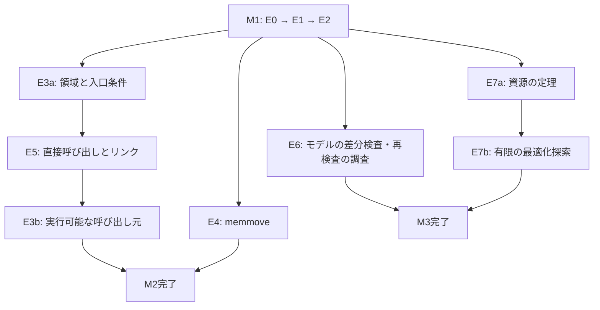

# 検証済みlibcの発展 — 実装・検証計画

[計画の一覧](../README.md) · [採用した発展方向](../../notes/verified-libc-next-experiments.md) · [既存のプロトタイプ](../../../prototypes/verified-libc-minimal/README.md) · [前回の完了監査](../../../prototypes/verified-libc-minimal/reports/audit.md)

作成日: **2026-11-08**

状態: **完了**。M1・M2・M3と[全体の監査](../../../prototypes/verified-libc-evolution/reports/audit.md)を完了した。E6bは実現性調査の完了であり、独立した証明再検査の機能は未達である。

## 1. 目的と、実装を区切る単位

**証明済みの小さな操作から処理を構成し、呼び出し元・最終成果物まで保証をつなぎ、その過程で残る前提を追跡できる環境を作る。** 正しい関数を増やすことに加え、証明の再利用、前提の導出、実物との対応、性能と開発負担を確かめる。

採用したメモのE0〜E7を、次の三つの実装単位に分ける。M1の終了を本計画全体の完了とはしない。

| 単位 | 対象 | 必須の成果物 |
| --- | --- | --- |
| **M1: 合成と任意長コピー** | E0・E1・E2 | 結果の分類、反例の根拠、証明を合成する部品、任意長の8バイトコピー、同じ公開契約の証明、実物・速度・容量・修正費用の評価 |
| **M2: 呼び出し条件と関数間の接続** | E3・E4・E5 | 領域と権限のモデル、重複を扱う`memmove`、限定した直接呼び出しとリンク後の証明、条件を検査してコピーする呼び出し元 |
| **M3: モデル・資源・探索** | E6・E7 | 使用命令の差分検査、独立した証明検査の実現性調査、ステップ数の定理、有限の候補探索と独立した再測定 |

詳細は[最初の実装単位M1](phase-1-composition.md)と[後続の実装単位M2・M3](later-stages.md)に分ける。日数を固定する代わりに、成果物と通過条件で進める。

## 2. 出発点を固定する

既存版はmacOS arm64上で、2関数の基本版とコピーの長さ8専用版を持つ。機能・終了・保存・アクセスの定理、Mach-Oとリンク後の照合、境界・ABI・破壊試験がある。選択した2関数の本体は92バイトである。詳細な値と根拠は[保存された記録](../../../prototypes/verified-libc-minimal/reports/verification.json)と[測定報告](../../../prototypes/verified-libc-minimal/reports/measurements.md)を参照する。

発展版は**`prototypes/verified-libc-evolution/`へ新設**する。既存版のソース、公開契約、保存済み報告を上書きせず、比較対象として使う。`.deps/`や`build/`を無条件に複製しない。

初期の環境は既存版と同じmacOS / thin arm64 / Mach-O / Apple ABIとする。arm64e、別OS、別ISAを同時に導入しない。HOL Light・s2n-bignum・OCamlパッケージは既存の[deps.lock](../../../prototypes/verified-libc-minimal/deps.lock)と[opam-switch.export](../../../prototypes/verified-libc-minimal/opam-switch.export)の版から開始する。

依存を共有する場合も、実体のパス、コミット、変更の有無、パッケージの版を検査する。新しいモデルや検査器の導入は明示したセットアップで行い、通常の検査からネットワークへ接続しない。版の変更が必要になった場合は、変更理由と既存版の再検査結果を別の記録へ残す。

## 3. 段階の依存関係

| 段階 | 着手に必要な条件 | 終了時の判定 |
| --- | --- | --- |
| E0 | 既存版の再現と入力の固定 | 証明済み・反例あり・未解決を区別でき、検査基盤の異常も隠れない |
| E1 | E0の分類と正例がある | 親が子の定理を利用し、同じ命令列の直接記述版と一致する |
| E2 | E1の列・条件分岐・ループの接続が使える | 任意長のコピーが元と同じ契約を満たし、評価が完了する |
| E3a | M1完了 | 領域からライブラリの入口条件を導く論理がある |
| E4 | M1完了 | 非重複を要求しない`memmove`の契約と機械語の証明がある |
| E5 | E1とE3aの契約が固定されている | 直接呼び出しの実物・分岐先・ABI・復帰先を証明できる |
| E3b | E3aとE5完了 | 実行可能な呼び出し元まで条件の導出と証明がつながる |
| E6 | M1の使用命令と証明対象が固定されている | 差分検査と、独立した証明検査の調査結果がある |
| E7a | E2完了 | ステップ数とアクセス量の式が検査された定理になる |
| E7b | E0・E1・E2・E7a完了 | 有限の候補を同じ契約で検査し、固定後に再測定できる |

E3は、抽象的な呼び出し条件の導出と、実際の呼び出し命令を含むコードへの接続を分ける。これにより、E3がE5を必要とし、同時にE5が未完成のE3全体を必要とする循環を避ける。E3aだけで「呼び出し元のバイナリまで検証した」とは報告しない。



## 4. 全段階で維持する保証と、前提の記録

### 4.1 正しさの受理条件

- 仕様は生成器と別に置き、期待する命題・コードとの対応・定理の空の仮定リストを検査する。実装の正しさを新しい公理で与えない。
- 公開する各実装について、機能・有限ステップでの復帰・保存状態・途中のデータアクセスを確認する。最終状態のフレームだけから途中の安全性を推定しない。
- 現在のコピーと埋め込みの前提・事後条件・変更範囲を維持する。高速化のために整列、余分な容量、サイズ上限を追加しない。
- M1では葉関数、スタック・ヒープ使用ゼロを保つ。M2の呼び出し元のスタック使用は別の契約として証明し、M1の保証に紛れ込ませない。
- バイト列の期待値を変更したら証明を実行し直す。最終実行ファイルとの対応まで確認する。
- 最終の受理は新しい証明プロセスで行う。例外、欠けた定理、追加公理、古い結果、検査中の入力変更を成功にしない。

### 4.2 結果と根拠の記録

判定対象ごとに、`proved`、`counterexample`、`unknown`を分ける。候補を採用できるのは、必要な全契約が`proved`の場合だけとする。検査基盤のエラーは別の`infrastructure_error`として全体を失敗させ、通常の未知の候補へ混ぜない。

反例は、モデル内の証明、実行可能なモデルでの再生、実機での再現を区別する。実機の異常終了だけで、HOL内の命題の否定を証明したとは扱わない。

各段階の`assumptions`記録には、以下を持たせる。

| 項目 | 内容 |
| --- | --- |
| 主張と対象 | 機能・終了・アクセス等、対象の契約・コード・版・ABI |
| 論理上の条件 | 領域、長さ、非重複、保存状態など |
| 条件の供給元 | 親の定理、実行時検査、外部契約のどこで満たすか |
| 外部への信頼 | ISAと実機、OSによる権限の維持、論理・実行環境など |
| 根拠と状態 | 定理、反例、有限の試験、測定、レビュー、未解決事項 |
| 変化 | 前段階から、何が導出可能になり、何を新たに仮定したか |

文字列の一覧やハッシュだけを論理上の導出の代わりにしない。子の条件の充足は定理で確認し、実機との対応に残る信頼は別に表示する。

## 5. 完了・仮説の成否・見直しを分ける

| 判定 | 意味 |
| --- | --- |
| 実装単位の完了 | 必須の機能、定理、実物との対応、試験、評価、再実行手順がすべてそろった |
| 設計仮説の支持／未達／不明 | 合成が修正負担を減らしたか、速度が改善したか、独立した検査を実現できたか等の研究結果 |
| 外部条件の未解決 | ツール未対応、モデルとの意味の不一致など、必要な成果物をまだ作れていない状態 |

測定した結果が遅いことは、正しい実装と評価の成果物が未完成であることとは違う。一方、必要な定理や実物との対応が欠けた状態を、考察を書いたことだけで実装完了にしない。

E6bはもともと独立した検査の**実現性調査**である。調査の完了と独立再検査機能の実装成功を別の欄へ記す。失敗した場合も、試した入力・版・失敗箇所・必要な追加作業がなければ調査完了にしない。詳細は[後続段階](later-stages.md)で定める。

次の場合は依存する段階へ進まず、原因と変更案を記録する。

- 期待する契約を弱めないと証明できない。
- 合成が子の命令全体の再シミュレーションに戻っており、目的を満たしていない。
- 必要な命令・ABI・再配置が基盤で扱えない。
- 検査基盤の異常と、実装の未知・反例を分離できない。
- 設定した容量・資源の必須条件を満たせない。

範囲や通過条件を変更する場合は、当初の未達と変更理由を残す。既存版の記録を直して未達を消さない。速度が未達であることを理由に、SIMDや別ISAを際限なく追加しない。

## 6. 成果物の配置と入口

以下は予定する配置である。計画作成後、発展版の実装ディレクトリを新設した。各成果物の完成は実施記録の証拠で判定する。

```text
prototypes/verified-libc-evolution/
  README.md
  Makefile
  deps.lock                    # 既存の基盤と追加バックエンドの固定情報
  include/                     # 実験用のC宣言と契約
  generator/                   # 命令の構造、ブロック、合成、限定した候補生成
  proofs/
    specs.ml                   # 独立した契約と期待命題
    blocks.ml                  # 最小部品の機械語の証明
    composition.ml             # 列・分岐・ループの合成
    counterexamples.ml         # 反例と非終了の根拠
    memcpy_chunk8.ml
    regions.ml
    callers.ml
    memmove.ml
    calls.ml
    costs.ml
  tools/                       # 新規証明プロセス、抽出、分類、集約、差分検査
  tests/                       # 正例、誤実装、境界、ABI、ツールの異常
  benchmarks/                  # 事前に固定した方法、候補固定後の再測定
  reports/
    progress.md
    baseline.json
    assumptions.json
    m1/ m2/ m3/                # 各単位の証拠、判定、生データ
    audit.md                   # 全体の完了条件の照合
  build/                       # 生成物、詳細ログ。Git管理外
```

発展版と既存版のパス・環境変数・HOL定数名・シンボル名を区別する。新しい版の生成物や証明ログを既存版の`build/`へ書かない。既存の依存を使う導入手順も、発展版のREADMEへ明記する。

予定する利用者向け入口は次の通り。未完成の単位の入口は失敗を返す。

```sh
# 当該単位の生成・証明・実物・試験。古い成功結果の流用はしない。
make -C prototypes/verified-libc-evolution verify-m1
make -C prototypes/verified-libc-evolution verify-m2
make -C prototypes/verified-libc-evolution verify-m3

# 対応する検査を通した成果物だけを測る。
make -C prototypes/verified-libc-evolution measure-m1
make -C prototypes/verified-libc-evolution measure-m2
make -C prototypes/verified-libc-evolution measure-m3

# 全実装単位の必須検査と、完了監査。
make -C prototypes/verified-libc-evolution verify-all
```

前提とする段階が未完なら、後続の入口は未達として終了する。存在しない検査を空の成功ターゲットにしない。共有する正常系の証明は一つの新規プロセスでまとめてもよいが、公理追加等の異常系は隔離する。

## 7. 本計画全体の完了条件

1. M1の証明合成と任意長コピーが、元の契約・バイト列照合・容量資源条件を満たし、性能と修正費用を評価できる。
2. M2の領域の論理、`memmove`、直接呼び出し、リンク後の証明がそろい、実行可能な呼び出し元の入口条件まで導かれる。
3. M3の対象命令の差分検査、独立した証明検査の実現性調査、資源の定理、有限の候補探索と再測定が完了している。
4. 各段階の正例・誤実装・未解決・基盤異常が区別され、必要な定理と最終成果物の対応が再検査できる。
5. 仮定の供給元、増減、残る外部への信頼を段階別に追え、根拠が単なるログのラベルになっていない。
6. 実行時費用と証明・導入・探索の費用を分け、支持されなかった性能・開発負担の仮説も報告する。
7. 導入、各単位の再実行、全検査、測定、範囲、未達をREADMEと最終監査へ記録する。

動的リンク、汎用アセンブラ／新言語のパーサー、任意のレジスタ割り当て、アロケータ全体、Rust全体の形式検証、並行メモリモデル、障害に対する全件原子性、全CPUの実時間保証、完全なlibcは本計画へ含めない。これらへの発展は、今回の結果を踏まえた次の計画で判断する。

## 8. 参照する根拠

実装方針の一次資料は[発展方向のメモ](../../notes/verified-libc-next-experiments.md)に整理している。本計画は、既存の[s2n-bignumの保証境界](https://github.com/awslabs/s2n-bignum/blob/main/SOUNDNESS.md)、[Valeのマクロ](https://project-everest.github.io/vale/programs.html)、[Jasmin](https://jasmin-lang.readthedocs.io/en/stable/)、[Sail](https://github.com/rems-project/sail)、[CryptOpt](https://arxiv.org/abs/2211.10665)を参考にするが、各機能をすでに導入・接続したとは扱わない。
